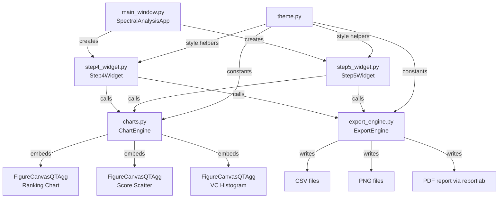

# Design Document: Graphical Enhancements and Export

## Overview

This feature adds rich inline visualisations and multi-format export to **Step 4 (Elemental Preferences)** and **Step 5 (Validation)** of the Spectral Analysis Software, plus a set of GUI polish improvements across both steps and the main window.

The primary deliverables are:

- A **Chart module** (`src/gui/charts.py`) that renders three matplotlib figures as inline `FigureCanvasQTAgg` widgets: a horizontal bar ranking chart (Step 4), a wavelength-vs-confidence scatter plot (Step 4), and a VC quality histogram (Step 5).
- An **Export Engine** (`src/gui/export_engine.py`) that saves results as CSV files, PNG figures, and a structured reportlab PDF report.
- **Updated widgets** (`step4_widget.py`, `step5_widget.py`) that embed the new charts, add summary banners, four-tier VC colour badges, and export buttons.
- **Updated main window** (`main_window.py`) that replaces tab labels with Unicode-prefixed step names.
- **Theme additions** (`theme.py`) for banner, badge, and progress-indicator helper styles.

All charts are embedded inline — no pop-up windows. Export buttons are disabled until data exists. Long-running operations show an indeterminate progress bar.

---

## Architecture



**Key design decisions:**

1. **Separate `charts.py` module** — Chart rendering logic is concentrated in one place rather than scattered across widget files. Widgets own the canvas and toolbar widgets, but delegate all axes-drawing calls to `ChartEngine`. This makes charts independently testable and reusable.

2. **Separate `export_engine.py` module** — Export logic (file I/O, reportlab calls, dialog management) is kept out of widget files to keep widgets focused on user interaction. `ExportEngine` is a stateless collection of functions, not a class with state.

3. **Step 4 layout: QSplitter (vertical)** — The existing inner `QTabWidget` (with ranking/competition/winner tables) sits in the top pane. A new `QWidget` holding both the Ranking Chart and Score Scatter side by side sits in the bottom pane. The splitter lets users resize the chart area. Initial split ratio is 55 % table / 45 % charts.

4. **Step 5 layout: QSplitter (vertical)** — The existing results table sits in the top pane. The VC Histogram sits in the bottom pane.

5. **PDF structure** — Uses `reportlab.platypus.SimpleDocTemplate` with a `Flowable` list: `Paragraph` (cover), `Table` (parameters, summary, results), `Image` (histogram), `Paragraph` (wavelength list). The histogram `Figure` is serialised to a `BytesIO` PNG buffer before being passed to reportlab `Image`.

6. **Progress indicator** — An indeterminate `QProgressBar` (with `setRange(0, 0)`) is shown inline below the action button during any worker thread. It is hidden when the thread finishes or errors.

---

## Components and Interfaces

### `src/gui/charts.py` — ChartEngine

```python
class ChartEngine:
    """
    Stateless chart rendering functions.  All methods operate on existing
    matplotlib Figure / Axes objects passed from the owning widget.
    """

    @staticmethod
    def apply_dark_style(fig: Figure, ax: Axes) -> None:
        """Apply Theme_Palette dark background to figure and axes."""

    @staticmethod
    def render_ranking_chart(ax: Axes, ranking_df: pd.DataFrame) -> None:
        """
        Draw horizontal bar chart on ax from ranking_df.
        Sorts descending by (Wins, Total_Score).
        Annotates each bar with Wins value.
        Cycles bar colours through ACCENT_CYCLE.
        Displays 'No data available' placeholder when ranking_df is empty.
        """

    @staticmethod
    def render_score_scatter(ax: Axes, winner_lines_df: pd.DataFrame) -> None:
        """
        Draw scatter plot on ax from winner_lines_df.
        Y-axis fixed [0.0, 1.0].
        Colours points by Winning_Element cycling through ACCENT_CYCLE.
        One legend entry per element.
        Displays placeholder when winner_lines_df is empty.
        """

    @staticmethod
    def render_vc_histogram(ax: Axes, validation_results_df: pd.DataFrame) -> None:
        """
        Draw VC histogram on ax using fixed bins [0.0, 0.70, 0.85, 0.95, 1.0].
        Colours each bar by quality tier.
        Excludes null VCs; shows placeholder if all null or df empty.
        """

    @staticmethod
    def get_bar_colours(n: int) -> list[str]:
        """
        Return a list of n hex colour strings cycling through ACCENT_CYCLE.
        ACCENT_CYCLE = [C_ACCENT, C_ACCENT2, C_SUCCESS, C_WARN].
        """

    @staticmethod
    def classify_vc(vc: float | None) -> tuple[str, str, str]:
        """
        Return (tier_label, background_hex, text_hex) for a VC value.
        VC > 0.95  → ('Excellent', C_SUCCESS, '#FFFFFF')
        0.85 ≤ VC ≤ 0.95 → ('Good', C_ACCENT, '#FFFFFF')
        0.70 ≤ VC < 0.85 → ('Moderate', C_WARN, '#FFFFFF')
        VC < 0.70  → ('Weak', C_ERROR, '#FFFFFF')
        None/NaN   → ('Failed', C_BG_CARD, C_TEXT2)
        """
```

Module-level constants:
```python
ACCENT_CYCLE = [C_ACCENT, C_ACCENT2, C_SUCCESS, C_WARN]  # from theme
TIER_BINS    = [0.0, 0.70, 0.85, 0.95, 1.0]
TIER_COLOURS = [C_ERROR, C_WARN, C_ACCENT, C_SUCCESS]   # Weak→Excellent
TIER_LABELS  = ["Weak", "Moderate", "Good", "Excellent"]
```

### `src/gui/export_engine.py` — ExportEngine

```python
def export_step4_csv(
    ranking_df: pd.DataFrame,
    winner_lines_df: pd.DataFrame,
    competition_df: pd.DataFrame,
    directory: Path,
    base: str = "analysis"
) -> list[Path]:
    """Save three CSV files; returns list of written paths. Raises on error."""

def export_step5_csv(
    validation_results_df: pd.DataFrame,
    filepath: Path
) -> Path:
    """Save single CSV; returns written path. Raises on error."""

def save_figure_png(fig: Figure, filepath: Path, dpi: int = 150) -> Path:
    """
    Save matplotlib Figure as PNG with dpi≥150 and C_BG_DEEP background.
    Deletes partial file on error. Returns written path.
    """

def export_step4_png(
    ranking_fig: Figure,
    scatter_fig: Figure,
    directory: Path
) -> list[Path]:
    """Save ranking_chart.png and score_scatter.png. Returns list of paths."""

def export_step5_png(vc_fig: Figure, filepath: Path) -> Path:
    """Save VC histogram PNG. Returns written path."""

def generate_pdf_report(
    validation_results_df: pd.DataFrame,
    params: dict,
    vc_fig: Figure,
    processed_filename: str,
    reference_filename: str,
    target_wavelengths: list[float],
    filepath: Path,
    step4_results: dict | None = None,
    ranking_fig: Figure | None = None
) -> Path:
    """
    Build and save LIBS Validation Report PDF using reportlab.
    Sections: cover, parameters, summary, results table, VC histogram,
    wavelength list, optional Step 4 summary.
    Deletes partial file on error. Returns written path.
    Raises ImportError with user-friendly message if reportlab absent.
    """

def _figure_to_image_buffer(fig: Figure) -> BytesIO:
    """Render Figure to in-memory PNG buffer for embedding in PDF."""
```

### `src/gui/step4_widget.py` — updated `Step4Widget`

New additions:
- `self.summary_banner: QLabel` — shows primary element, wins, element count, peak count
- `self.primary_element_label: QLabel` — bold, 14pt, C_ACCENT2
- `self.ranking_canvas: FigureCanvasQTAgg` + `self.ranking_toolbar: NavigationToolbar2QT`
- `self.scatter_canvas: FigureCanvasQTAgg` + `self.scatter_toolbar: NavigationToolbar2QT`
- `self.export_csv_button: QPushButton` — disabled until analysis complete
- `self.export_png_button: QPushButton` — disabled until analysis complete
- `self.progress_bar: QProgressBar` — indeterminate, hidden by default
- Layout change: vertical `QSplitter` separating existing result tabs (top) from charts panel (bottom, horizontal arrangement of two canvases with toolbars)

Modified methods:
- `_on_analysis_finished` — calls `_update_charts()`, `_update_summary_banner()`, enables export buttons, hides progress bar
- `_on_analyze_clicked` — shows progress bar, disables export buttons
- New `_update_charts()` — calls `ChartEngine.render_ranking_chart()` and `ChartEngine.render_score_scatter()`
- New `_update_summary_banner()` — updates banner and primary element label
- New `_on_export_csv_clicked()` — opens QFileDialog, calls `ExportEngine.export_step4_csv()`
- New `_on_export_png_clicked()` — opens QFileDialog, calls `ExportEngine.export_step4_png()`

### `src/gui/step5_widget.py` — updated `Step5Widget`

New additions:
- `self.summary_banner: QLabel` — shows mean VC, total count, tier counts
- `self.mean_vc_label: QLabel` — bold, 14pt, tier-coloured
- `self.vc_canvas: FigureCanvasQTAgg` + `self.vc_toolbar: NavigationToolbar2QT`
- `self.export_csv_button: QPushButton`
- `self.export_png_button: QPushButton`
- `self.export_pdf_button: QPushButton`
- `self.progress_bar: QProgressBar` — indeterminate, hidden by default
- Layout change: vertical `QSplitter` — results table top, VC histogram bottom

Modified methods:
- `_populate_results_table` — applies `ChartEngine.classify_vc()` to set QTableWidgetItem background and foreground per row
- `_on_validation_finished` — calls `_update_chart()`, `_update_summary_banner()`, enables export buttons, hides progress bar
- `_on_validate_clicked` — shows progress bar, disables export buttons
- New `_update_chart()` — calls `ChartEngine.render_vc_histogram()`
- New `_update_summary_banner()` — updates banner and mean VC label
- New `_on_export_csv_clicked()` — calls `ExportEngine.export_step5_csv()`
- New `_on_export_png_clicked()` — calls `ExportEngine.export_step5_png()`
- New `_on_export_pdf_clicked()` — calls `ExportEngine.generate_pdf_report()`

### `src/gui/main_window.py` — updated tab labels

The five `addTab` calls change to:
```
"① Step 1: Baseline Correction"
"② Step 2: Peak Detection"
"③ Step 3: Element Identification"
"④ Step 4: Elemental Preferences"
"⑤ Step 5: Validation"
```

### `src/gui/theme.py` — additions

New helper functions:
```python
def summary_banner_style() -> str:
    """Inline style for the summary statistics banner QLabel."""

def primary_element_label_style() -> str:
    """Inline style: bold, 14pt, C_ACCENT2, transparent background."""

def mean_vc_label_style(colour: str) -> str:
    """Inline style: bold, 14pt, given colour, transparent background."""

def progress_bar_style() -> str:
    """Inline style for indeterminate QProgressBar."""
```

New palette constant:
```python
C_CHART_GRID = C_BORDER   # alias for chart grid lines (already exists as C_BORDER)
```

---

## Data Models

### Chart rendering inputs (all existing DataFrames)

| Chart | DataFrame | Key columns |
|---|---|---|
| Ranking Chart | `ranking_df` | Element, Wins, Total_Score, Avg_Score |
| Score Scatter | `winner_lines_df` | Winning_Element, Observed_Wavelength, Confidence_Score |
| VC Histogram | `validation_results_df` | Validation_Coefficient (nullable float) |

### PDF Report data bundle (passed to `generate_pdf_report`)

```python
{
    "validation_results_df": pd.DataFrame,   # rows per wavelength
    "params": {
        "WINDOW": float,
        "MIN_POINTS": int,
        "VC_THRESHOLD": float
    },
    "vc_fig": matplotlib.figure.Figure,      # pre-rendered VC histogram
    "processed_filename": str,
    "reference_filename": str,
    "target_wavelengths": list[float],
    "filepath": pathlib.Path,
    # optional
    "step4_results": dict | None,            # analysis_results dict from Step4Widget
    "ranking_fig": matplotlib.figure.Figure | None
}
```

### VC Quality Tier mapping

| Condition | Tier | Background | Text |
|---|---|---|---|
| VC > 0.95 | Excellent | C_SUCCESS (#22C55E) | #FFFFFF |
| 0.85 ≤ VC ≤ 0.95 | Good | C_ACCENT (#4A9EFF) | #FFFFFF |
| 0.70 ≤ VC < 0.85 | Moderate | C_WARN (#F59E0B) | #FFFFFF |
| VC < 0.70 | Weak | C_ERROR (#EF4444) | #FFFFFF |
| null / NaN | Failed | C_BG_CARD (#222536) | C_TEXT2 (#8B90A4) |

### reportlab PDF structure (Flowables list)

```
[Paragraph(cover_title), Paragraph(cover_meta), Spacer,
 Paragraph("Parameters"), Table(params_rows), Spacer,
 Paragraph("Summary"), Table(summary_rows), Spacer,
 Paragraph("Detailed Results"), Table(results_rows) | Paragraph("No results available"), Spacer,
 Paragraph("VC Distribution"), Image(vc_histogram_buffer), Spacer,
 Paragraph("Target Wavelengths"), Paragraph(wavelengths_text), Spacer,
 # if step4_results:
 Paragraph("Step 4 Summary"), Table(top5_rows), Image(ranking_chart_buffer)]
```

---

## Correctness Properties

*A property is a characteristic or behavior that should hold true across all valid executions of a system — essentially, a formal statement about what the system should do. Properties serve as the bridge between human-readable specifications and machine-verifiable correctness guarantees.*

### Property 1: Bar count matches element count

*For any* `ranking_df` with N rows (N ≥ 1), after calling `ChartEngine.render_ranking_chart(ax, ranking_df)`, the axes SHALL contain exactly N bar patches.

**Validates: Requirements 1.2**

### Property 2: Bars are sorted by (Wins DESC, Total_Score DESC)

*For any* `ranking_df`, after calling `render_ranking_chart(ax, ranking_df)`, the order of y-tick labels from bottom to top SHALL match the ascending sort of `ranking_df` sorted descending by Wins then Total_Score (matplotlib horizontal bars are rendered bottom-up).

**Validates: Requirements 1.3**

### Property 3: Bar annotations match Wins values

*For any* `ranking_df` with N rows, after calling `render_ranking_chart(ax, ranking_df)`, there SHALL be exactly N text annotations on the axes, and each annotation's string value SHALL equal the integer Wins of the corresponding element.

**Validates: Requirements 1.4**

### Property 4: Colour cycling is consistent for any element count

*For any* integer N ≥ 1, `ChartEngine.get_bar_colours(N)` SHALL return a list of length N where `colours[i] == ACCENT_CYCLE[i % len(ACCENT_CYCLE)]` for all i in [0, N).

**Validates: Requirements 1.5, 2.3**

### Property 5: Score scatter Y-axis is always fixed to [0.0, 1.0]

*For any* `winner_lines_df` with at least one row (including rows with Confidence_Score values at extremes 0.0 and 1.0), after calling `render_score_scatter(ax, winner_lines_df)`, the axes Y-limits SHALL be (0.0, 1.0).

**Validates: Requirements 2.2**

### Property 6: Scatter legend has exactly one entry per distinct element

*For any* `winner_lines_df`, after calling `render_score_scatter(ax, winner_lines_df)`, the number of legend entries SHALL equal the number of distinct values in `winner_lines_df['Winning_Element']`.

**Validates: Requirements 2.3**

### Property 7: VC histogram uses fixed tier bin boundaries

*For any* `validation_results_df` with at least one non-null Validation_Coefficient, after calling `render_vc_histogram(ax, validation_results_df)`, the x-positions of the rendered bars SHALL correspond to the bin midpoints derived from `TIER_BINS = [0.0, 0.70, 0.85, 0.95, 1.0]`.

**Validates: Requirements 3.2**

### Property 8: VC histogram bar colours match quality tiers

*For any* `validation_results_df` containing non-null VC values in all four quality tiers, after calling `render_vc_histogram(ax, validation_results_df)`, each bar's face colour SHALL match the expected tier colour: bin [0.0–0.70) → C_ERROR, [0.70–0.85) → C_WARN, [0.85–0.95) → C_ACCENT, [0.95–1.0] → C_SUCCESS.

**Validates: Requirements 3.3**

### Property 9: VC classification is total and correct for all values in [0, 1]

*For any* float VC in [0.0, 1.0], `ChartEngine.classify_vc(vc)` SHALL return a tuple `(label, bg_colour, fg_colour)` where the label is one of {"Excellent", "Good", "Moderate", "Weak"} and the assignment follows the four-tier thresholds exactly (VC > 0.95 → Excellent; 0.85 ≤ VC ≤ 0.95 → Good; 0.70 ≤ VC < 0.85 → Moderate; VC < 0.70 → Weak), and `fg_colour` is always `'#FFFFFF'`.

**Validates: Requirements 4.1, 4.2**

### Property 10: CSV export header matches DataFrame columns

*For any* `pd.DataFrame` with at least one column, `ExportEngine.export_step5_csv(df, path)` (and the analogous Step 4 function for each of the three frames) SHALL write a CSV file whose first row exactly matches `','.join(df.columns)`.

**Validates: Requirements 5.3**

### Property 11: PNG export respects DPI and background colour

*For any* matplotlib `Figure`, `save_figure_png(fig, path, dpi=150)` SHALL produce a file at the given path such that when re-read the image dimensions are consistent with dpi ≥ 150 and the figure facecolor was set to `C_BG_DEEP` before saving.

**Validates: Requirements 6.3**

### Property 12: PDF flowables include all required sections for any validation result

*For any* non-empty `validation_results_df` and any `params` dict, the internal `_build_pdf_flowables(…)` function SHALL return a list containing at minimum: a cover-page paragraph, a parameters table, a summary table, a results table, an image flowable, and a wavelengths paragraph — in that order.

**Validates: Requirements 7.3**

### Property 13: Summary banner content reflects analysis results for any result set

*For any* `analysis_results` dict (Step 4), after calling `_update_summary_banner()` on `Step4Widget`, the banner label text SHALL contain the primary element name, the primary element's Wins count, the total number of distinct elements, and the total number of peaks analysed.

**Validates: Requirements 8.2**

### Property 14: Mean VC label colour matches quality tier for any mean VC

*For any* mean VC value computed from `validation_results_df`, after calling `_update_summary_banner()` on `Step5Widget`, the mean VC label's stylesheet SHALL use the colour corresponding to the quality tier of that mean VC as defined by `ChartEngine.classify_vc()`.

**Validates: Requirements 8.4**

### Property 15: Chart canvas identity is preserved across sequential renders

*For any* two sequential sets of analysis results passed to `Step4Widget`, the Python object identity of `self.ranking_canvas` and `self.scatter_canvas` SHALL be the same after the second render as after the first (i.e., no new canvas objects are created).

**Validates: Requirements 9.3**

### Property 16: Export buttons follow enabled/disabled cycle across any number of runs

*For any* sequence of (start-run, complete-run) events on `Step4Widget` or `Step5Widget`, the export buttons SHALL be disabled at every start-run event and enabled at every successful complete-run event.

**Validates: Requirements 10.3, 10.4, 10.5**

---

## Error Handling

| Failure scenario | Handling |
|---|---|
| `ranking_df` or `winner_lines_df` is empty | Placeholder "No data available" centred on axes; no exception raised |
| `validation_results_df` has all-null VCs | Placeholder shown; histogram not rendered |
| Chart rendering raises any exception | Catch in `render_*` methods; display "Chart unavailable" placeholder; log exception; do not propagate |
| CSV write fails (PermissionError, disk full) | Catch `OSError`; show `QMessageBox.critical` with OS error message; do not leave partial files |
| PNG save fails | Catch `OSError`; show error dialog; delete partial file via `Path.unlink(missing_ok=True)` |
| PDF generation fails (any exception) | Catch; show error dialog; delete partial file; do not crash |
| `reportlab` not installed | Catch `ImportError` in `generate_pdf_report`; show dialog: "reportlab is not installed. Run: pip install reportlab"; return without crash |
| User cancels file dialog | Guard with `if not filepath: return` before any I/O call |
| Worker thread raises unhandled exception | `WorkerThread.error` signal → `_on_worker_error` shows error dialog, re-enables buttons, hides progress bar |

---

## Testing Strategy

### Unit tests (pytest + hypothesis)

All unit tests live in `tests/gui/test_charts.py`, `tests/gui/test_export_engine.py`, and updated `tests/gui/test_step4_widget.py` / `tests/gui/test_step5_widget.py`.

Unit tests cover:
- `ChartEngine.classify_vc()` with concrete boundary values (0.0, 0.70, 0.85, 0.95, 1.0, None, NaN)
- `ChartEngine.get_bar_colours()` with known counts (1, 4, 5, 8)
- `ExportEngine.export_step5_csv()` with a minimal DataFrame to a temp path
- Export button initial states (disabled)
- Tab label strings in `SpectralAnalysisApp`

Property-based tests (Hypothesis, minimum 100 examples each) cover each of the 16 correctness properties above.

**Property-based testing library:** [Hypothesis](https://hypothesis.readthedocs.io/) (already present in the Python ecosystem; install with `pip install hypothesis`).

Hypothesis strategies used:
- `st.integers(min_value=1, max_value=20)` for element counts
- `st.floats(min_value=0.0, max_value=1.0)` for VC values
- `st.lists(st.floats(min_value=0.0, max_value=1.0), min_size=1, max_size=50)` for VC series
- `st.builds(pd.DataFrame, ...)` patterns for DataFrame generation
- `st.just(None)` combined via `st.one_of` for null VC scenarios

Tag format per test: `# Feature: graphical-enhancements-and-export, Property N: <property text>`

### Integration tests

- `tests/gui/test_export_engine_integration.py` — write CSV/PNG/PDF to a `tmp_path` fixture and assert files exist and are non-empty; verify PDF starts with `%PDF-`; verify CSV header row.
- GUI smoke test (optional, requires display): instantiate `Step4Widget` and `Step5Widget` in a headless Qt app and confirm they construct without error.

### Manual testing checklist

- Run analysis in Step 4; verify both charts appear with correct colours and annotations.
- Run validation in Step 5; verify VC histogram and colour badges appear.
- Export CSV from both steps; verify file contents.
- Export PNG from both steps; open files to verify resolution and dark background.
- Export PDF from Step 5 with and without Step 4 results; verify section structure.
- Cancel each export dialog; verify no files are written.
- Test with an empty dataset (no matches) to verify placeholders.
- Verify tab labels show Unicode circle numbers.
