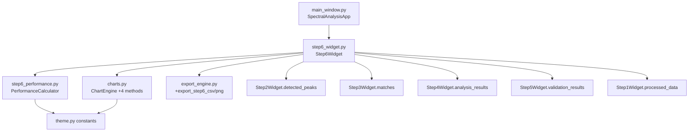

# Design Document: Step 6 — Model Performance Metrics

## Overview

Step 6 adds a **Model Performance Metrics** tab to the existing LIBS spectral analysis
desktop application built with PyQt6. After the user completes Steps 2–5 the new tab
aggregates their outputs, computes classification quality metrics (Accuracy, Precision,
Recall, F1-Score, SBR Improvement) and presents four scientific visualisations modelled
on Figures 7, 11, 12 and 14 from the reference paper:

- **Fig 7 style** — Elemental Preference Ranking bar chart
- **Fig 11 style** — Multi-Stage Validation Pipeline funnel
- **Fig 12 style** — Correlation Heatmap
- **Fig 14 style** — Performance Metrics bar chart

The implementation follows the two-column layout, dark/light theme conventions, and
`WorkerThread`/`ChartEngine`/`ExportEngine` patterns established by Steps 1–5.

---

## Architecture

### Module Map

```
src/
  core/
    step6_performance.py        ← NEW  PerformanceCalculator
  gui/
    step6_widget.py             ← NEW  Step6Widget
    charts.py                   ← MODIFY  +4 static methods
    export_engine.py            ← MODIFY  +export_step6_csv, export_step6_png
    main_window.py              ← MODIFY  add tab at index 6
```

### High-Level Data Flow

```
Step2Widget.detected_peaks  ──┐
Step3Widget.matches          ──┤  Step6Widget.refresh()
Step4Widget.analysis_results ──┤       │
Step5Widget.validation_results──┘       │
Step1Widget.processed_data   ──────────┤
                                        ▼
                               PerformanceCalculator.compute()
                                        │
                               PerformanceResults (TypedDict)
                                        │
                    ┌───────────────────┼───────────────────┐
                    ▼                   ▼                   ▼
          ChartEngine.*()      Summary QTableWidget   ExportEngine.*()
```


### Dependency Graph



---

## Components and Interfaces

### 1. `PerformanceCalculator` (`src/core/step6_performance.py`)

Stateless computation class — instantiated once per `refresh()` call.

```python
class PerformanceCalculator:
    def compute(
        self,
        detected_peaks: list[DetectedPeak] | None,
        matches: list[NISTMatch] | None,
        analysis_results: dict | None,
        validation_results: pd.DataFrame | None,
        processed_data: ProcessedSpectra | None = None,
    ) -> "PerformanceResults":
        ...

    # Internal helpers (all raise no unhandled exceptions)
    def _compute_stage_counts(
        self,
        detected_peaks: list[DetectedPeak],
        matches: list[NISTMatch],
        analysis_results: dict,
        validation_results: pd.DataFrame,
    ) -> dict[str, int]:
        ...

    def _classify_confidence_tier(self, wins: int) -> str:
        ...  # "High" | "Medium" | "Low"

    def _compute_metrics(
        self,
        stage_counts: dict[str, int],
        unique_elements: int,
        avg_lines_per_element: float,
    ) -> dict[str, float | None]:
        ...

    def _compute_sbr(
        self,
        validated_peak_wls: list[float],
        detected_peaks: list[DetectedPeak],
        processed_data: ProcessedSpectra | None,
    ) -> float | None:
        ...

    def _build_heatmap(
        self,
        validation_results: pd.DataFrame,
        matches: list[NISTMatch],
    ) -> tuple[np.ndarray, list[str], list[str]]:
        # returns (matrix, peak_labels, element_labels)
        ...
```


### 2. `Step6Widget` (`src/gui/step6_widget.py`)

```python
class Step6Widget(QWidget):
    def __init__(
        self,
        step2_tab: Step2Widget,
        step3_tab: Step3Widget,
        step4_tab: Step4Widget,
        step5_tab: Step5Widget,
        step1_tab: Step1Widget | None = None,
        file_history=None,
        notes_panel=None,
    ): ...

    # Public API
    def refresh(self) -> None: ...
    def apply_theme(self) -> None: ...

    # Left panel
    def _create_left_panel(self) -> QWidget: ...

    # Right panel
    def _create_right_panel(self) -> QWidget: ...

    # Chart update helpers
    def _update_chart_fig7(self) -> None: ...
    def _update_chart_fig11(self) -> None: ...
    def _update_chart_fig12(self) -> None: ...
    def _update_chart_fig14(self) -> None: ...

    # Table
    def _populate_summary_table(self) -> None: ...

    # Export handlers
    def _on_export_csv_clicked(self) -> None: ...
    def _on_export_png_clicked(self) -> None: ...
    def _on_export_pdf_clicked(self) -> None: ...

    # Instance attributes (after refresh)
    performance_results: "PerformanceResults | None"
```

### 3. `ChartEngine` additions (`src/gui/charts.py`)

All four methods are `@staticmethod`, follow the existing `ax.clear()` / `_finish()` /
`_show_placeholder()` pattern, and must not raise unhandled exceptions.

```python
@staticmethod
def render_element_ranking_fig7(
    ax: Axes,
    ranking_df: pd.DataFrame | None,
) -> None:
    """Horizontal bar chart: elements × matched line counts (Fig 7 style)."""

@staticmethod
def render_pipeline_funnel(
    ax: Axes,
    stage_counts: dict[str, int] | None,
) -> None:
    """Horizontal funnel: five pipeline stages with count bars (Fig 11 style)."""

@staticmethod
def render_correlation_heatmap(
    ax: Axes,
    heatmap_matrix: np.ndarray | None,
    peak_labels: list[str],
    element_labels: list[str],
) -> None:
    """2-D heatmap: ambiguous peaks × elements, coolwarm [0,1] (Fig 12 style)."""

@staticmethod
def render_performance_metrics(
    ax: Axes,
    metrics_dict: dict[str, float | None],
    ax2: Axes,
) -> None:
    """Dual-axis bar chart: Accuracy/Precision/Recall/F1 + SBR (Fig 14 style)."""
```

### 4. `ExportEngine` additions (`src/gui/export_engine.py`)

```python
def export_step6_csv(
    performance_results: "PerformanceResults",
    filepath: Path,
) -> Path:
    """Write Step 6 summary CSV (one row per element + aggregate metrics)."""

def export_step6_png(
    figures: list[Figure],
    filepath: Path,
    dpi: int = 150,
) -> Path:
    """Composite PNG of all four Step 6 charts (2 × 2 grid)."""
```


### 5. `main_window.py` modifications

```python
# After step5_tab instantiation
from src.gui.step6_widget import Step6Widget

self.step6_tab = Step6Widget(
    step2_tab=self.step2_tab,
    step3_tab=self.step3_tab,
    step4_tab=self.step4_tab,
    step5_tab=self.step5_tab,
    step1_tab=self.step1_tab,
    file_history=self.file_history,
    notes_panel=self.notes_panel,
)

# Insert before "📊 Analysis Summary" tab — index 5
self.tabs.insertTab(5, self.step6_tab, "⑥ Step 6: Model Performance")
# "📊 Analysis Summary" shifts to index 6

# In _on_toggle_theme():
# Add self.step6_tab to the existing apply_theme() loop

# In _on_tab_changed():
# index == 5 → call self.step6_tab.refresh()
# index == 6 → call self.summary_tab.refresh()  (was 5)
```

---

## Data Models

### `PerformanceResults` (TypedDict)

```python
from typing import TypedDict

class PipelineStages(TypedDict):
    stage1_detected: int       # len(detected_peaks)
    stage2_nist_matched: int   # peaks with ≥1 NIST match
    stage3_ranked: int         # peaks whose element is in ranking_df
    stage4_validated: int      # peaks with Validation_Coefficient ≥ 0.50
    stage5_confirmed: int      # peaks with Validation_Coefficient ≥ 0.70

class ElementRow(TypedDict):
    element: str
    confidence_tier: str       # "High" | "Medium" | "Low"
    matched_lines: int         # Wins column proxy
    mean_vc: float | None      # mean Validation_Coefficient

class PerformanceResults(TypedDict):
    pipeline_stages: PipelineStages | None
    element_rows: list[ElementRow]
    accuracy: float | None     # [0, 1]
    precision: float | None    # [0, 1]
    recall: float | None       # [0, 1]
    f1_score: float | None     # [0, 1]
    sbr_improvement: float | None   # multiplier, or float('inf')
    heatmap_matrix: np.ndarray | None
    peak_labels: list[str]
    element_labels: list[str]
    ranking_df: pd.DataFrame | None  # passed through from step4
    missing_steps: list[str]   # e.g. ["Step 3", "Step 5"]
```

### Confidence Tier Thresholds

| Tier   | Condition (Wins proxy) | Colour token |
|--------|------------------------|--------------|
| High   | wins ≥ 10              | `C_SUCCESS`  |
| Medium | 3 ≤ wins ≤ 9          | `C_WARN`     |
| Low    | wins < 3               | `C_ERROR`    |

### Metric Formulas

```
TP  = stage5_confirmed
FP  = stage2_nist_matched − stage5_confirmed
FN  = max(0, n_elements × avg_lines_per_element − stage1_detected)

Precision  = TP / (TP + FP)          [0.0 if TP+FP = 0]
Recall     = TP / (TP + FN)          [0.0 if TP+FN = 0]
F1         = 2·Precision·Recall / (Precision + Recall)  [0.0 if both = 0]
Accuracy   = TP / (TP + FP + FN)     [all clamped to [0, 1]]

SBR_Improvement = mean(validated_peak_intensities) / mean(background_intensities)
               → None  if processed_data unavailable
               → inf   if mean(background) == 0
```


---

## Correctness Properties

*A property is a characteristic or behavior that should hold true across all valid
executions of a system — essentially, a formal statement about what the system should do.
Properties serve as the bridge between human-readable specifications and machine-verifiable
correctness guarantees.*

### Property 1: Missing upstream data never raises

*For any* combination of the four upstream inputs (detected\_peaks, matches,
analysis\_results, validation\_results) where any subset of them is `None` or empty,
calling `PerformanceCalculator.compute()` SHALL return a `PerformanceResults` dict
without raising an exception, with metric fields set to `None` for those that depend on
the missing input.

**Validates: Requirements 3.2**

---

### Property 2: Pipeline stage counts satisfy monotonicity and derivation invariants

*For any* valid upstream data, the five pipeline stage counts produced by
`PerformanceCalculator._compute_stage_counts()` SHALL satisfy:

- `stage1 = len(detected_peaks)`
- `stage2 ≤ stage1`
- `stage4 = count of rows where Validation_Coefficient ≥ 0.50`
- `stage5 = count of rows where Validation_Coefficient ≥ 0.70`
- `stage5 ≤ stage4`

**Validates: Requirements 3.3**

---

### Property 3: Confidence tier classification is total and correct

*For any* non-negative integer `wins`, `PerformanceCalculator._classify_confidence_tier(wins)`
SHALL return exactly one of `"High"`, `"Medium"`, or `"Low"`, and the assignment SHALL
satisfy: `wins ≥ 10 → "High"`, `3 ≤ wins ≤ 9 → "Medium"`, `wins < 3 → "Low"`.
The boundary values `wins = 10`, `wins = 3`, and `wins = 0` SHALL each return the
expected tier.

**Validates: Requirements 3.4, 5.2, 5.3, 5.4**

---

### Property 4: All classification metrics are clamped to [0, 1]

*For any* non-negative integer triple (TP, FP, FN) including the degenerate cases
(0, 0, 0), the computed Precision, Recall, F1-Score, and Accuracy SHALL each be
a `float` in the closed interval `[0.0, 1.0]`. In particular, when `TP + FP = 0`
Precision SHALL equal `0.0`, and when `TP + FN = 0` Recall SHALL equal `0.0`
(no `ZeroDivisionError`).

**Validates: Requirements 4.2, 4.3, 4.4**

---

### Property 5: SBR Improvement handles all denominator cases correctly

*For any* non-empty array of validated peak intensities and any non-negative background
intensities array: when `mean(background) > 0` the result SHALL equal
`mean(validated) / mean(background)`; when `mean(background) == 0` the result SHALL
be `float('inf')`; when `processed_data` is `None` the result SHALL be `None`.

**Validates: Requirements 4.5**

---

### Property 6: Correlation heatmap matrix dimensions and values match inputs

*For any* `validation_results` DataFrame and `matches` list with N unique wavelengths
and M unique elements, the heatmap matrix produced by `PerformanceCalculator._build_heatmap()`
SHALL have shape `(N, M)`, every cell `[i, j]` SHALL equal the `Validation_Coefficient`
of peak i matched to element j if such a row exists in `validation_results`, and SHALL
equal `0.0` otherwise.

**Validates: Requirements 3.5, 7.1**

---

### Property 7: Element ranking bar chart bars appear in descending order

*For any* `ranking_df` with at least one row, `ChartEngine.render_element_ranking_fig7()`
SHALL draw bars such that bar widths (matched line counts) are in non-ascending order
from top to bottom on the Y-axis.

**Validates: Requirements 5.1**

---

### Property 8: Bar chart annotations equal number of bars

*For any* `ranking_df` with K rows, `ChartEngine.render_element_ranking_fig7()` SHALL
produce exactly K numeric count annotations, one at the right end of each bar.

**Validates: Requirements 5.5**

---

### Property 9: Performance metrics chart handles partial None inputs

*For any* `metrics_dict` where any subset of the five metric values is `None`, calling
`ChartEngine.render_performance_metrics(ax, metrics_dict, ax2)` SHALL render a bar
(or "N/A" annotation) for each metric position without raising an exception, and SHALL
render a bar for every non-`None` value.

**Validates: Requirements 8.6**

---

### Property 10: Heatmap cell text colour follows the 0.5 threshold rule

*For any* `heatmap_matrix` passed to `ChartEngine.render_correlation_heatmap()`, each
cell's text annotation colour SHALL be white (`#FFFFFF`) when the cell value ≥ 0.5, and
SHALL be `C_BG_DEEP` when the cell value < 0.5.

**Validates: Requirements 7.3**

---

### Property 11: Summary table Mean VC equals per-element average from validation results

*For any* `ranking_df` and `validation_results` where element rows have multiple
`Validation_Coefficient` entries, each row in the summary `QTableWidget` SHALL display
a Mean VC equal to the arithmetic mean of all `Validation_Coefficient` values attributed
to that element in `validation_results`.

**Validates: Requirements 9.2**

---

### Property 12: refresh() with partial upstream data shows placeholders only for missing visualisations

*For any* combination of present and absent upstream step data, calling `Step6Widget.refresh()`
SHALL render the four chart tabs using available data and show a placeholder
(via `_show_placeholder`) only for chart tabs whose required data is absent, leaving the
remaining charts populated with real data.

**Validates: Requirements 11.3**


---

## Error Handling

### Missing Upstream Data

`PerformanceCalculator.compute()` inspects each input at the start and builds a
`missing_steps` list. Individual internal helpers (`_compute_stage_counts`,
`_build_heatmap`, etc.) receive only the inputs that are present. Every helper is
wrapped in a `try/except` that logs the exception and returns a safe default (`None`,
empty array, or an empty dict) rather than propagating the exception to the GUI.

`Step6Widget.refresh()` checks `performance_results.missing_steps` after compute and
updates the status banner accordingly, e.g. "Run Steps 3 and 5 first to see pipeline
funnel and heatmap charts."

### Zero-Division Guards

- `Precision`: guarded by `if TP + FP == 0: return 0.0`
- `Recall`: guarded by `if TP + FN == 0: return 0.0`
- `F1`: computed only when both Precision and Recall are non-zero (returns `0.0` otherwise)
- `SBR`: guarded by `if mean_bg == 0: return float('inf')` after checking the array is non-empty

### ChartEngine Robustness

All four new static methods follow the existing pattern:

```python
try:
    ...  # rendering logic
except Exception:
    logger.exception("render_xxx failed")
    ax.clear()
    ChartEngine._show_placeholder(ax, "Chart unavailable")
    ChartEngine.apply_dark_style(fig, ax)
```

### Export Errors

- `export_step6_csv` / `export_step6_png` re-raise `OSError` after removing any partial file.
- `generate_pdf_report` already has this pattern; a Step 6 variant will follow it.
- If the file-save dialog is dismissed (empty path returned by `QFileDialog`), the export
  handler returns immediately without showing an error dialog.

### Export Button State

Export buttons are disabled at widget construction and at the start of every `refresh()`
cycle. They are re-enabled as a group only after `compute()` completes successfully and
`performance_results` is not `None`. This prevents stale exports mid-recompute.

---

## Testing Strategy

### Dual Testing Approach

Unit tests verify specific examples and edge cases. Property-based tests (Hypothesis)
verify universal correctness across arbitrary inputs. The two are complementary.

### Property-Based Testing Library

**Hypothesis** (`hypothesis` package) — the standard Python PBT library already present
in the project (confirmed by `.hypothesis/` directory).

Each property test runs a minimum of **100 iterations** (Hypothesis default) and is
tagged:

```python
# Feature: step6-model-performance, Property N: <property text>
```

### Unit Test Coverage Targets

| Component | Test type | What is verified |
|-----------|-----------|------------------|
| `PerformanceCalculator.compute()` | Unit | All-None inputs, all-present inputs, each step missing individually |
| `_classify_confidence_tier` | Property (P3) | All wins values including boundary cases |
| `_compute_metrics` | Property (P4) | Any (TP, FP, FN) triple |
| `_compute_sbr` | Property (P5) | Any intensity arrays, zero-background, None processed_data |
| `_compute_stage_counts` | Property (P2) | Random peaks/matches/results; invariant checks |
| `_build_heatmap` | Property (P6) | Random validation_results × matches |
| `render_element_ranking_fig7` | Property (P7, P8) | Random ranking_df; check bar order + annotation count |
| `render_performance_metrics` | Property (P9) | Any subset of None values |
| `render_correlation_heatmap` | Property (P10) | Any matrix; check cell text colours |
| `Step6Widget` summary table | Property (P11) | Random ranking_df + validation_results |
| `Step6Widget.refresh()` partial | Property (P12) | Any present/absent combination |
| Export CSV/PNG functions | Integration | Writes file with correct columns/DPI |
| Export button state | Unit | Disabled before results, enabled after, re-disabled on re-run |

### Test File Location

```
tests/
  test_step6_performance.py   ← PerformanceCalculator unit + property tests
  test_step6_charts.py        ← ChartEngine new method tests
  test_step6_widget.py        ← Step6Widget integration tests (minimal Qt setup)
  test_export_step6.py        ← export_step6_csv / export_step6_png tests
```

### Hypothesis Strategies for Key Inputs

```python
from hypothesis import given, settings
from hypothesis import strategies as st

# Random non-negative TP/FP/FN for metric clamping property
metrics_strategy = st.tuples(
    st.integers(min_value=0, max_value=1000),
    st.integers(min_value=0, max_value=1000),
    st.integers(min_value=0, max_value=1000),
)

# Random wins value for tier classification
wins_strategy = st.integers(min_value=0, max_value=500)

# Random ranking_df
ranking_df_strategy = st.builds(
    pd.DataFrame,
    data=st.fixed_dictionaries({
        "Element": st.lists(st.text(min_size=1, max_size=4), min_size=1, max_size=20, unique=True),
        "Wins": st.lists(st.integers(min_value=0, max_value=100), min_size=1, max_size=20),
        "Total_Score": st.lists(st.floats(min_value=0, max_value=1e6), min_size=1, max_size=20),
        "Avg_Score": st.lists(st.floats(min_value=0, max_value=1e6), min_size=1, max_size=20),
    })
)
```

