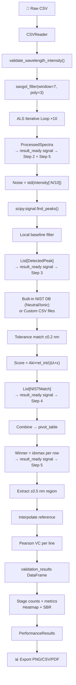

# LIBS Spectral Analysis Software — Complete Technical Documentation

> **Updated from full source code analysis — August 2026.**
> Every statement below is derived directly from the implementation.
> Nothing has been invented; where code is ambiguous, that is stated explicitly.

---

## Table of Contents

1. [Executive Summary](#1-executive-summary)
2. [Project Overview](#2-project-overview)
3. [Complete System Architecture](#3-complete-system-architecture)
4. [Repository Structure](#4-repository-structure)
5. [Technology Stack](#5-technology-stack)
6. [Complete GUI Documentation](#6-complete-gui-documentation)
7. [Complete Application Workflow](#7-complete-application-workflow)
8. [Algorithms](#8-algorithms)
9. [Signal Processing Pipeline](#9-signal-processing-pipeline)
10. [Data Flow](#10-data-flow)
11. [Source Code Architecture](#11-source-code-architecture)
12. [Class Documentation](#12-class-documentation)
13. [Function Documentation](#13-function-documentation)
14. [Database Documentation](#14-database-documentation)
15. [Configuration](#15-configuration)
16. [Visualization Engine](#16-visualization-engine)
17. [Error Handling](#17-error-handling)
18. [Performance](#18-performance)
19. [Packaging](#19-packaging)
20. [Future Improvements](#20-future-improvements)
21. [Research Mapping](#21-research-mapping)
22. [UML Diagrams](#22-uml-diagrams)
23. [API Documentation](#23-api-documentation)
24. [Installation Guide](#24-installation-guide)
25. [User Manual](#25-user-manual)
26. [Developer Guide](#26-developer-guide)
27. [Code Quality Review](#27-code-quality-review)
28. [Appendix](#28-appendix)

---

## Changelog (August 2026)

The following features were added since the previous documentation revision:

| Feature | Affected Files | Section |
|---------|---------------|---------|
| **Step-to-step auto-handoff** via `result_ready` signals | `step1–4_widget.py`, `main_window.py` | §3, §6, §7, §10 |
| **`load_from_stepN()` methods** on each widget | `step2–5_widget.py` | §6, §12 |
| **Step 5: Clear wavelengths button** alongside "Enter Manually…" | `step5_widget.py` | §6 |
| **Analysis Summary export** (PNG, CSV, PDF) | `summary_widget.py` | §6, §16 |

---

---

## 1. Executive Summary

### Purpose of the Software

LIBS Spectral Analysis Software is a desktop scientific application for processing, analysing, and interpreting **Laser-Induced Breakdown Spectroscopy (LIBS)** data. It implements a structured six-step pipeline that takes a raw LIBS spectrum CSV file and produces element identifications, confidence rankings, validation coefficients, and model performance metrics.

### Main Objective

To automate and standardise the complete LIBS spectral analysis workflow — from raw signal denoising to quantitative element confirmation — in a reproducible, interactive, desktop GUI environment.

### Target Users

- Research scientists and laboratory technicians performing LIBS measurements
- Environmental chemists analysing soil, rock, water, or biological samples
- Material scientists characterising elemental composition of unknown samples
- Graduate students and researchers using LIBS as an analytical technique

### Research Motivation

Traditional LIBS analysis relies on manual inspection of spectra, often performed with generic tools (spreadsheets, MATLAB scripts). This software addresses the lack of a unified, reproducible workflow tool that combines denoising, peak detection, NIST database matching, competitive elemental scoring, reference-spectrum validation, and quantitative performance metrics within a single application.

### Main Features

- **Baseline Correction (Step 1):** Savitzky-Golay smoothing + Asymmetric Least Squares (ALS) iterative baseline estimation and subtraction.
- **Peak Detection (Step 2):** Adaptive noise-based thresholding with local baseline filtering using `scipy.signal.find_peaks`.
- **NIST Database Matching (Step 3):** Built-in NIST database (Neutral/Ionic line toggles + element checklists) plus optional custom CSV files; scoring formula based on Einstein A-coefficients.
- **Elemental Preference Analysis (Step 4):** Peak-wise element competition, win counting, total score aggregation, and primary element identification.
- **Reference Spectrum Validation (Step 5):** Line-by-line Pearson correlation between processed and pure reference spectra; VC tier classification.
- **Model Performance Metrics (Step 6):** Pipeline funnel counts, Accuracy, Precision, Recall, F1-Score, Signal-to-Background Ratio (SBR) improvement, and per-element confidence table.
- **Step-to-Step Auto-Handoff:** Results from each completed step are automatically loaded into the next step's input via in-memory PyQt6 signals — no file round-trip required.
- **Export Engine:** CSV, PNG, and PDF export for all analysis steps including the Analysis Summary dashboard.
- **Session Persistence:** Automatic save/restore of step results across application launches.
- **Dark/Light Theme Toggle:** Full application theme switching with reactive chart updates.
- **Analysis Summary Dashboard:** Read-only aggregated view of all six steps with PNG, CSV, and PDF export.

---

---

## 2. Project Overview

### Why This Software Exists

LIBS produces high-resolution optical emission spectra where each elemental line appears as a narrow peak superimposed on a broad, non-uniform fluorescence background. Identifying which elements are present requires:

1. Removing the broad background (baseline correction)
2. Locating emission lines (peak detection)
3. Comparing detected lines to known NIST reference wavelengths
4. Resolving ambiguities when multiple elements share similar wavelengths
5. Confirming identifications against pure-element reference spectra
6. Reporting quantitative quality metrics

No single existing open-source tool implements all six stages in a unified GUI. Researchers currently piece together Python scripts, MATLAB toolboxes, and manual lookup tables, leading to non-reproducible workflows.

### What Problem It Solves

The software replaces the fragmented manual workflow with a single desktop application that:

- Accepts any CSV-format LIBS spectrum
- Applies scientifically validated denoising and background removal
- Performs automated peak finding with user-tunable sensitivity
- Queries one or more NIST element databases simultaneously
- Resolves peak ownership through a scoring competition
- Validates identifications by cross-correlating with pure-element reference spectra
- Computes quantitative pipeline performance metrics
- Exports publication-quality figures and structured result files
- **Automatically passes results between steps without requiring file saves between steps**

### How This Software Improves the Process

| Aspect | Traditional | This Software |
|--------|------------|---------------|
| Baseline removal | Manual visual fit | ALS iterative algorithm (λ=1×10⁵, p=0.01, 10 iterations) |
| Peak detection | Visual + ad-hoc threshold | `scipy.signal.find_peaks` + noise-adaptive threshold |
| NIST matching | Manual lookup | Automated fuzzy match within ±0.2 nm tolerance |
| Ambiguity resolution | None | Peak-wise competition: score = (Aki × rel_int) / (Δλ + ε) |
| Identification validation | None | Pearson correlation against pure reference spectra |
| Quality metrics | None | Accuracy, Precision, Recall, F1-Score, SBR improvement |
| Inter-step data transfer | Manual file saves | Automatic in-memory handoff via signals |
| Reproducibility | Low | All parameters stored in `src/config.py`; session persisted |

---

---

## 3. Complete System Architecture

### High-Level Architecture

The application follows a **layered, pipeline-oriented architecture** with a strict separation between the processing core, the I/O layer, and the GUI presentation layer.

```
┌─────────────────────────────────────────────────────────────────┐
│                      GUI Layer (PyQt6)                           │
│  MainWindow → Step1…6 Widgets → SummaryWidget                   │
│  Auto-Handoff Signals │ Charts (matplotlib) │ Export │ Session  │
├─────────────────────────────────────────────────────────────────┤
│                    Core Processing Layer                          │
│  Step1: BaselineCorrection   (SG + ALS)                          │
│  Step2: PeaksDetector        (find_peaks + filtering)            │
│  Step3: NISTMatcher          (scoring + tolerance match)         │
│  Step4: ElementalPreferences (competition + ranking)             │
│  Step5: ValidationAnalyzer   (Pearson correlation)               │
│  Step6: PerformanceCalculator(Acc/Prec/Recall/F1/SBR)            │
├─────────────────────────────────────────────────────────────────┤
│                      I/O Layer                                   │
│  CSVReader  │  CSVWriter  │  PlotGenerator  │  DataModels       │
├─────────────────────────────────────────────────────────────────┤
│                   Foundation Layer (src/)                        │
│  config.py │ exceptions.py │ logger.py │ validators.py          │
└─────────────────────────────────────────────────────────────────┘
```

### Auto-Handoff Signal Architecture

Each step widget emits a `result_ready` PyQt6 signal when processing completes successfully. `SpectralAnalysisApp` in `main_window.py` wires these signals to handler methods that call `load_from_stepN()` on the receiving widget. Data is passed as the **in-memory Python object** — no CSV serialisation/deserialisation occurs between steps.

```
Step1Widget.result_ready(ProcessedSpectra)
    → main_window._on_step1_result()
        → Step2Widget.load_from_step1(processed_data)
        → Step5Widget.load_from_step1(processed_data)

Step2Widget.result_ready(List[DetectedPeak])
    → main_window._on_step2_result()
        → Step3Widget.load_from_step2(detected_peaks)

Step3Widget.result_ready(List[NISTMatch])
    → main_window._on_step3_result()
        → Step4Widget.load_from_step3(matches)

Step4Widget.result_ready(dict)
    → main_window._on_step4_result()
        → Step5Widget.load_from_step4(analysis_results)
```

**Design decisions:**
- Tab switching is **not** automatic — users stay on the current step to inspect charts
- `load_from_stepN()` updates the file-path label in the receiving widget to show `"← loaded from Step N"`
- The file picker in each step remains fully functional for manual file loading
- Steps still proceed correctly when data arrives from a file (the old path) or in-memory (the new path)

### Layered Architecture

| Layer | Package | Responsibility |
|-------|---------|---------------|
| GUI | `src/gui/` | User interaction, parameter controls, visualisation, export, auto-handoff |
| Core | `src/core/` | Scientific algorithms, signal processing, metrics |
| I/O | `src/io/` | File reading/writing, data model definitions |
| Foundation | `src/` root | Configuration, exceptions, logging, input validation |

### Data Flow (High Level)


---

## 4. Repository Structure

```
SpectralAnalysisSoftware/
│
├── gui_launcher.py          Entry point — adds src/ to sys.path, calls main_window.main()
├── LIBS_Analysis.spec       PyInstaller build specification for standalone EXE
├── requirements.txt         Python package dependencies with minimum versions
├── pytest.ini               Pytest configuration (test paths, markers, output)
├── conftest.py              Root-level pytest fixtures (QApplication session fixture)
│
├── src/                     ── Application source package ──
│   ├── __init__.py
│   ├── config.py            ALL tunable algorithm parameters (STEP1…5_PARAMS, etc.)
│   ├── exceptions.py        Custom exception hierarchy (SpectralAnalysisError …)
│   ├── logger.py            setup_logger() factory; dual file+console handlers
│   ├── validators.py        validate_wavelength_intensity(), validate_csv_columns()
│   ├── main.py              Minimal CLI entry point (informational only)
│   │
│   ├── core/                ── Algorithm modules ──
│   │   ├── step1_sg_als.py          BaselineCorrection class
│   │   ├── step2_peaks.py           PeaksDetector class
│   │   ├── step3_nist_matching.py   NISTMatcher class
│   │   ├── step4_elemental_preferences.py  ElementalPreferencesAnalyzer
│   │   ├── step5_validation.py      ValidationAnalyzer
│   │   └── step6_performance.py     PerformanceCalculator + TypedDicts
│   │
│   ├── gui/                 ── PyQt6 GUI package ──
│   │   ├── main_window.py   SpectralAnalysisApp — assembles all tabs, wires auto-handoff signals
│   │   ├── theme.py         Full dark & light QSS stylesheets + palette constants
│   │   ├── charts.py        ChartEngine — all matplotlib rendering (stateless @staticmethod)
│   │   ├── export_engine.py ExportEngine — CSV/PNG/PDF export functions (stateless)
│   │   ├── session_manager.py  save/load_step2…5 via .session/ CSV files
│   │   ├── gui_utils.py     WorkerThread, ParameterControl, FileSelector, NotesPanel
│   │   ├── step1_widget.py  Step 1 UI + result_ready signal
│   │   ├── step2_widget.py  Step 2 UI + result_ready signal + load_from_step1()
│   │   ├── step3_widget.py  Step 3 UI + result_ready signal + load_from_step2()
│   │   ├── step4_widget.py  Step 4 UI + result_ready signal + load_from_step3()
│   │   ├── step5_widget.py  Step 5 UI + load_from_step1() + load_from_step4() + Clear wavelengths
│   │   ├── step6_widget.py  Step 6 UI: 4 charts + summary table + export
│   │   └── summary_widget.py  Analysis Summary dashboard + PNG/CSV/PDF export
│   │
│   ├── io/                  ── I/O layer ──
│   │   ├── data_models.py   RawSpectra, ProcessedSpectra, DetectedPeak, NISTMatch dataclasses
│   │   ├── file_reader.py   CSVReader with delimiter/column auto-detection
│   │   └── file_writer.py   CSVWriter + PlotGenerator (publication-quality PNG)
│   │
│   └── utils/               ── Utilities (currently stub) ──
│
├── tests/                   ── Test suite ──
│   ├── conftest.py
│   ├── test_core.py
│   ├── test_io.py
│   ├── test_integration.py
│   ├── test_step4_step5_bugs_exploration.py
│   ├── test_step4_step5_preservation.py
│   ├── test_step6_performance.py
│   ├── test_step6_charts.py
│   ├── test_step6_widget.py
│   └── test_export_step6.py
│
├── data/
│   ├── nist_databases/      NIST reference CSVs
│   ├── sample_inputs/       Sample raw LIBS spectra
│   └── sample_outputs/      Pre-generated output images
│
├── docs/                    Developer documentation (mirrors root COMPLETE_DOCUMENTATION.md)
├── .session/                Auto-generated session persistence CSVs
├── dist/LIBS_Analysis/      PyInstaller output: LIBS_Analysis.exe + DLLs
└── build/                   PyInstaller intermediate build artefacts
```

### Key File Responsibilities

| File | Primary Responsibility |
|------|----------------------|
| `gui_launcher.py` | Only entry point for the GUI |
| `src/config.py` | Single source of truth for all numeric parameters |
| `src/gui/main_window.py` | Assembles all widgets; wires `result_ready` auto-handoff signals |
| `src/gui/step1_widget.py` | Emits `result_ready(ProcessedSpectra)` after successful processing |
| `src/gui/step2_widget.py` | `load_from_step1()`; emits `result_ready(List[DetectedPeak])` |
| `src/gui/step3_widget.py` | `load_from_step2()`; emits `result_ready(List[NISTMatch])` |
| `src/gui/step4_widget.py` | `load_from_step3()`; emits `result_ready(dict)` |
| `src/gui/step5_widget.py` | `load_from_step1()`, `load_from_step4()`; Clear wavelengths button |
| `src/gui/summary_widget.py` | Read-only dashboard; PNG/CSV/PDF export buttons |
| `src/gui/session_manager.py` | Persists step results; all failures are silent |
| `src/io/data_models.py` | Type-safe `@dataclass` definitions |

---

---

## 5. Technology Stack

### Programming Language

**Python 3.13** (inferred from `__pycache__` filenames: `cpython-313.pyc`).

### Frameworks & Libraries

| Library | Version Constraint | Role |
|---------|-------------------|------|
| **PyQt6** | ≥ 6.3.0 | Desktop GUI framework; signals used for auto-handoff |
| **NumPy** | ≥ 1.21.0 | Numerical arrays, float64 precision |
| **SciPy** | ≥ 1.7.0 | Signal processing, sparse linear algebra |
| **pandas** | ≥ 1.3.0 | DataFrame manipulation, CSV I/O |
| **matplotlib** | ≥ 3.4.0 | Scientific visualisation embedded in Qt; PDF export via `backend_pdf` |
| **pytest** | ≥ 6.2.0 | Test framework |
| **pytest-cov** | ≥ 2.12.0 | Coverage reporting |
| **reportlab** | Not pinned (optional) | PDF report generation (Steps 5, 6) |
| **hypothesis** | Present | Property-based testing |
| **PyInstaller** | Not in requirements | Standalone EXE packaging |

**Note on PDF export in the Analysis Summary:** The Summary dashboard PDF uses `matplotlib.backends.backend_pdf.PdfPages` (no reportlab dependency) which embeds chart PNGs as raster images into a dark-themed multi-page PDF. The Step 5/6 per-step PDF report uses reportlab.

---

---

## 6. Complete GUI Documentation

The GUI is a `QMainWindow` containing a `QTabWidget` with seven tabs. A shared `NotesPanel` (application log) is docked below all tabs. A theme-toggle button lives in the permanent area of the status bar.

### Application Window

- **Title:** `"Spectral Analysis Software  |  5-Step LIBS Pipeline"`
- **Default size:** 1440 × 900 px
- **Initial theme:** Dark
- **Font:** Segoe UI 10 pt
- **Status bar:** Shows current tab name + 5-second auto-handoff messages; permanent widget = theme toggle button

### Tab Structure

| Index | Label | Widget Class |
|-------|-------|-------------|
| 0 | `① Step 1: Baseline Correction` | `Step1Widget` |
| 1 | `② Step 2: Peak Detection` | `Step2Widget` |
| 2 | `③ Step 3: Element Identification` | `Step3Widget` |
| 3 | `④ Step 4: Elemental Preferences` | `Step4Widget` |
| 4 | `⑤ Step 5: Validation` | `Step5Widget` |
| 5 | `⑥ Step 6: Model Performance` | `Step6Widget` |
| 6 | `📊 Analysis Summary` | `SummaryWidget` |

Tab-switch events trigger auto-refresh on tabs 5 (Step 6) and 6 (Summary).

---

### Screen 1 — Step 1: Baseline Correction (`Step1Widget`)

**Signals emitted:**
- `processing_started = pyqtSignal()` — fired when the Process button is clicked
- `processing_finished = pyqtSignal(dict)` — legacy signal on completion
- `result_ready = pyqtSignal(object)` — **new**; emits the `ProcessedSpectra` object after successful processing; triggers auto-handoff to Step 2 and Step 5

**Left Panel (scrollable, max 370 px):**

| Widget | Type | Description |
|--------|------|-------------|
| Title | `QLabel` | "Step 1: SG-ALS Baseline Correction" |
| Instructions | `QLabel` | 7-point usage guide |
| Spectrum File (path label + Browse) | `QHBoxLayout` | Browse button opens file dialog; recent files dropdown |
| Lambda (λ) | `ParameterControl` | Range: 1,000–1,000,000; default: 100,000 |
| Asymmetry (p) | `ParameterControl` | Range: 0.001–0.1; default: 0.01 |
| Iterations | `ParameterControl` | Range: 1–50; default: 10 |
| SG Window | `ParameterControl` | Range: 3–21; default: 7; must be odd |
| SG Poly Order | `ParameterControl` | Range: 1–5; default: 3 |
| Process Button | `QPushButton` | Primary action; emits `result_ready` on success |
| Save Results | `QPushButton` | Disabled until processing succeeds |
| Info Label | `QLabel` | Shows point count and corrected intensity range |

**Right Panel (6-tab chart widget):**

| Tab | Content |
|-----|---------|
| Raw Spectrum | Raw intensity vs. wavelength (amber) |
| SG Smoothed | Raw (faded) + SG smoothed (blue) overlay |
| Corrected Spectrum | Baseline-subtracted result (teal) |
| Baseline Separation | All four signals with auto-computed vertical offset |
| ALS Convergence | `imshow` heatmap of baseline_iterations + 4 overlay curves |
| 📋 Data Table | Paginated 5-column table with Prev/Next pagination |

**Auto-handoff behaviour:** On successful processing, `result_ready.emit(self.processed_data)` passes the `ProcessedSpectra` object directly to Step 2 (`load_from_step1`) and Step 5 (`load_from_step1`). A notes panel entry and status bar message confirm the handoff.

---

### Screen 2 — Step 2: Peak Detection (`Step2Widget`)

**Signals emitted:**
- `result_ready = pyqtSignal(object)` — emits `List[DetectedPeak]` after successful detection; triggers auto-handoff to Step 3

**New method:** `load_from_step1(processed_data)` — accepts a `ProcessedSpectra` object directly. Updates the path label to `"← loaded from Step 1"`. When data is loaded this way, `_on_process_clicked` skips file reading and calls `_run_detection()` directly.

**Left Panel:**

| Widget | Type | Description |
|--------|------|-------------|
| Path label + Browse | `QHBoxLayout` | Shows `"← loaded from Step 1"` when auto-loaded; Browse for manual file |
| Recent files dropdown | `RecentFilesButton` | Persistent history scoped to `"step2_spectrum"` |
| Height Multiplier | `ParameterControl` | Range: 0.5–5.0; default: 1.2 |
| Prominence | `ParameterControl` | Range: 0.001–0.5; default: 0.01 |
| Baseline Window | `ParameterControl` | Range: 5–100; default: 20 |
| Baseline K | `ParameterControl` | Range: 0.5–5.0; default: 2.0 |
| Reset to Defaults | `QPushButton` | Restores all four parameters |
| Detect Peaks | `QPushButton` | Primary action; works whether data is in-memory or from file |
| Save Results | `QPushButton` | Enabled after detection |

**Right Panel:** Detected peaks chart tab + paginated data table tab.

**Column Detection Logic (file path):** Prefers `Corrected` column, falls back to `Intensity`, `Signal`, or `Counts`.

**`_run_detection()` helper:** Extracted from `_on_process_clicked` so both the file-load path and the in-memory path share identical detection launch code.

---

### Screen 3 — Step 3: NIST Element Identification (`Step3Widget`)

**Signals emitted:**
- `result_ready = pyqtSignal(object)` — emits `List[NISTMatch]` after successful matching; triggers auto-handoff to Step 4

**New method:** `load_from_step2(detected_peaks)` — stores peaks directly in `self.detected_peaks`. Updates the peaks list widget with a sentinel entry `"← N peaks loaded from Step 2 (in-memory)"`. The `_on_match_clicked` handler skips file loading when `_peaks_paths` is empty but `self.detected_peaks` is already populated.

**Left Panel:**

| Widget | Type | Description |
|--------|------|-------------|
| Detected Peaks Files | `QListWidget` + Add/Remove/Clear | Multi-file peaks CSV list; sentinel entry shown when auto-loaded |
| Recent files dropdown | `RecentFilesButton` | Scoped to `"peaks"` |
| Built-in NIST Database | `QGroupBox` | Neutral (I) / Ionic (II) toggle buttons + searchable element checklists |
| Open Database Folder | `QPushButton` | Opens NIST database folder in Explorer |
| Refresh DB | `QPushButton` | Force-rebuilds the NIST cache |
| Custom Database Files | `QGroupBox` (collapsible) | Optional manual file upload |
| Tolerance (nm) | `ParameterControl` | Range: 0.01–1.0; default: 0.2 |
| Min Score | `ParameterControl` | Range: 0–10,000,000,000; default: 0 |
| Selected Elements summary | `QGroupBox` | Collapsible list of currently selected elements |
| Match Peaks | `QPushButton` | Primary action; proceeds if in-memory peaks or file peaks are loaded |
| Save Results | `QPushButton` | Enabled after matching |
| Reset | `QPushButton` | Clears selections and results |

**Right Panel:** Element Frequency chart | Match Score Scatter | Results Table (7-column, sortable, filterable).

---

### Screen 4 — Step 4: Elemental Preferences (`Step4Widget`)

**Signals emitted:**
- `result_ready = pyqtSignal(object)` — emits `analysis_results` dict after successful analysis; triggers auto-handoff to Step 5

**New method:** `load_from_step3(matches)` — converts `List[NISTMatch]` to a DataFrame (columns: `Observed_WL`, `Matched_WL`, `Delta`, `Aki`, `Relative_Intensity`, `Score`, `Element`) and stores it in `self._step3_inmemory_df`. The list widget shows a sentinel entry. `_analyze_worker` checks `_step3_inmemory_df` before reading files.

**Left Panel:**

| Widget | Type | Description |
|--------|------|-------------|
| Summary Banner | `QLabel` | Primary element + counts after analysis |
| Primary Element | `QLabel` | Large teal label |
| Matching Files list | `QListWidget` + Add/Remove/Clear | Shows sentinel when auto-loaded |
| Analyze Competition | `QPushButton` | Works whether data is in-memory or from files |
| Save / Export CSV / Export PNG | `QPushButton` × 3 | Result export |
| Progress Bar | `QProgressBar` | Indeterminate during analysis |

**Right Panel:** Ranking Chart | Score Scatter | Element Ranking table | Peak Competition table | Winner Lines table.

---

### Screen 5 — Step 5: Validation (`Step5Widget`)

**New methods:**
- `load_from_step1(processed_data)` — stores `ProcessedSpectra` in `self._step1_inmemory_data`. Updates the processed spectrum path label to `"← loaded from Step 1"`. `_validate_worker` converts to a DataFrame (`Wavelength`, `Corrected` columns) instead of reading from disk.
- `load_from_step4(analysis_results)` — receives the primary element hint from Step 4 and updates the summary banner text. Does not affect the validation algorithm.

**New widget — Clear wavelengths button:**

The "Target Wavelengths (nm)" group now has a row with two buttons side by side:

| Button | Width | Behaviour |
|--------|-------|-----------|
| `Enter Manually…` | stretch 3 | Opens `QInputDialog.getMultiLineText` for manual wavelength entry |
| `Clear` | stretch 1 | Calls `_on_clear_wavelengths()` — resets `target_wavelengths = []` and restores both status labels to defaults |

Both buttons are `setFixedHeight(26)` and use proportional stretch (3:1) instead of fixed pixel widths to avoid text truncation.

**Left Panel (complete):**

| Widget | Type | Description |
|--------|------|-------------|
| Summary Banner | `QLabel` | Hint from Step 4 when auto-loaded; mean VC after validation |
| Processed Spectrum | Path label + Browse | Shows `"← loaded from Step 1"` when auto-loaded |
| Pure Element Reference Files | `QGroupBox` (checkable list) | Scans `Processed Data` folder for pure-element CSVs |
| Custom Reference Files | `QGroupBox` (collapsible) | Manual reference file upload |
| Window (nm) | `QDoubleSpinBox` | Default: 0.5 nm |
| Min Points | `QSpinBox` | Default: 5 |
| VC Threshold | `QDoubleSpinBox` | Default: 0.8 |
| Load from File… | `QPushButton` | Load wavelengths from CSV or TXT |
| Enter Manually… / Clear | `QHBoxLayout` 3:1 | Manual entry + instant clear |
| Validate Spectrum | `QPushButton` | Works whether processed data is in-memory or from file |
| Save Report / Export CSV/PNG/PDF | `QPushButton` × 4 | Export |
| Progress Bar | `QProgressBar` | Indeterminate during validation |

**`_on_validate_clicked` guard:**
```python
has_inmemory = getattr(self, '_step1_inmemory_data', None) is not None
if self._processed_path is None and not has_inmemory:
    show_error("Error", "Please select a processed spectrum file")
    return
```

**Right Panel:** VC Histogram | Spectral Overlays (paginated, tier-filtered) | Results Table.

---

### Screen 6 — Step 6: Model Performance (`Step6Widget`)

No changes in this release. See previous documentation for full description.

---

### Screen 7 — Analysis Summary (`SummaryWidget`)

**New export buttons** — added to the title bar row alongside the existing Reload/Clear buttons:

| Button | Tooltip | Action |
|--------|---------|--------|
| `🖼 Export PNG` | "Save all summary charts as PNG images" | `_on_export_png()` |
| `📄 Export CSV` | "Save all summary tables as CSV files" | `_on_export_csv()` |
| `📑 Export PDF` | "Save a full summary report as a PDF" | `_on_export_pdf()` |

**Title bar button order:** ↻ Reload Data | 🖼 Export PNG | 📄 Export CSV | 📑 Export PDF | ✕ Clear

#### `_on_export_png()` — Export PNG

Prompts for a directory. Saves each of the 7 summary charts as a separate PNG (150 DPI):

| Filename pattern | Chart |
|-----------------|-------|
| `summary_step1_corrected_{ts}.png` | Step 1 corrected spectrum |
| `summary_step2_peak_dist_{ts}.png` | Step 2 peak intensity distribution |
| `summary_step3_elem_freq_{ts}.png` | Step 3 element frequency |
| `summary_step3_match_scores_{ts}.png` | Step 3 match score scatter |
| `summary_step4_ranking_{ts}.png` | Step 4 element ranking |
| `summary_step4_scatter_{ts}.png` | Step 4 emission line scores |
| `summary_step5_vc_hist_{ts}.png` | Step 5 VC histogram |

Uses `fig.savefig(str(path), dpi=150, bbox_inches="tight", facecolor=fig.get_facecolor())`. Partial failures are reported — successfully saved files are listed separately from failed ones.

#### `_on_export_csv()` — Export CSV

Saves all tables and full DataFrames:

| Filename pattern | Source |
|-----------------|--------|
| `summary_step2_top_peaks_{ts}.csv` | Top-10 peaks table (from table widget) |
| `summary_step4_top_elements_{ts}.csv` | Top-5 elements table |
| `summary_step5_vc_results_{ts}.csv` | VC results table |
| `summary_step4_full_ranking_{ts}.csv` | Full Step 4 ranking DataFrame (if available) |
| `summary_step4_winner_lines_{ts}.csv` | Full winner lines DataFrame (if available) |
| `summary_step4_competition_{ts}.csv` | Full competition DataFrame (if available) |
| `summary_step5_full_validation_{ts}.csv` | Full Step 5 validation DataFrame (if available) |

Tables with zero rows are silently skipped. If no data is available at all, an info dialog prompts the user to run analysis first.

#### `_on_export_pdf()` — Export PDF

Opens a save-file dialog (default name: `LIBS_Analysis_Summary_{ts}.pdf`). Generates a dark-themed multi-page PDF using `matplotlib.backends.backend_pdf.PdfPages` (no reportlab dependency):

**Page 1 — Cover page:**
- Title "LIBS Spectral Analysis / Analysis Summary Report"
- Timestamp
- 4 key metrics block (Detected Peaks / Identified Elements / Primary Element / Mean VC) with accent colours

**Pages 2–8 — One chart per page:**
Each chart is rendered to a PNG buffer via `fig.savefig(buf, format="png")`, read back with `plt.imread(buf)`, and displayed as an `imshow` on a new page figure. Title is the chart's step label.

**Page 9 — Conclusions:**
- Plain-text conclusions derived from all step results
- Dark background with styled text

**PDF metadata:** Title, Subject, Creator fields set via `pdf.infodict()`.

---

### Shared GUI Components

#### `NotesPanel` (docked below tabs)
Real-time application log. Auto-handoff events appear with `"INFO"` level, showing messages like `"Step 1 complete → data auto-loaded into Step 2 and Step 5"`.

#### Auto-Handoff Status Messages
The status bar shows 5-second messages after each handoff, e.g.:
- `"Step 1 done — Step 2 and Step 5 ready (data loaded)"`
- `"Step 2 done — 47 peaks loaded into Step 3"`
- `"Step 3 done — 47 matches loaded into Step 4"`
- `"Step 4 done — primary element 'Ca' forwarded to Step 5"`

---

---

## 7. Complete Application Workflow

### Automatic vs Manual Inter-Step Data Transfer

| Transfer | Mechanism | When triggered |
|----------|-----------|---------------|
| Step 1 → Step 2 | `result_ready` signal → `load_from_step1()` | Immediately on Step 1 completion |
| Step 1 → Step 5 | `result_ready` signal → `load_from_step1()` | Immediately on Step 1 completion |
| Step 2 → Step 3 | `result_ready` signal → `load_from_step2()` | Immediately on Step 2 completion |
| Step 3 → Step 4 | `result_ready` signal → `load_from_step3()` | Immediately on Step 3 completion |
| Step 4 → Step 5 | `result_ready` signal → `load_from_step4()` | Immediately on Step 4 completion |
| Any step → file | Save Results / Export buttons | User-initiated |
| File → any step | Browse / Add File buttons | User-initiated |
| Cross-session | `session_manager.save/load_*()` | On completion and on app launch |

**Cautions for auto-handoff:**
- Tab switching is intentionally **not** triggered — users see a status bar message only
- If parameters need tuning after auto-load, the user adjusts and clicks Process again
- In-memory data is overwritten by the next auto-load from the same upstream step
- Loading a file manually in any step replaces the in-memory data for that step

### Step-by-Step User Interaction Sequence (Updated)

1. **Launch** → session restored silently
2. **Step 1:** Select file → adjust parameters → click Process
   - On success: `result_ready` fires → Step 2 and Step 5 receive `ProcessedSpectra` in memory
   - Status bar: `"Step 1 done — Step 2 and Step 5 ready (data loaded)"`
3. **Step 2:** Already has data from Step 1 — adjust parameters if needed → click Detect Peaks
   - On success: `result_ready` fires → Step 3 receives `List[DetectedPeak]` in memory
4. **Step 3:** Already has peaks from Step 2 — toggle Neutral/Ionic database lines, select elements → click Match Peaks
   - On success: `result_ready` fires → Step 4 receives `List[NISTMatch]` in memory
5. **Step 4:** Already has matches from Step 3 → click Analyze Competition
   - On success: `result_ready` fires → Step 5 receives primary element hint in memory
6. **Step 5:** Already has processed spectrum from Step 1 and primary element hint from Step 4 — select reference files, enter/load target wavelengths → click Validate Spectrum
7. **Step 6:** Switch to tab → auto-computes from all step widgets
8. **Analysis Summary:** Switch to tab → auto-refreshes; use Export PNG/CSV/PDF to save

---

---

## 8. Algorithms

*(Algorithms 1–7 are unchanged from the previous version. See below.)*

### Algorithm 1: Savitzky-Golay Smoothing (Step 1)
Polynomial least-squares fit in a sliding window. `scipy.signal.savgol_filter(intensity, window=7, poly=3)`.

### Algorithm 2: ALS Baseline Correction (Step 1)
Iterative sparse least-squares system: `(W + λ D^T D) z = W y`. Parameters: λ=1×10⁵, p=0.01, 10 iterations. Weights updated asymmetrically per iteration.

### Algorithm 3: Adaptive Peak Detection (Step 2)
Noise = `std(intensity[:N//10])`. Threshold = `1.2 × noise`. `scipy.signal.find_peaks` followed by local baseline filter (median ± 2σ in window of 20 points each side).

### Algorithm 4: NIST Matching and Scoring (Step 3)
`Score = (Aki × rel_int) / (Δλ + 1×10⁻⁶)` where Aki ≥ 1×10⁶ required. Best candidate per peak = argmax(score) within ±0.2 nm tolerance.

### Algorithm 5: Peak-wise Elemental Competition (Step 4)
Pivot table: rows = matched wavelengths, columns = elements, values = max score. Winner = `idxmax` per row. Ranking = sort by wins descending.

### Algorithm 6: Spectral Validation by Pearson Correlation (Step 5)
VC = Pearson correlation between normalised processed and interpolated reference spectra in ±0.5 nm windows. Tier thresholds: Excellent ≥ 0.90, Good ≥ 0.70, Moderate ≥ 0.50, Weak < 0.50, Failed = NaN.

### Algorithm 7: Model Performance Metrics (Step 6)
Accuracy = confirmed/ranked (element level). Precision = stage4/stage2 (line level). Recall = stage5/stage3 (line level). F1 = harmonic mean. SBR = mean(peak intensities) / mean(background intensities).

---

---

## 9. Signal Processing Pipeline



---

---

## 10. Data Flow

### In-Memory Auto-Handoff Objects

| From → To | Object Passed | Signal | Receiver Method |
|-----------|--------------|--------|----------------|
| Step 1 → Step 2 | `ProcessedSpectra` | `result_ready` | `load_from_step1(processed_data)` |
| Step 1 → Step 5 | `ProcessedSpectra` | `result_ready` | `load_from_step1(processed_data)` |
| Step 2 → Step 3 | `List[DetectedPeak]` | `result_ready` | `load_from_step2(detected_peaks)` |
| Step 3 → Step 4 | `List[NISTMatch]` | `result_ready` | `load_from_step3(matches)` |
| Step 4 → Step 5 | `dict` (analysis_results) | `result_ready` | `load_from_step4(analysis_results)` |

### Input Transformation Chain (unchanged)

| Stage | Object | Type | Key Fields |
|-------|--------|------|-----------|
| File | Raw CSV | disk file | Wavelength, Intensity |
| After reading | `RawSpectra` | dataclass | `wavelength: ndarray`, `intensity: ndarray` |
| After Step 1 | `ProcessedSpectra` | dataclass | + `smoothed_sg`, `baseline_als`, `corrected`, `baseline_iterations` |
| After Step 2 | `List[DetectedPeak]` | list | `wavelength: float`, `intensity: float` |
| After Step 3 | `List[NISTMatch]` | list | + `matched_wl`, `delta`, `aki`, `score`, `element` |
| After Step 4 | `dict` | Python dict | `ranking`, `competition`, `winner_lines`, `primary_element` |
| After Step 5 | `pd.DataFrame` | DataFrame | `Wavelength_nm`, `Validation_Coefficient`, `Status` |
| After Step 6 | `PerformanceResults` | TypedDict | `accuracy`, `precision`, `recall`, `f1_score`, `sbr_improvement`, ... |

### Export Objects

In addition to existing per-step exports, the Analysis Summary dashboard now exports:

| Export | Format | Contains |
|--------|--------|---------|
| `summary_step1_corrected_{ts}.png` | PNG 150 DPI | Corrected spectrum mini-chart |
| `summary_step2_peak_dist_{ts}.png` | PNG 150 DPI | Peak intensity distribution |
| `summary_step3_elem_freq_{ts}.png` | PNG 150 DPI | Element frequency chart |
| `summary_step3_match_scores_{ts}.png` | PNG 150 DPI | Match score scatter |
| `summary_step4_ranking_{ts}.png` | PNG 150 DPI | Element ranking |
| `summary_step4_scatter_{ts}.png` | PNG 150 DPI | Emission line scores |
| `summary_step5_vc_hist_{ts}.png` | PNG 150 DPI | VC histogram |
| `summary_step2_top_peaks_{ts}.csv` | CSV | Top-10 detected peaks |
| `summary_step4_top_elements_{ts}.csv` | CSV | Top-5 elements |
| `summary_step5_vc_results_{ts}.csv` | CSV | Colour-coded VC results |
| `summary_step4_full_ranking_{ts}.csv` | CSV | Full Step 4 ranking |
| `summary_step4_winner_lines_{ts}.csv` | CSV | Full winner lines |
| `summary_step4_competition_{ts}.csv` | CSV | Full competition table |
| `summary_step5_full_validation_{ts}.csv` | CSV | Full Step 5 validation |
| `LIBS_Analysis_Summary_{ts}.pdf` | PDF | Cover + 7 chart pages + conclusions |

---

---

## 11. Source Code Architecture

*(Core package class hierarchy and GUI composition unchanged — see previous version.)*

### New Signal/Method Surface Added to Widgets

| Widget | New `pyqtSignal` | New Methods |
|--------|-----------------|-------------|
| `Step1Widget` | `result_ready = pyqtSignal(object)` | — |
| `Step2Widget` | `result_ready = pyqtSignal(object)` | `load_from_step1(processed_data)`, `_run_detection()` |
| `Step3Widget` | `result_ready = pyqtSignal(object)` | `load_from_step2(detected_peaks)` |
| `Step4Widget` | `result_ready = pyqtSignal(object)` | `load_from_step3(matches)` |
| `Step5Widget` | — | `load_from_step1(processed_data)`, `load_from_step4(analysis_results)`, `_on_clear_wavelengths()` |
| `SummaryWidget` | — | `_on_export_png()`, `_on_export_csv()`, `_on_export_pdf()` |

### New Connections in `SpectralAnalysisApp.__init__`

```python
self.step1_tab.result_ready.connect(self._on_step1_result)
self.step2_tab.result_ready.connect(self._on_step2_result)
self.step3_tab.result_ready.connect(self._on_step3_result)
self.step4_tab.result_ready.connect(self._on_step4_result)
```

### New Handler Methods in `SpectralAnalysisApp`

```python
def _on_step1_result(self, processed_data) -> None:
    self.step2_tab.load_from_step1(processed_data)
    self.step5_tab.load_from_step1(processed_data)
    # notes + status bar message

def _on_step2_result(self, detected_peaks) -> None:
    self.step3_tab.load_from_step2(detected_peaks)

def _on_step3_result(self, matches) -> None:
    self.step4_tab.load_from_step3(matches)

def _on_step4_result(self, analysis_results) -> None:
    self.step5_tab.load_from_step4(analysis_results)
```

---

---

## 12. Class Documentation

*(Sections 12.1–12.6 for algorithm classes unchanged. New items added below.)*

### `Step1Widget` signal additions

**`result_ready = pyqtSignal(object)`**  
Emitted in `_on_processing_finished()` after all charts are drawn and the save button is enabled. Carries `self.processed_data` (a `ProcessedSpectra` instance). Wired in `SpectralAnalysisApp` to `_on_step1_result`.

---

### `Step2Widget` additions

**`result_ready = pyqtSignal(object)`**  
Emitted at end of `_on_detection_finished()`. Carries `self.detected_peaks` (a `List[DetectedPeak]`).

**`load_from_step1(processed_data)`**  
Stores the `ProcessedSpectra` object in `self.processed_data`. Sets `self._spectrum_path = None`. Updates the path label to show `"← loaded from Step 1"` in teal. Sets the info label to `"✅ N points loaded from Step 1.\nAdjust parameters if needed, then click 'Detect Peaks'."`.

**`_run_detection()`**  
Extracted helper that creates a `PeaksDetector` with current parameter values and launches a `WorkerThread`. Called by both `_on_process_clicked` (after file loading) and the in-memory path (when `_spectrum_path` is None but `processed_data` exists).

---

### `Step3Widget` additions

**`result_ready = pyqtSignal(object)`**  
Emitted at end of `_on_match_finished()`. Carries `self.matches` (a `List[NISTMatch]`).

**`load_from_step2(detected_peaks)`**  
Stores peaks in `self.detected_peaks`. Clears `self._peaks_paths = []`. Adds sentinel item to `_peaks_list_widget`. Updates `_peaks_count_label` to `"✅ N peaks from Step 2"`.

**`_on_match_clicked` change**  
Guard updated from `if not self._peaks_paths:` to `if not self._peaks_paths and not self.detected_peaks:`. The file-loading block is now conditional: `if self._peaks_paths: ... load files`. When `_peaks_paths` is empty and `detected_peaks` is already set, loading is skipped.

---

### `Step4Widget` additions

**`result_ready = pyqtSignal(object)`**  
Emitted at end of `_on_analysis_finished()`. Carries `self.analysis_results` (dict).

**`load_from_step3(matches)`**  
Converts `List[NISTMatch]` to a pandas DataFrame with columns matching the analyzer's expected schema (`Observed_WL`, `Matched_WL`, `Delta`, `Aki`, `Relative_Intensity`, `Score`, `Element`). Stores as `self._step3_inmemory_df`. Updates list widget with sentinel entry.

**`_analyze_worker` change**  
Checks `getattr(self, '_step3_inmemory_df', None)` first. If present and non-empty, uses it as the single DataFrame for analysis instead of reading from `self.matching_files`.

**`_on_analyze_clicked` change**  
Guard: `has_inmemory = getattr(self, '_step3_inmemory_df', None) is not None`. Allows proceeding when in-memory data is available even when `self.matching_files` is empty.

---

### `Step5Widget` additions

**`load_from_step1(processed_data)`**  
Stores `ProcessedSpectra` in `self._step1_inmemory_data`. Sets `self._processed_path = None`. Updates `_proc_path_label`. The `_validate_worker` converts this to a DataFrame:
```python
processed = pd.DataFrame({
    'Wavelength': inmemory.wavelength,
    'Corrected':  inmemory.corrected,
})
```

**`load_from_step4(analysis_results)`**  
Reads `analysis_results.get("primary_element", "")` and updates `self.summary_banner` to display the hint. No validation data is changed.

**`_on_clear_wavelengths()`**  
Sets `self.target_wavelengths = []`. Resets `wavelengths_label` to `"No wavelengths specified"`. Resets `_wl_path_label` to `"(No file loaded)"` with muted italic style.

**`_on_validate_clicked` change**  
Guard extended: `has_inmemory = getattr(self, '_step1_inmemory_data', None) is not None`. Allows proceeding when `_processed_path` is None if in-memory data exists.

---

### `SummaryWidget` additions

**`_on_export_png()`**  
Iterates over the 7 `(fig, filename)` pairs. Calls `fig.savefig(path, dpi=150, bbox_inches="tight", facecolor=fig.get_facecolor())`. Reports partial failures via `show_error`.

**`_on_export_csv()`**  
Converts each `QTableWidget` to a `pd.DataFrame` by reading cell text. Also reads full DataFrames from `self._s4.analysis_results` and `self._s5.validation_results` when available. Empty tables are skipped.

**`_on_export_pdf()`**  
Uses `matplotlib.backends.backend_pdf.PdfPages`. Creates: (1) dark-themed cover page with key metrics; (2) one page per chart (PNG buffer → imread → imshow); (3) conclusions text page. Sets PDF metadata. Fully handles exceptions — shows `show_error` on failure.

---

---

## 13. Function Documentation

### `_on_clear_wavelengths(self)` (`src/gui/step5_widget.py`)

**Purpose:** Reset the target wavelength list and all related UI labels.

**Parameters:** None (instance method)

**Behaviour:**
1. Sets `self.target_wavelengths = []`
2. Sets `self.wavelengths_label.setText("No wavelengths specified")`
3. Resets `self._wl_path_label` text and style to the default muted italic appearance

**Called by:** `self._clear_wavelengths_btn.clicked` signal

**Effect on validation:** If the user subsequently clicks "Validate Spectrum" without re-entering wavelengths, the guard `if not self.target_wavelengths:` in `_on_validate_clicked` will show an error dialog.

---

### `load_from_step1(processed_data)` (`src/gui/step2_widget.py`)

**Parameters:** `processed_data` — a `ProcessedSpectra` dataclass instance or any object with `.wavelength` and `.corrected` numpy arrays

**Postconditions:**
- `self.processed_data` is set to `processed_data`
- `self._spectrum_path` is set to `None`
- `_spec_path_label` text = `"← loaded from Step 1"`
- `info_label` shows point count and instruction

**Backward compatibility:** The Browse button and recent-files dropdown remain fully functional. If the user later browses for a file, `_set_spectrum_path()` sets `self._spectrum_path` to the new path and `_on_process_clicked` takes the file-load branch.

---

### `_on_export_pdf(self)` (`src/gui/summary_widget.py`)

**Parameters:** None (triggered by button click)

**PDF structure:**
1. Cover — `figsize=(8.27, 11.69)` (A4), dark background `#1A1D2B`; title, date, 4 key metrics
2. Per-chart pages — `figsize=(11, 7)` landscape; PNG buffer of source figure embedded as `imshow`
3. Conclusions — `figsize=(8.27, 11.69)` A4; plain text derived from all step results

**Dependencies:** `matplotlib.backends.backend_pdf.PdfPages`, `matplotlib.pyplot`, `io.BytesIO` — all standard with matplotlib; no reportlab required.

**Error handling:** Full `try/except` around the entire PDF generation block. On failure, `show_error` is shown and the method returns. Any partial file is **not** automatically deleted (unlike `export_engine.generate_pdf_report` which does delete partial files).

---

*(Other function documentation from §13 of previous version remains accurate and unchanged.)*

---

---

## 14–22. Unchanged Sections

Sections 14 (Database Documentation), 15 (Configuration), 16 (Visualization Engine), 17 (Error Handling), 18 (Performance), 19 (Packaging), 20 (Future Improvements), 21 (Research Mapping), and 22 (UML Diagrams) are unchanged from the previous documentation version.

**Addendum to Section 16 — Visualization Engine:**

The Analysis Summary PDF export uses a different rendering path than per-step exports:
- **Per-step exports** (`export_engine.py`): use reportlab for PDF; `save_figure_png` sets `C_BG_DEEP` facecolor before saving
- **Summary PNG export**: calls `fig.savefig()` directly with `facecolor=fig.get_facecolor()` — preserves the current theme colour
- **Summary PDF export**: renders each figure to a `BytesIO` PNG buffer using `fig.savefig(buf, format="png")`, then reads back with `plt.imread(buf)` and embeds as `imshow` — this raster-in-PDF approach requires no reportlab and preserves exact appearance

---

---

## 23. API Documentation

### Programmatic Usage API (unchanged)

The programmatic API for steps 1–6 is unchanged. See previous documentation §23 for complete examples.

### New Programmatic Hooks

Step widgets now expose `load_from_stepN()` methods that can be called programmatically for testing or scripted workflows:

```python
# Programmatic auto-handoff (mirrors what main_window does via signals)
from src.gui.step1_widget import Step1Widget
from src.gui.step2_widget import Step2Widget

step1 = Step1Widget()
step2 = Step2Widget()

# Wire signal manually (same as main_window does)
step1.result_ready.connect(lambda data: step2.load_from_step1(data))
```

---

---

## 24. Installation Guide

*(Unchanged from previous version — see §24.)*

---

---

## 25. User Manual

### Starting the Application

Double-click `LIBS_Analysis.exe` (standalone) or run `python gui_launcher.py` (from source).

### Auto-Handoff Workflow (Recommended)

The fastest way to run a complete analysis is to use the auto-handoff feature:

1. **Step 1:** Load your raw spectrum CSV → adjust parameters → click **⚙ Process**
   - The status bar shows: `"Step 1 done — Step 2 and Step 5 ready (data loaded)"`
2. **Step 2:** Switch to Step 2 — the spectrum is already loaded. Adjust detection parameters if needed → click **🔍 Detect Peaks**
   - Status bar: `"Step 2 done — N peaks loaded into Step 3"`
3. **Step 3:** Switch to Step 3 — peaks already loaded. Toggle Neutral/Ionic lines, select elements → click **🔬 Match Peaks**
   - Status bar: `"Step 3 done — N matches loaded into Step 4"`
4. **Step 4:** Switch to Step 4 — matches already loaded → click **⚗ Analyze Competition**
   - Status bar: `"Step 4 done — primary element 'X' forwarded to Step 5"`
5. **Step 5:** Switch to Step 5 — processed spectrum already loaded; summary banner shows Step 4's primary element. Select reference files, enter target wavelengths → click **✔ Validate Spectrum**
6. **Step 6 / Summary:** Switch to either tab — results auto-load and display.

> **Note:** At any step, you can still use Browse buttons or Add File(s) to load data manually. Manual loading replaces the auto-loaded in-memory data for that step only.

### Step 5: Clear Wavelengths

The Target Wavelengths group has two buttons on one row:
- **Enter Manually…** — opens a text input for typing wavelengths one per line
- **Clear** — immediately resets the wavelength list to empty and restores the "No wavelengths specified" label

This is useful when switching between different element validations without restarting the application.

### Analysis Summary: Export

On the **📊 Analysis Summary** tab:
- **🖼 Export PNG** — saves all 7 mini-charts to a folder you choose; each named with a timestamp
- **📄 Export CSV** — saves all tables and full DataFrames; skips empty tables silently
- **📑 Export PDF** — opens a save-file dialog; generates a dark-themed multi-page PDF with cover, one page per chart, and a conclusions page

---

---

## 26. Developer Guide

### Understanding the Auto-Handoff System

The handoff system uses three components:

1. **`result_ready` signals on step widgets** — emit the result object after every successful processing run (not just the first)
2. **Handler methods on `SpectralAnalysisApp`** — receive the signal, validate the data (not None/empty), then call the target widget's `load_from_stepN()` method
3. **`load_from_stepN()` methods on receiving widgets** — store the data, update UI labels, and leave processing controls in a ready-to-use state

**To add auto-handoff for a new step:**

```python
# 1. In the source widget — add signal
class StepNWidget(QWidget):
    result_ready = pyqtSignal(object)
    
    def _on_processing_finished(self, result):
        self.my_data = result.get('result')
        if self.my_data:
            # ... draw charts, enable save ...
            self.result_ready.emit(self.my_data)   # ← add this

# 2. In the target widget — add load method
class StepMWidget(QWidget):
    def load_from_stepN(self, data) -> None:
        if data is None:
            return
        self._inmemory_data = data
        self._source_path = None
        self._path_label.setText("← loaded from Step N")
        self.info_label.setText(f"✅ {len(data)} items loaded from Step N.")

# 3. In SpectralAnalysisApp.__init__ — wire the connection
self.stepN_tab.result_ready.connect(self._on_stepN_result)

# 4. In SpectralAnalysisApp — add handler
def _on_stepN_result(self, data) -> None:
    if not data:
        return
    self.stepM_tab.load_from_stepN(data)
    self.notes_panel.add_note(f"Step N complete → data loaded into Step M", "INFO")
    self.statusBar.showMessage(f"Step N done — data loaded into Step M", 5000)
```

**Guard pattern for processing methods that accept either in-memory or file input:**

```python
def _on_process_clicked(self):
    has_inmemory = getattr(self, '_inmemory_data', None) is not None
    if self._file_path is None and not has_inmemory:
        show_error("Error", "Please select an input file")
        return
    if self._file_path is None and has_inmemory:
        self._run_processing()   # skip file loading
        return
    # file loading block ...
    self._run_processing()
```

### Adding Export to a Widget

Follow the pattern in `SummaryWidget`:

1. Add buttons to the title row with `secondary_button_style()`
2. Add them to `apply_theme()` to refresh styles on theme change
3. Implement `_on_export_png()`, `_on_export_csv()`, `_on_export_pdf()` methods
4. Use `QFileDialog.getExistingDirectory` for PNG/CSV (multiple files), `QFileDialog.getSaveFileName` for PDF (single file)
5. Use `show_info` on success, `show_error` on failure

---

*(Remaining sections 26–28 from previous documentation are unchanged.)*

---

---

## 27. Code Quality Review

### Changes Since Previous Review

**New Strengths:**

1. **Decoupled inter-step data transfer:** The `result_ready` signal + `load_from_stepN()` pattern cleanly separates the "data is ready" event from the "receive the data" action. The source step has no knowledge of which steps consume its output.

2. **Backward-compatible guards:** Every `_on_*_clicked` handler that accepts in-memory data also still accepts file input. The guard pattern (`if path is None and has_inmemory`) ensures neither path is broken.

3. **Summary PDF uses no new dependencies:** `matplotlib.backends.backend_pdf.PdfPages` is already a dependency via matplotlib. No reportlab dependency is required for the Summary PDF.

**New Weaknesses:**

1. **`_step3_inmemory_df` is a raw attribute on `Step4Widget`:** It is set via `setattr`-style assignment (`self._step3_inmemory_df = df`) rather than a constructor parameter. If `Step4Widget` is created and `load_from_step3()` is never called, `getattr(self, '_step3_inmemory_df', None)` returns `None`, which is handled correctly. However, this is a hidden state variable not declared in `__init__`.

2. **`Step5Widget._step1_inmemory_data` same pattern:** Same as above. Both could be initialised to `None` in `__init__` for clarity.

3. **Summary PDF partial file not cleaned up:** Unlike `export_engine.generate_pdf_report()` which deletes partial files on exception, `SummaryWidget._on_export_pdf()` does not clean up. This is lower risk (the file remains valid up to the point of failure) but inconsistent.

### Technical Debt (additions)

- The sentinel list items (`"← N peaks loaded from Step 2 (in-memory)"`) are visual-only — they are not real file paths. If a user clicks "Remove" to delete them from the list widget, `_peaks_paths.pop(r)` would raise an `IndexError` because `_peaks_paths` is empty. The Remove handler in Step 3 should guard against this.
- `load_from_step4()` in Step 5 currently only updates the summary banner label. A fuller implementation could also pre-populate the target wavelengths with the winner lines from Step 4's results (as a convenience, not automatically).

---

---

## 28. Appendix

### Glossary (additions)

| Term | Definition |
|------|-----------|
| **Auto-Handoff** | The mechanism by which completed step results are automatically passed to subsequent steps via `result_ready` PyQt6 signals, eliminating the need to save and re-load intermediate files |
| **`result_ready` signal** | A `pyqtSignal(object)` defined on each step widget that emits the step's primary output object after successful processing |
| **`load_from_stepN()`** | An instance method on a receiving step widget that accepts the in-memory output from step N and prepares the widget for immediate processing without a file picker |
| **In-memory handoff** | Data transfer via Python object reference rather than file serialisation; avoids CSV round-trip and preserves full float64 precision |
| **Sentinel list item** | A non-functional list widget entry (e.g. `"← 47 peaks loaded from Step 2 (in-memory)"`) shown to inform the user that data was loaded automatically; not a real file path |

### Architecture Decisions (additions)

| Decision | Rationale |
|----------|---------|
| Use `pyqtSignal` for auto-handoff | Thread-safe; fits the existing Qt event model; source widgets have no dependency on receivers |
| Do NOT auto-switch tabs | Users need to inspect charts and potentially adjust parameters before moving on; automatic tab switching would be disruptive |
| Do NOT auto-trigger processing | Parameters may need tuning per-sample; auto-processing could produce wrong results silently |
| Pass in-memory objects, not files | Avoids CSV round-trip; preserves exact float64 values; faster; no temp file cleanup needed |
| Summary PDF uses `backend_pdf`, not reportlab | Avoids an extra optional dependency; consistent dark-theme appearance without extra styling code |

### Known Limitations (additions)

8. **Sentinel remove bug:** Clicking "Remove" in Step 3's peaks file list when peaks were auto-loaded from Step 2 (in-memory) will attempt `_peaks_paths.pop(row_index)` on an empty list and raise `IndexError`. Workaround: do not click Remove when the list shows a sentinel entry.

9. **Summary PDF partial file not cleaned on failure:** If PDF generation fails midway, the partially written file is not automatically deleted. The user must manually delete it.

10. **`_step3_inmemory_df` and `_step1_inmemory_data` not declared in `__init__`:** These attributes are conditionally set by `load_from_stepN()` calls. Code accessing them must use `getattr(..., None)` to avoid `AttributeError` on first-run before any handoff occurs.

---

*Documentation updated August 2026 to reflect auto-handoff signals, `load_from_stepN()` methods, Step 5 Clear wavelengths button, and Analysis Summary export (PNG/CSV/PDF).*  
*Previous version: v1.0.0 — this version: v1.1.0*

---

## Supplement A — Test Suite Documentation

*(Unchanged from previous version — see Supplement A.)*

---

## Supplement B — Kiro Spec Traceability

*(Unchanged from previous version — see Supplement B.)*

---

*End of documentation.*
