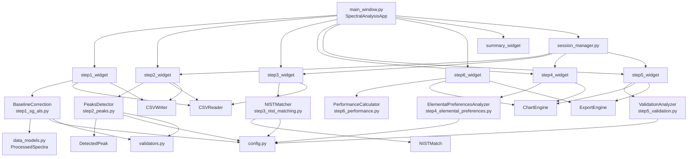
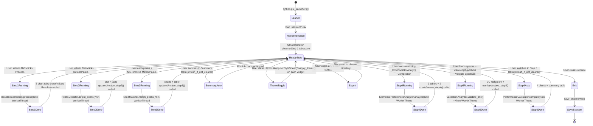
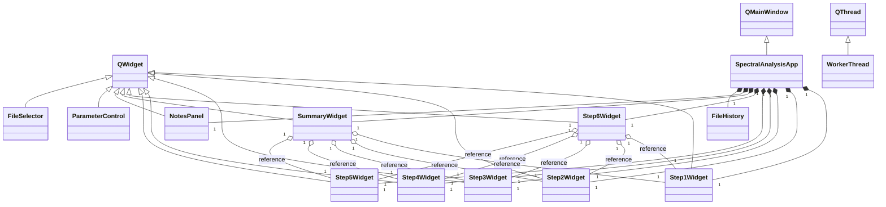
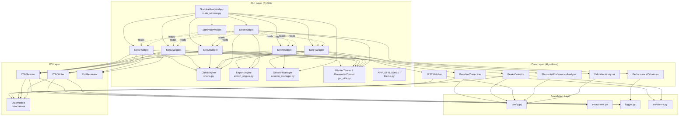
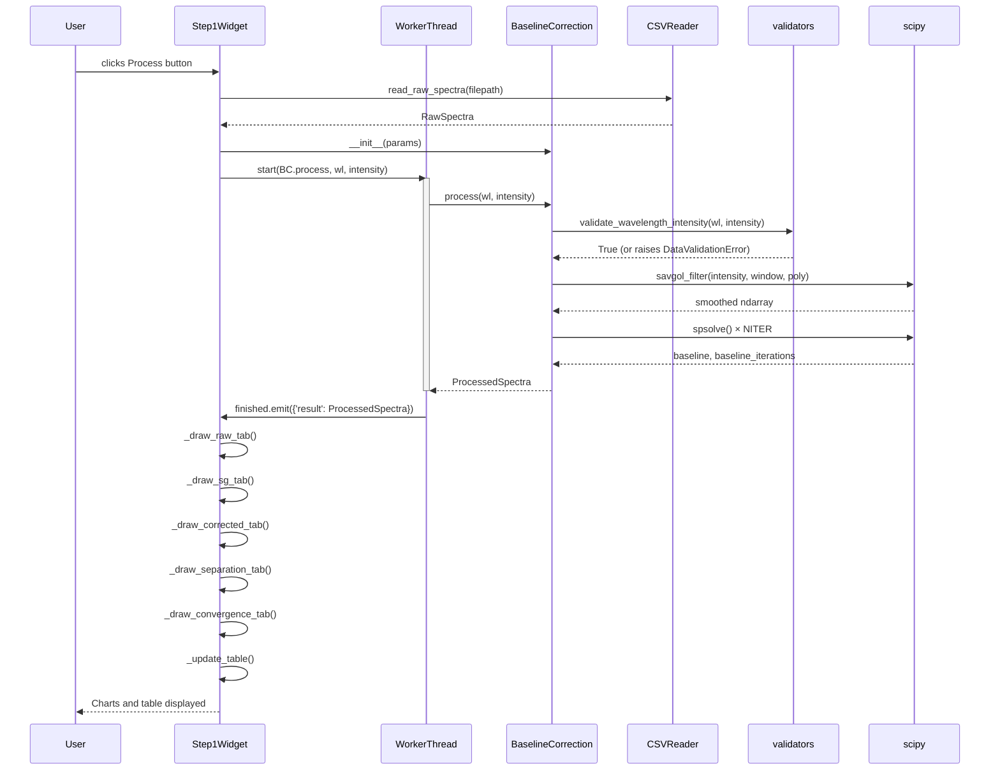
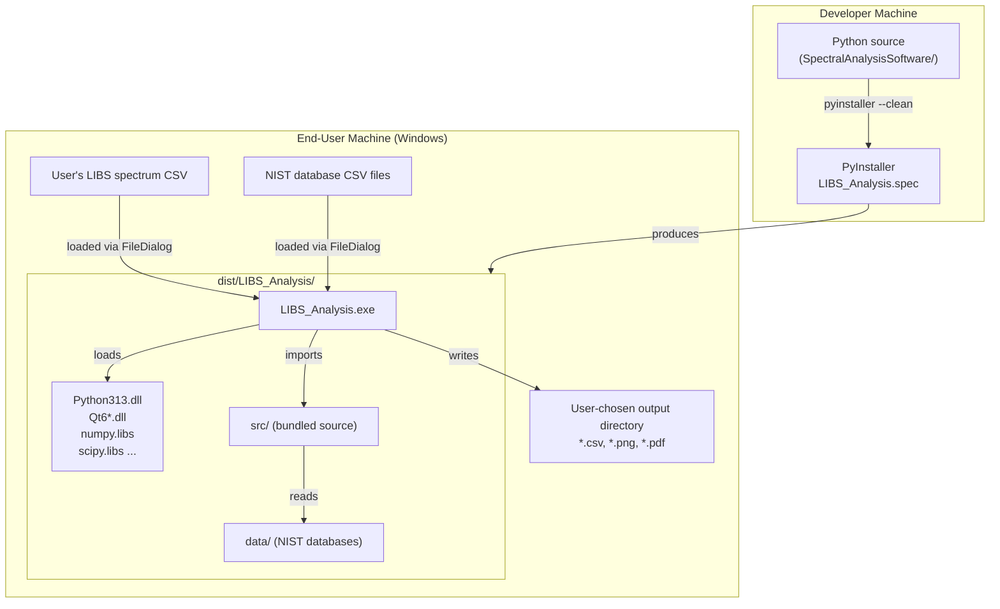

# LIBS Spectral Analysis Software — Complete Technical Documentation

> **Generated from full source code analysis.**
> Every statement below is derived directly from the implementation.
> Nothing has been invented; where code is ambiguous, that is stated explicitly.

---

## Table of Contents

1. [Executive Summary](#1-executive-summary)
2. [Project Overview](#2-project-overview)
3. [Complete System Architecture](#3-complete-system-architecture)
4. [Repository Structure](#4-repository-structure)
5. [Technology Stack](#5-technology-stack)
6. [Complete GUI Documentation](#6-complete-gui-documentation)
7. [Complete Application Workflow](#7-complete-application-workflow)
8. [Algorithms](#8-algorithms)
9. [Signal Processing Pipeline](#9-signal-processing-pipeline)
10. [Data Flow](#10-data-flow)
11. [Source Code Architecture](#11-source-code-architecture)
12. [Class Documentation](#12-class-documentation)
13. [Function Documentation](#13-function-documentation)
14. [Database Documentation](#14-database-documentation)
15. [Configuration](#15-configuration)
16. [Visualization Engine](#16-visualization-engine)
17. [Error Handling](#17-error-handling)
18. [Performance](#18-performance)
19. [Packaging](#19-packaging)
20. [Future Improvements](#20-future-improvements)
21. [Research Mapping](#21-research-mapping)
22. [UML Diagrams](#22-uml-diagrams)
23. [API Documentation](#23-api-documentation)
24. [Installation Guide](#24-installation-guide)
25. [User Manual](#25-user-manual)
26. [Developer Guide](#26-developer-guide)
27. [Code Quality Review](#27-code-quality-review)
28. [Appendix](#28-appendix)

---

---

## 1. Executive Summary

### Purpose of the Software

LIBS Spectral Analysis Software is a desktop scientific application for processing, analysing, and interpreting **Laser-Induced Breakdown Spectroscopy (LIBS)** data. It implements a structured six-step pipeline that takes a raw LIBS spectrum CSV file and produces element identifications, confidence rankings, validation coefficients, and model performance metrics.

### Main Objective

To automate and standardise the complete LIBS spectral analysis workflow — from raw signal denoising to quantitative element confirmation — in a reproducible, interactive, desktop GUI environment.

### Target Users

- Research scientists and laboratory technicians performing LIBS measurements
- Environmental chemists analysing soil, rock, water, or biological samples
- Material scientists characterising elemental composition of unknown samples
- Graduate students and researchers using LIBS as an analytical technique

### Research Motivation

Traditional LIBS analysis relies on manual inspection of spectra, often performed with generic tools (spreadsheets, MATLAB scripts). This software addresses the lack of a unified, reproducible workflow tool that combines denoising, peak detection, NIST database matching, competitive elemental scoring, reference-spectrum validation, and quantitative performance metrics within a single application.

### Main Features

- **Baseline Correction (Step 1):** Savitzky-Golay smoothing + Asymmetric Least Squares (ALS) iterative baseline estimation and subtraction.
- **Peak Detection (Step 2):** Adaptive noise-based thresholding with local baseline filtering using `scipy.signal.find_peaks`.
- **NIST Database Matching (Step 3):** Multi-file NIST CSV matching with flexible column auto-detection and a scoring formula based on Einstein A-coefficients.
- **Elemental Preference Analysis (Step 4):** Peak-wise element competition, win counting, total score aggregation, and primary element identification.
- **Reference Spectrum Validation (Step 5):** Line-by-line Pearson correlation between processed and pure reference spectra; VC tier classification.
- **Model Performance Metrics (Step 6):** Pipeline funnel counts, Accuracy, Precision, Recall, F1-Score, Signal-to-Background Ratio (SBR) improvement, and per-element confidence table.
- **Export Engine:** CSV, PNG, and PDF (reportlab) export for all analysis steps.
- **Session Persistence:** Automatic save/restore of step results across application launches.
- **Dark/Light Theme Toggle:** Full application theme switching with reactive chart updates.
- **Analysis Summary Dashboard:** Read-only aggregated view of all six steps.

---

---

## 2. Project Overview

### Why This Software Exists

LIBS produces high-resolution optical emission spectra where each elemental line appears as a narrow peak superimposed on a broad, non-uniform fluorescence background. Identifying which elements are present requires:

1. Removing the broad background (baseline correction)
2. Locating emission lines (peak detection)
3. Comparing detected lines to known NIST reference wavelengths
4. Resolving ambiguities when multiple elements share similar wavelengths
5. Confirming identifications against pure-element reference spectra
6. Reporting quantitative quality metrics

No single existing open-source tool implements all six stages in a unified GUI. Researchers currently piece together Python scripts, MATLAB toolboxes, and manual lookup tables, leading to non-reproducible workflows.

### What Problem It Solves

The software replaces the fragmented manual workflow with a single desktop application that:

- Accepts any CSV-format LIBS spectrum
- Applies scientifically validated denoising and background removal
- Performs automated peak finding with user-tunable sensitivity
- Queries one or more NIST element databases simultaneously
- Resolves peak ownership through a scoring competition
- Validates identifications by cross-correlating with pure-element reference spectra
- Computes quantitative pipeline performance metrics
- Exports publication-quality figures and structured result files

### Existing Workflow (Before This Software)

1. Export raw spectrum from spectrometer software as CSV
2. Open in Excel or MATLAB; manually subtract a visually estimated baseline
3. Visually identify peaks by eye or with a threshold
4. Cross-reference peak wavelengths against printed NIST tables
5. Document results in a separate spreadsheet
6. Repeat for every sample with no guaranteed consistency

### Problems in Traditional Workflow

- **Baseline subjectivity:** Manual baseline estimation varies between analysts
- **Threshold inconsistency:** No standard rule for what counts as a peak
- **NIST lookup errors:** Human error when matching wavelengths to a long table
- **No competition resolution:** When multiple elements match the same line, there is no systematic winner selection
- **No validation:** Identified elements are not confirmed against reference spectra
- **No metrics:** There is no way to quantify the quality of an identification result

### How This Software Improves the Process

| Aspect | Traditional | This Software |
|--------|------------|---------------|
| Baseline removal | Manual visual fit | ALS iterative algorithm (λ=1×10⁵, p=0.01, 10 iterations) |
| Peak detection | Visual + ad-hoc threshold | `scipy.signal.find_peaks` + noise-adaptive threshold |
| NIST matching | Manual lookup | Automated fuzzy match within ±0.2 nm tolerance |
| Ambiguity resolution | None | Peak-wise competition: score = (Aki × rel_int) / (Δλ + ε) |
| Identification validation | None | Pearson correlation against pure reference spectra |
| Quality metrics | None | Accuracy, Precision, Recall, F1-Score, SBR improvement |
| Reproducibility | Low | All parameters stored in `src/config.py`; session persisted |

---

---

## 3. Complete System Architecture

### High-Level Architecture

The application follows a **layered, pipeline-oriented architecture** with a strict separation between the processing core, the I/O layer, and the GUI presentation layer.

```
┌─────────────────────────────────────────────────────────────┐
│                      GUI Layer (PyQt6)                       │
│  MainWindow → Step1…6 Widgets → SummaryWidget               │
│  Charts (matplotlib embedded) │ ExportEngine │ SessionMgr   │
├─────────────────────────────────────────────────────────────┤
│                    Core Processing Layer                      │
│  Step1: BaselineCorrection   (SG + ALS)                      │
│  Step2: PeaksDetector        (find_peaks + filtering)        │
│  Step3: NISTMatcher          (scoring + tolerance match)     │
│  Step4: ElementalPreferences (competition + ranking)         │
│  Step5: ValidationAnalyzer   (Pearson correlation)           │
│  Step6: PerformanceCalculator(Acc/Prec/Recall/F1/SBR)        │
├─────────────────────────────────────────────────────────────┤
│                      I/O Layer                               │
│  CSVReader  │  CSVWriter  │  PlotGenerator  │  DataModels   │
├─────────────────────────────────────────────────────────────┤
│                   Foundation Layer (src/)                    │
│  config.py │ exceptions.py │ logger.py │ validators.py      │
└─────────────────────────────────────────────────────────────┘
```

### Layered Architecture

| Layer | Package | Responsibility |
|-------|---------|---------------|
| GUI | `src/gui/` | User interaction, parameter controls, visualisation, export |
| Core | `src/core/` | Scientific algorithms, signal processing, metrics |
| I/O | `src/io/` | File reading/writing, data model definitions |
| Foundation | `src/` root | Configuration, exceptions, logging, input validation |

### Module Interactions



### Data Flow (High Level)


---

## 4. Repository Structure

```
SpectralAnalysisSoftware/
│
├── gui_launcher.py          Entry point — adds src/ to sys.path, calls main_window.main()
├── LIBS_Analysis.spec       PyInstaller build specification for standalone EXE
├── requirements.txt         Python package dependencies with minimum versions
├── pytest.ini               Pytest configuration (test paths, markers, output)
├── conftest.py              Root-level pytest fixtures (QApplication session fixture)
│
├── src/                     ── Application source package ──
│   ├── __init__.py          Package initialiser; re-exports all config, logger,
│   │                        exceptions, and validators for one-line imports
│   ├── config.py            ALL tunable algorithm parameters (STEP1…5_PARAMS,
│   │                        OUTPUT_CONFIG, VALIDATION_CONFIG, LOGGING_CONFIG)
│   ├── exceptions.py        Custom exception hierarchy (SpectralAnalysisError …)
│   ├── logger.py            setup_logger() factory; dual file+console handlers
│   ├── validators.py        validate_wavelength_intensity(), validate_csv_columns()
│   ├── main.py              Minimal CLI entry point (informational only)
│   │
│   ├── core/                ── Algorithm modules ──
│   │   ├── __init__.py
│   │   ├── step1_sg_als.py          BaselineCorrection class
│   │   ├── step2_peaks.py           PeaksDetector class
│   │   ├── step3_nist_matching.py   NISTMatcher class
│   │   ├── step4_elemental_preferences.py  ElementalPreferencesAnalyzer + ElementalAnalysisError
│   │   ├── step5_validation.py      ValidationAnalyzer + ValidationError
│   │   └── step6_performance.py     PerformanceCalculator + TypedDicts
│   │
│   ├── gui/                 ── PyQt6 GUI package ──
│   │   ├── __init__.py
│   │   ├── main_window.py   SpectralAnalysisApp (QMainWindow), application entry
│   │   ├── theme.py         Full dark & light QSS stylesheets + palette constants
│   │   ├── charts.py        ChartEngine — all matplotlib rendering (stateless)
│   │   ├── export_engine.py ExportEngine — CSV/PNG/PDF export functions (stateless)
│   │   ├── session_manager.py  save/load_step2…5 via .session/ CSV files
│   │   ├── gui_utils.py     WorkerThread, ParameterControl, FileSelector, NotesPanel
│   │   ├── step1_widget.py  Step 1 UI: 5-tab chart + parameter controls + table
│   │   ├── step2_widget.py  Step 2 UI: scatter + table + parameter controls
│   │   ├── step3_widget.py  Step 3 UI: multi-NIST file list + 2 charts + table
│   │   ├── step4_widget.py  Step 4 UI: 2 charts + 3-tab results tables + export
│   │   ├── step5_widget.py  Step 5 UI: VC histogram + overlay grid + table + PDF
│   │   ├── step6_widget.py  Step 6 UI: 4 charts + summary table + export
│   │   └── summary_widget.py  Analysis Summary dashboard (read-only)
│   │
│   ├── io/                  ── I/O layer ──
│   │   ├── __init__.py
│   │   ├── data_models.py   RawSpectra, ProcessedSpectra, DetectedPeak, NISTMatch dataclasses
│   │   ├── file_reader.py   CSVReader with delimiter/column auto-detection
│   │   └── file_writer.py   CSVWriter + PlotGenerator (publication-quality PNG)
│   │
│   └── utils/               ── Utilities (currently stub) ──
│       └── __init__.py
│
├── tests/                   ── Test suite ──
│   ├── __init__.py
│   ├── conftest.py          Test fixtures: sample spectra, CSV files, QApplication
│   ├── test_core.py         Unit tests for Steps 1–5 algorithms
│   ├── test_io.py           Unit tests for CSVReader, CSVWriter, PlotGenerator
│   ├── test_integration.py  End-to-end pipeline tests
│   ├── test_step4_step5_bugs_exploration.py  Regression tests for known bugs
│   ├── test_step4_step5_preservation.py      Data-preservation property tests
│   ├── test_step6_performance.py             Step 6 metrics correctness tests
│   ├── test_step6_charts.py                  Chart rendering smoke tests
│   ├── test_step6_widget.py                  Step 6 widget interaction tests
│   └── test_export_step6.py                  CSV/PNG/PDF export correctness tests
│
├── data/
│   ├── nist_databases/      NIST reference CSVs (e.g. NIST-Ca.csv)
│   ├── sample_inputs/       Sample raw LIBS spectra (soil3-unprocessed.csv)
│   └── sample_outputs/      Pre-generated output images for documentation
│
├── docs/                    Developer documentation
├── .session/                Auto-generated session persistence CSVs
├── dist/LIBS_Analysis/      PyInstaller output: LIBS_Analysis.exe + DLLs
└── build/                   PyInstaller intermediate build artefacts
```

### Key File Responsibilities

| File | Primary Responsibility |
|------|----------------------|
| `gui_launcher.py` | Only entry point for the GUI; path manipulation and delegation to `main_window.main()` |
| `src/config.py` | Single source of truth for all numeric parameters; edit here to change algorithm behaviour |
| `src/exceptions.py` | All custom exceptions; inherit from `SpectralAnalysisError` for unified catching |
| `src/core/step6_performance.py` | The most complex module; contains three TypedDicts and a fully defensive compute method |
| `src/gui/charts.py` | Stateless chart rendering; every method is `@staticmethod`; theme-aware via `get_chart_*()` |
| `src/gui/export_engine.py` | Stateless export; all functions are module-level; `generate_pdf_report` uses reportlab |
| `src/gui/session_manager.py` | Persists step results to `.session/*.csv` files; all functions are silent on failure |
| `src/io/data_models.py` | Type-safe `@dataclass` definitions; no behaviour, only data |

---

---

## 5. Technology Stack

### Programming Language

**Python 3.13** (inferred from `__pycache__` filenames: `cpython-313.pyc`). No version specifier is set in `requirements.txt` beyond package minimums.

### Frameworks & Libraries

| Library | Version Constraint | Role | Where Used |
|---------|-------------------|------|-----------|
| **PyQt6** | ≥ 6.3.0 | Desktop GUI framework | All `src/gui/` modules |
| **NumPy** | ≥ 1.21.0 | Numerical arrays, float64 precision | All core algorithms |
| **SciPy** | ≥ 1.7.0 | Signal processing, sparse linear algebra | Steps 1 & 2 |
| **pandas** | ≥ 1.3.0 | DataFrame manipulation, CSV I/O | Steps 3–6, I/O layer |
| **matplotlib** | ≥ 3.4.0 | Scientific visualisation embedded in Qt | All chart widgets |
| **pytest** | ≥ 6.2.0 | Test framework | `tests/` |
| **pytest-cov** | ≥ 2.12.0 | Coverage reporting | CI / development |
| **reportlab** | Not pinned (optional) | PDF report generation | `export_engine.py` |
| **PyInstaller** | Not in requirements | Standalone EXE packaging | `LIBS_Analysis.spec` |
| **hypothesis** | Present (`.hypothesis/`) | Property-based testing | `tests/test_step4_step5_preservation.py` |

### Detailed Dependency Explanations

#### PyQt6
- **Why:** Python bindings for Qt6; provides cross-platform native desktop UI with `QMainWindow`, `QTabWidget`, `QSplitter`, thread-safe worker signals.
- **What:** Provides all widgets, the event loop (`QApplication.exec()`), and Qt Stylesheet (QSS) theming.
- **Where:** `src/gui/main_window.py` (application entry), every `*_widget.py` file, `gui_utils.py`.

#### NumPy
- **Why:** Required for vectorised operations on spectral arrays (typically 1,000–100,000 elements).
- **What:** Float64 arrays, `np.array`, `np.diff`, `np.std`, `np.percentile`, sparse matrix construction, `np.clip`.
- **Where:** `step1_sg_als.py` (ALS matrix operations), `step2_peaks.py` (noise estimation), `step6_performance.py` (SBR computation).

#### SciPy
- **Why:** Provides the two core algorithms not available in NumPy: Savitzky-Golay filter and sparse least-squares solver.
- **What:**
  - `scipy.signal.savgol_filter` — Step 1 smoothing
  - `scipy.signal.find_peaks` — Step 2 peak detection
  - `scipy.sparse.diags`, `scipy.sparse.linalg.spsolve` — Step 1 ALS sparse system
  - `scipy.interpolate.interp1d` — Step 5 reference spectrum interpolation
- **Where:** `step1_sg_als.py`, `step2_peaks.py`, `step5_validation.py`.

#### pandas
- **Why:** All NIST databases, matching results, competition tables, and validation results are naturally tabular.
- **What:** `read_csv`, `DataFrame.pivot_table`, `DataFrame.groupby`, `pd.to_numeric`, `DataFrame.to_csv`.
- **Where:** `step3_nist_matching.py`, `step4_elemental_preferences.py`, `step5_validation.py`, `step6_performance.py`, all I/O modules, `session_manager.py`.

#### matplotlib
- **Why:** Scientific-grade 2D plots embedded inside PyQt6 widgets via `matplotlib.backends.backend_qtagg`.
- **What:** `Figure`, `FigureCanvasQTAgg`, `NavigationToolbar2QT`, line plots, scatter plots, bar charts, heatmaps (`imshow`), histograms.
- **Where:** All `*_widget.py` files (embedded canvases), `charts.py` (rendering logic), `file_writer.py` (exported PNG generation).

#### reportlab *(optional)*
- **Why:** Python's standard library has no PDF generation capability; reportlab is the de-facto choice.
- **What:** `SimpleDocTemplate`, `Paragraph`, `Table`, `Image` — generates the multi-section LIBS Validation Report PDF.
- **Where:** `export_engine.py::generate_pdf_report`. Guarded by `try/except ImportError` with a helpful message.

#### PyInstaller
- **Why:** Packages the application + all dependencies into a standalone folder (`.exe` + DLLs) that runs without a Python installation.
- **What:** `Analysis`, `EXE`, `COLLECT` objects; collects scipy/matplotlib/PyQt6 data files and hidden imports.
- **Where:** `LIBS_Analysis.spec`. Build command: `pyinstaller LIBS_Analysis.spec --clean`.

#### hypothesis
- **Why:** Property-based testing generates random inputs automatically to find edge cases in algorithmic code.
- **What:** Generates arbitrary spectra and matching DataFrames for Steps 4 & 5.
- **Where:** `tests/test_step4_step5_preservation.py` (inferred from `.hypothesis/` directory and test file name).

---

---

## 6. Complete GUI Documentation

The GUI is a `QMainWindow` containing a `QTabWidget` with seven tabs. A shared `NotesPanel` (application log) is docked below all tabs. A theme-toggle button lives in the permanent area of the status bar.

### Application Window

- **Title:** `"Spectral Analysis Software  |  5-Step LIBS Pipeline"`
- **Default size:** 1440 × 900 px
- **Initial theme:** Dark (palette defined in `theme.py`)
- **Font:** Segoe UI 10 pt
- **Status bar:** Shows current tab name; permanent widget = theme toggle button

### Tab Structure

| Index | Label | Widget Class |
|-------|-------|-------------|
| 0 | `① Step 1: Baseline Correction` | `Step1Widget` |
| 1 | `② Step 2: Peak Detection` | `Step2Widget` |
| 2 | `③ Step 3: Element Identification` | `Step3Widget` |
| 3 | `④ Step 4: Elemental Preferences` | `Step4Widget` |
| 4 | `⑤ Step 5: Validation` | `Step5Widget` |
| 5 | `⑥ Step 6: Model Performance` | `Step6Widget` |
| 6 | `📊 Analysis Summary` | `SummaryWidget` |

When the user switches to tab 5 (Step 6), `refresh_if_not_cleared()` is called automatically. When the user switches to tab 6 (Summary), the same method on `SummaryWidget` is called.

---

### Screen 1 — Step 1: Baseline Correction (`Step1Widget`)

**Purpose:** Load a raw LIBS spectrum CSV, apply Savitzky-Golay smoothing followed by ALS baseline correction, and inspect/export the result.

**Left Panel (scrollable, max 370 px):**

| Widget | Type | Description |
|--------|------|-------------|
| Title | `QLabel` | "Step 1: SG-ALS Baseline Correction" |
| Instructions | `QLabel` | 7-point usage guide with warning about Step 2 requirement |
| File Selector | `FileSelector` | Click-to-open dialog for raw spectrum CSV |
| Lambda (λ) | `ParameterControl` | Range: 1,000–1,000,000; default: 100,000; slider + spinbox |
| Asymmetry (p) | `ParameterControl` | Range: 0.001–0.1; default: 0.01; 4 decimal places |
| Iterations | `ParameterControl` | Range: 1–50; default: 10; integer |
| SG Window | `ParameterControl` | Range: 3–21; default: 7; odd integer |
| SG Poly Order | `ParameterControl` | Range: 1–5; default: 3 |
| Process Button | `QPushButton` | Primary action; launches `WorkerThread` with `BaselineCorrection.process()` |
| Save Results | `QPushButton` | Disabled until processing succeeds; saves CSV + PNG |
| Info Label | `QLabel` | Shows point count and corrected intensity range after processing |

**Right Panel (5-tab chart widget + data table):**

| Tab | Content |
|-----|---------|
| Raw Spectrum | Raw intensity vs. wavelength (amber line) |
| SG Smoothed | Raw (faded) + SG smoothed (blue) overlay |
| Corrected Spectrum | Baseline-subtracted result (teal) only |
| Baseline Separation | All four signals with auto-computed vertical offset |
| ALS Convergence | `imshow` heatmap of baseline_iterations matrix + 4 overlay curves |

Below the chart tabs: a 5-column `QTableWidget` preview of the first 10 data rows (Wavelength, Raw, Smoothed_SG, Baseline_ALS, Corrected).

**Events:**
- File selection → sets `file_selector.filepath`
- Process clicked → reads file, spawns WorkerThread, draws all 5 tabs on finish
- Save clicked → opens `QFileDialog.getExistingDirectory`, writes timestamped CSV + PNG

**Save Output:** `SG_ALS_LIBS_processed_{timestamp}.csv` + `SG_ALS_LIBS_processed_{timestamp}.png`

---

### Screen 2 — Step 2: Peak Detection (`Step2Widget`)

**Purpose:** Load a processed spectrum (preferably Step 1 output), detect emission peaks, and export detected-peaks CSV for use in Step 3.

**Left Panel:**

| Widget | Type | Description |
|--------|------|-------------|
| File Selector | `FileSelector` | Accepts Step 1 corrected CSV or raw CSV |
| Height Multiplier | `ParameterControl` | Range: 0.5–5.0; default: 1.2 |
| Prominence | `ParameterControl` | Range: 0.001–0.5; default: 0.01 |
| Baseline Window | `ParameterControl` | Range: 5–100; default: 20 |
| Baseline K | `ParameterControl` | Range: 0.5–5.0; default: 2.0 |
| Reset to Defaults | `QPushButton` | Restores all four parameters to `STEP2_PARAMS` values |
| Detect Peaks | `QPushButton` | Primary action |
| Save Results | `QPushButton` | Enabled after detection |

**Right Panel:**
- Single matplotlib canvas: spectrum (blue) + peak markers (amber ×)
- `NavigationToolbar2QT` for zoom/pan
- 2-column table: Wavelength (nm), Intensity (first 10 rows)

**Column Detection Logic:** Reads the CSV manually; prefers a `Corrected` column (Step 1 output), falls back to `Intensity`, `Signal`, or `Counts`.

**Save Output:** `detected_peaks_{timestamp}.csv` + `detected_peaks_{timestamp}.png`

**Session persistence:** Calls `save_step2(peaks)` on successful detection; restores on application launch.

---

### Screen 3 — Step 3: NIST Element Identification (`Step3Widget`)

**Purpose:** Match detected peaks against one or more NIST CSV databases to identify which elements each peak likely corresponds to.

**Left Panel:**

| Widget | Type | Description |
|--------|------|-------------|
| Detected Peaks File | `FileSelector` | Peaks CSV from Step 2 |
| NIST Database List | `QListWidget` | Shows queued NIST files (max height 90 px) |
| Add File(s)… | `QPushButton` | Multi-file dialog; deduplicates |
| Remove Selected | `QPushButton` | Removes highlighted items from list |
| Clear All | `QPushButton` | Clears all NIST files |
| Count Label | `QLabel` | "N files queued" or "No NIST files loaded" |
| Tolerance (nm) | `ParameterControl` | Range: 0.01–1.0; default: 0.2 |
| Min Score | `ParameterControl` | Range: 0–10,000,000,000; default: 0 |
| Match Peaks | `QPushButton` | Primary action |
| Save Results | `QPushButton` | Enabled after matching |
| Show matched only | `QCheckBox` | Filters table to matched peaks only |

**Right Panel (vertical splitter):**
- Top: 2 side-by-side charts
  - Element Frequency chart (`ChartEngine.render_element_frequency_chart`)
  - Match Score scatter (`ChartEngine.render_match_score_scatter`)
- Bottom: 7-column results table (Observed, Matched, Delta, Element, Aki, Rel. Int., Score)

**Multi-DB Behaviour:** When >1 NIST file is loaded, uses `match_multiple_databases()`; save creates one CSV per database with element name in filename.

**Session persistence:** `save_step3(matches)` / `load_step3()` via `.session/step3_matches.csv`.

---

### Screen 4 — Step 4: Elemental Preferences (`Step4Widget`)

**Purpose:** Load multiple NIST matching result CSVs (from Step 3, one per element), perform peak-wise competition to determine which element wins each spectral line, rank elements by win count and total score.

**Left Panel:**

| Widget | Type | Description |
|--------|------|-------------|
| Summary Banner | `QLabel` | Shows primary element + element/peak counts after analysis |
| Primary Element | `QLabel` | Large 15 pt teal label showing winning element name |
| Files Label | `QLabel` | "N file(s): name1, name2 …" |
| Add Files… | `QPushButton` | Multi-file CSV dialog |
| Clear | `QPushButton` | Resets file list |
| Analyze Competition | `QPushButton` | Primary action; launches `WorkerThread` |
| Save Results | `QPushButton` | Saves ranking/competition/winners CSVs |
| Export CSV | `QPushButton` | Uses `export_step4_csv()` |
| Export PNG | `QPushButton` | Uses `export_step4_png()` |
| Progress Bar | `QProgressBar` | Indeterminate; shown during analysis |

**Right Panel (vertical splitter):**
- Top: 2 side-by-side charts
  - Ranking chart: `ChartEngine.render_ranking_chart` (horizontal bar, wins)
  - Score scatter: `ChartEngine.render_score_scatter` (wavelength vs. score, log Y)
- Bottom: 3-tab `QTabWidget`
  - **Element Ranking:** 5-column (Rank, Element, Wins, Total Score, Avg Score)
  - **Peak Competition:** 4-column (Wavelength, Winner, Max Score, Competitors)
  - **Winner Lines:** 5-column (Element, Observed nm, NIST nm, Confidence, Competitors)

**Session persistence:** `save_step4` / `load_step4` via multiple `.session/step4_*.csv` files.

---

### Screen 5 — Step 5: Validation (`Step5Widget`)

**Purpose:** Validate element identifications by computing Pearson correlation between the processed spectrum and a pure-element reference spectrum at each identified emission line.

**Left Panel:**

| Widget | Type | Description |
|--------|------|-------------|
| Summary Banner | `QLabel` | Mean VC, tier counts after validation |
| Mean VC Label | `QLabel` | Large VC value coloured by tier |
| Processed Spectrum | `FileSelector` | Step 1 corrected CSV |
| Reference Spectrum | `FileSelector` | Pure-element reference CSV |
| Window (nm) | `QDoubleSpinBox` | ±window around each line; default 0.5 nm |
| Min Points | `QSpinBox` | Minimum data points per region; default 5 |
| VC Threshold | `QDoubleSpinBox` | "Good" threshold; default 0.8 |
| Load from File… | `QPushButton` | Load wavelengths from CSV/TXT |
| Enter Manually… | `QPushButton` | `QInputDialog.getMultiLineText` |
| Validate Spectrum | `QPushButton` | Primary action |
| Save Report | `QPushButton` | Saves PDF via reportlab |
| Export CSV/PNG/PDF | 3 × `QPushButton` | Individual export formats |
| Progress Bar | `QProgressBar` | Indeterminate during validation |

**Right Panel (vertical splitter):**
- Top: 2-tab chart widget
  - **VC Histogram:** `ChartEngine.render_vc_histogram` with tier colouring + wavelength annotations inside bars
  - **Spectral Overlays:** paginated 3×3 grid of processed vs. reference overlays per validated line; tier filter checkboxes (Excellent/Good/Moderate/Weak/Failed); Prev/Next pagination
- Bottom: 4-column results table (Wavelength nm, VC, Status, Quality tier — colour-coded)

**Overlay Features:** Each subplot shows processed (blue) and reference (dashed teal) spectra after normalization; title includes VC value and tier label in tier colour.

**Session persistence:** `save_step5` / `load_step5` via `.session/step5_validation.csv`.

---

### Screen 6 — Step 6: Model Performance (`Step6Widget`)

**Purpose:** Aggregate all upstream step results to compute pipeline stage counts, classification metrics (Accuracy, Precision, Recall, F1), SBR improvement, and a per-element summary table.

**Left Panel:**

| Widget | Type | Description |
|--------|------|-------------|
| Summary Banner | `QLabel` | "Acc: X% Prec: X% Rec: X% F1: X% | Elements: N" |
| Compute Metrics | `QPushButton` | Primary action; auto-triggered on tab-switch |
| Reload Data | `QPushButton` | Re-reads upstream tabs and recomputes |
| Clear | `QPushButton` | Resets charts and table; suppresses auto-refresh |
| Export CSV/PNG/PDF | 3 × `QPushButton` | Enabled after successful computation |
| Info Label | `QLabel` | Status messages |
| Progress Bar | `QProgressBar` | Indeterminate during computation |

**Right Panel (vertical splitter):**
- Top: 4-tab chart widget
  - **Ranking (Fig 7):** `render_element_ranking_fig7` — horizontal bars coloured by High/Medium/Low confidence tier
  - **Pipeline (Fig 11):** `render_pipeline_funnel` — 5-stage funnel with peak counts
  - **Heatmap (Fig 12):** `render_correlation_heatmap` — peaks × elements RdYlGn heatmap; full figure clear before each render to remove orphaned colorbar axes
  - **Metrics (Fig 14):** `render_performance_metrics` — dual-axis bar chart (Acc/Prec/Rec/F1 on left, SBR on right)
- Bottom: 8-column colour-coded summary table per element:
  - Element | Confidence Tier | Status | Matched Lines | Mean VC | Avg Δλ | Avg Score | Best Lines

**Auto-refresh logic:** `refresh_if_not_cleared()` is called on tab-switch. If `_cleared == True` (user clicked Clear), auto-refresh is suppressed until the next explicit Compute or Reload.

---

### Screen 7 — Analysis Summary (`SummaryWidget`)

**Purpose:** Read-only consolidated dashboard showing key metrics and mini-charts from all five steps.

**Layout:** Scrollable `QWidget` with sections:
1. Title row + Reload / Clear buttons
2. **Key Metrics** — 4 stat cards: Detected Peaks, Identified Elements, Primary Element, Mean VC
3. **① Baseline Correction** — mini corrected spectrum chart + stats label
4. **② Peak Detection** — intensity distribution histogram + top-10 peaks table
5. **③ Element Identification** — element frequency chart + match score scatter
6. **④ Elemental Preferences** — ranking chart + scatter + top-5 ranking table
7. **⑤ Validation** — full-width VC histogram + VC results table
8. **Conclusions** — auto-generated RichText paragraph from all step results

All charts are `(5, 2.8)` inch figures at 90 DPI with dark theme. Charts show placeholder text if the corresponding step has not been run.

---

### Shared GUI Components

#### `NotesPanel` (docked below tabs)
- Real-time application log (all Python `logging` output)
- Uses `_QtLogHandler` (a thread-safe `logging.Handler`) with a `_LogBridge` QObject to marshal log records from worker threads to the GUI thread via `pyqtSignal`
- Clear and Copy All buttons
- Maximum height 150 px

#### `WorkerThread` (from `gui_utils.py`)
- Subclass of `QThread`; executes any `callable(*args, **kwargs)` in a background thread
- Emits: `started`, `progress(str)`, `finished(dict)`, `error(str)`
- Result stored in `self.result` (not only in the signal) so callers can inspect it in `_on_*_finished`

#### `ParameterControl` (from `gui_utils.py`)
- Composed of `QDoubleSpinBox` + `QSlider` (0–1000 integer range mapped to float domain)
- Bidirectional sync: slider ↔ spinbox via blocked signals
- `value()` and `set_value(v)` public API

#### `FileSelector` (from `gui_utils.py`)
- `QWidget` that opens a file dialog on `mousePressEvent`
- Displays filename in italic/grey when empty, green bold when loaded

---

---

## 7. Complete Application Workflow

### From Application Launch to Exit



### Step-by-Step User Interaction Sequence

1. **Launch** → `gui_launcher.py` adds `src/` to `sys.path`, calls `main_window.main()`
2. **QApplication** is created, `APP_STYLESHEET` (dark QSS) applied, Segoe UI 10 pt font set
3. **`SpectralAnalysisApp.__init__`** creates all seven step widgets, assembles tabs, creates `NotesPanel`, adds theme button to status bar
4. **`_restore_session()`** silently loads `.session/*.csv` and restores `detected_peaks`, `matches`, `analysis_results`, `validation_results` into the corresponding step widgets
5. **User selects Step 1 tab** → file dialog → parameter adjustment → Process button:
   - `CSVReader.read_raw_spectra()` loads the file (auto-detects delimiter, wavelength/intensity columns)
   - `BaselineCorrection.process()` runs in a `WorkerThread` (non-blocking)
   - On finish: 5 chart tabs drawn, table populated, save button enabled
6. **User selects Step 2 tab** → loads Step 1 output CSV → Detect Peaks:
   - Reads CSV, prefers `Corrected` column
   - `PeaksDetector.detect_peaks()` in WorkerThread
   - Results saved to session
7. **User selects Step 3 tab** → loads peaks CSV + 1+ NIST CSVs → Match Peaks:
   - Reads peaks and all NIST databases
   - If 1 DB: `match_peaks()`; if >1: `match_multiple_databases()`
   - Table + 2 charts updated; session saved
8. **User selects Step 4 tab** → loads Step 3 result CSVs (one per element) → Analyze:
   - `ElementalPreferencesAnalyzer.analyze()` in WorkerThread
   - 3 result tables + 2 charts updated; primary element shown; session saved
9. **User selects Step 5 tab** → loads Step 1 output + pure-element reference + wavelengths → Validate:
   - `ValidationAnalyzer.validate_line()` for each wavelength in WorkerThread
   - VC histogram + paginated overlay grid updated; table colour-coded; session saved
10. **User switches to Step 6 tab** → auto-triggers compute:
    - `PerformanceCalculator.compute()` reads data from all step widgets
    - 4 charts rendered; summary table populated; export buttons enabled
11. **User switches to Summary tab** → auto-triggers refresh:
    - Mini-charts drawn from live step widget data; conclusions text generated
12. **Export at any step** → user picks directory → CSV/PNG/PDF written
13. **Theme toggle** → QSS switched; `apply_theme()` called on each step widget

---

---

## 8. Algorithms

### Algorithm 1: Savitzky-Golay Smoothing (Step 1)

**Purpose:** Remove high-frequency noise from the raw LIBS spectrum while preserving peak shapes (position and amplitude).

**Mathematical Intuition:**  
SG smoothing fits a polynomial of degree `d` to a sliding window of `w` points using least-squares, replacing each point with the polynomial's evaluated value. Because peaks are smooth local maxima, the polynomial fit preserves their shape better than a simple moving average.

**Implementation:**
```python
# src/core/step1_sg_als.py — BaselineCorrection.apply_sg_smoothing()
smoothed = savgol_filter(intensity, self.sg_window, self.sg_poly)
# sg_window=7, sg_poly=3 by default (from config.py)
```

**Parameters (from `STEP1_PARAMS`):**

| Parameter | Default | Effect |
|-----------|---------|--------|
| `WINDOW` | 7 | Window width in data points; must be odd; larger = more smoothing |
| `POLY` | 3 | Polynomial degree; lower = more smoothing, higher = better peak preservation |

**Input:** Raw intensity array (float64, N points)  
**Output:** Smoothed intensity array (float64, same N points)  
**Complexity:** O(N × W) per filter application  
**Advantages:** Preserves peak height and width better than simple averaging  
**Limitations:** Requires W > POLY; can distort peaks narrower than the window  

---

### Algorithm 2: Asymmetric Least Squares (ALS) Baseline Correction (Step 1)

**Purpose:** Estimate and subtract the broad fluorescence background from the SG-smoothed spectrum, leaving only emission peaks above zero.

**Mathematical Intuition:**  
ALS finds a smooth curve `z` that lies below the data `y`. The asymmetry is achieved by weighting residuals asymmetrically: residuals where `y > z` get weight `p` (small), and residuals where `y < z` get weight `1-p` (large). The smoothness is enforced by a second-order difference penalty `λ`.

**The iterative system solved at each iteration:**

```
Minimise: Σ wᵢ(yᵢ - zᵢ)² + λ · Σ (Δ²z)²
```

where `Δ²` is the second-order difference operator. This is equivalent to solving:

```
(W + λ D^T D) z = W y
```

where `W = diag(w)` and `D` is the second-order difference matrix.

**Implementation:**
```python
# src/core/step1_sg_als.py — BaselineCorrection.apply_als()
L = len(smoothed_intensity)
D = sparse.diags([1., -2., 1.], [0, -1, -2], shape=(L, L-2), dtype=np.float64, format='csc')
w = np.ones(L, dtype=np.float64)
for i in range(self.n_iter):
    W = sparse.diags(w, 0, dtype=np.float64, format='csc')
    Z = W + self.lambda_ * D.dot(D.T)
    z = spsolve(Z, w * smoothed_intensity)         # sparse solve
    w = self.p * (smoothed_intensity > z) + (1 - self.p) * (smoothed_intensity < z)
```

**Parameters:**

| Parameter | Default | Effect |
|-----------|---------|--------|
| `LAMBDA` | 1×10⁵ | Smoothness; higher = flatter baseline; typical range 10²–10⁷ |
| `P` | 0.01 | Asymmetry; lower means the baseline is pushed more aggressively below peaks |
| `NITER` | 10 | Iteration count; 5–10 is typically sufficient for convergence |

**Input:** Smoothed intensity array (float64, N points)  
**Output:** Tuple of (final baseline array, list of per-iteration baseline arrays)  
**Complexity:** O(N × NITER) for sparse solve; sparse matrix construction O(N)  
**Advantages:** Handles variable baseline without prior knowledge of peak locations  
**Limitations:** λ and p must be manually tuned per instrument/sample type; can fail for very spiky spectra if p is too low  

---

### Algorithm 3: Adaptive Peak Detection (Step 2)

**Purpose:** Automatically locate emission line positions in the baseline-corrected spectrum.

**Procedure:**
1. Estimate noise level from the first 10% of the spectrum: `noise_level = std(intensity[:N//10])`
2. Set height threshold: `height_threshold = HEIGHT_MULTIPLIER × noise_level`
3. Run `scipy.signal.find_peaks(intensity, height=height_threshold, prominence=PROMINENCE)`
4. Apply local baseline filter: for each candidate peak, extract a window of ±BASELINE_WINDOW points, compute local `median + BASELINE_K × std`, discard the peak if its intensity does not exceed this threshold

**Implementation (key section):**
```python
# src/core/step2_peaks.py — PeaksDetector.detect_peaks()
noise_level = np.std(intensity[:int(len(intensity) * 0.1)])
height_threshold = self.height_mult * noise_level
peaks, properties = find_peaks(intensity, height=height_threshold, prominence=self.prominence)
peaks_filtered = self.remove_baseline_peaks(intensity, peaks)
```

**Parameters:**

| Parameter | Default | Effect |
|-----------|---------|--------|
| `HEIGHT_MULTIPLIER` | 1.2 | Threshold = 1.2 × noise; lower detects more peaks (including false positives) |
| `PROMINENCE` | 0.01 | Minimum height above local baseline; small value = sensitive detection |
| `BASELINE_WINDOW` | 20 | Points on each side for local noise window |
| `BASELINE_K` | 2 | Sigma multiplier; 2 corresponds to ~95% noise exclusion |

**Input:** Wavelength array, corrected intensity array  
**Output:** `List[DetectedPeak]` sorted by wavelength  
**Complexity:** O(N log N) for `find_peaks` internals; O(N × P) for baseline filter (P = peaks found)  
**Advantages:** No manual threshold needed; adapts to per-spectrum noise level  
**Limitations:** Noise estimate from the first 10% can be inaccurate if that region contains real peaks  

---

### Algorithm 4: NIST Matching and Scoring (Step 3)

**Purpose:** Identify the most probable element for each detected peak by matching against NIST spectral line databases.

**Scoring Formula:**

```
Score = (Aki × relative_intensity) / (Δλ + 1×10⁻⁶)
```

Where:
- `Aki` = Einstein A-coefficient (spontaneous emission rate, s⁻¹); enforces physical significance (must be ≥ 1×10⁶)
- `relative_intensity` = NIST tabulated line intensity (must be > 0)
- `Δλ` = `|observed_wavelength - NIST_wavelength|` in nm
- `1×10⁻⁶` = epsilon to prevent division by zero for exact matches

**Implementation:**
```python
# src/core/step3_nist_matching.py — NISTMatcher.calculate_score()
if aki < 1e6 or rel_int <= 0:
    return 0
return (aki * rel_int) / (delta + 1e-6)
```

**Matching Procedure:**
1. For each detected peak, find all NIST entries where `|NIST_wl - peak_wl| ≤ TOLERANCE`
2. Score all candidates
3. Select the candidate with the highest score as the best match
4. If best score < `MIN_SCORE_THRESHOLD`, the peak is marked unidentified

**Parameters:**

| Parameter | Default | Effect |
|-----------|---------|--------|
| `TOLERANCE` | 0.2 nm | Wider window = more candidates; 0.2 nm is typical for medium-resolution LIBS |
| `MIN_SCORE_THRESHOLD` | 0 | Set higher to exclude low-confidence matches |

**Input:** `List[DetectedPeak]`, standardised NIST `pd.DataFrame`  
**Output:** `List[NISTMatch]` (one per detected peak)  
**Complexity:** O(P × D) where P = peaks, D = NIST entries (vectorised with pandas boolean indexing)  
**Advantages:** Score naturally weights physically stronger lines (higher Aki) and closer matches (smaller Δλ)  
**Limitations:** Score is relative; absolute value depends on database units; lines with Aki < 1×10⁶ are silently excluded  

---

### Algorithm 5: Peak-wise Elemental Competition (Step 4)

**Purpose:** Resolve ambiguity when multiple elements match the same spectral line by declaring a single winner per line.

**Procedure:**
1. Combine all per-element matching CSVs into a single DataFrame
2. Pivot: `rows = unique matched wavelengths`, `columns = elements`, `values = max Score`
3. For each row: `Winner = argmax(score across elements)`; `Num_Competitors = count(score > 0)`
4. Count wins per element; compute total score per element
5. Sort by wins (descending) → primary element = element with most wins

**Implementation:**
```python
# src/core/step4_elemental_preferences.py — ElementalPreferencesAnalyzer.analyze_peak_competition()
pivot = combined_data.pivot_table(
    index="Matched_WL", columns="Element", values="Score", aggfunc="max"
).fillna(0)
pivot["Winner"] = pivot.idxmax(axis=1)
pivot["Max_Score"] = pivot.max(axis=1)
pivot["Num_Competitors"] = (pivot.drop(columns=["Max_Score","Winner"]) > 0).sum(axis=1)
```

**Input:** Combined matching DataFrame with columns `Matched_WL`, `Element`, `Score`  
**Output:** `competition` DataFrame + `ranking` DataFrame + `winner_lines` DataFrame + `primary_element` str  
**Complexity:** O(P × E) for pivot; O(E log E) for ranking sort (P = peaks, E = elements)  

---

### Algorithm 6: Spectral Validation by Pearson Correlation (Step 5)

**Purpose:** Confirm that the processed spectrum around each identified emission line actually resembles a pure-element reference, providing a quantitative confidence score.

**Validation Coefficient (VC) Formula:**

```
VC = Σ[(pᵢ - p̄)(rᵢ - r̄)] / sqrt[Σ(pᵢ - p̄)² × Σ(rᵢ - r̄)²]
```

Where `p` = normalised processed intensities in the ±WINDOW region, `r` = normalised interpolated reference intensities at the same wavelengths.

**Procedure per line:**
1. Extract ±`WINDOW` nm region from processed spectrum (≥ `MIN_POINTS` required)
2. Interpolate reference spectrum to the processed wavelength grid (`interp1d`, default linear)
3. Normalise both to unit max amplitude
4. Compute Pearson correlation coefficient
5. Clamp result to [−1, 1]

**VC Tier Classification (from `ChartEngine.classify_vc`):**

| Tier | VC Range | Meaning |
|------|----------|---------|
| Excellent | VC ≥ 0.90 | Very strong spectral match |
| Good | 0.70 ≤ VC < 0.90 | Confirmed identification |
| Moderate | 0.50 ≤ VC < 0.70 | Probable identification |
| Weak | VC < 0.50 | Uncertain; may be background artefact |
| Failed | NaN | Insufficient data points in region |

**Implementation key section:**
```python
# src/core/step5_validation.py — ValidationAnalyzer.validate_line()
interp_func = interp1d(r_wl, r_int, kind=self.interp_kind, fill_value="extrapolate")
r_int_interp = interp_func(p_wl)
p_int_norm = p_int / np.max(np.abs(p_int))
r_int_norm = r_int_interp / np.max(np.abs(r_int_interp))
vc = self.validation_coefficient(p_int_norm, r_int_norm)
```

**Parameters:**

| Parameter | Default | Effect |
|-----------|---------|--------|
| `WINDOW` | 0.5 nm | Spectral region size; too small = few points; too large = includes other lines |
| `MIN_POINTS` | 5 | Guard against sparse spectra |
| `INTERPOLATION_KIND` | `'linear'` | `'cubic'` gives smoother interpolation but can overshoot |
| `VC_THRESHOLD` | 0.8 | Display threshold in GUI (does not affect computation) |

---

### Algorithm 7: Model Performance Metrics (Step 6)

**Purpose:** Quantify the quality of the entire analysis pipeline using four independent metrics computed at different levels of granularity.

**Four Metric Definitions:**

| Metric | Formula | Level | Denominator Meaning |
|--------|---------|-------|-------------------|
| **Accuracy** | `elements_confirmed / elements_ranked` | Element | Fraction of ranked elements with ≥1 validated line (VC ≥ 0.50) |
| **Precision** | `stage4_validated / stage2_nist_matched` | Line | Fraction of NIST-matched lines that pass VC ≥ 0.50 |
| **Recall** | `stage5_confirmed / stage3_ranked` | Line | Fraction of ranked-eligible lines that reach VC ≥ 0.70 |
| **F1-Score** | `2 × Precision × Recall / (Precision + Recall)` | Line | Harmonic mean of Precision and Recall |

**Pipeline Stage Counts:**

| Stage | Count Definition |
|-------|----------------|
| Stage 1: Detected | `len(detected_peaks)` from Step 2 |
| Stage 2: NIST Matched | Number of unique detected-peak wavelengths with ≥1 NIST match |
| Stage 3: Element Ranked | Peaks whose matched element appears in the Step 4 ranking |
| Stage 4: Validated (VC ≥ 0.50) | Lines in Step 5 results with VC ≥ 0.50 |
| Stage 5: Confirmed (VC ≥ 0.70) | Lines in Step 5 results with VC ≥ 0.70 |

**SBR Improvement:**
```
SBR = mean(peak_intensities) / mean(background_intensities)
```
Peak pixels are identified by matching validated peak wavelengths (±0.1 nm) against the Step 1 corrected spectrum. Background pixels are all other points.

**Confidence Tier (from `_classify_confidence_tier`):**

| Tier | Wins Threshold |
|------|---------------|
| High | wins ≥ 10 |
| Medium | 3 ≤ wins ≤ 9 |
| Low | wins < 3 |

**Fallback Logic:** When wavelength-based element confirmation fails (no tolerance matches between Step 5 wavelengths and Step 3 match wavelengths), the code falls back to confirming the top-N ranked elements proportional to the number of validated lines with VC ≥ 0.50. This prevents 0% Accuracy when real validation data exists.

---

---

## 9. Signal Processing Pipeline

```mermaid
flowchart TD
    A["📁 Raw CSV File\nWavelength nm + Intensity counts"] --> B

    subgraph S1["Step 1: Baseline Correction"]
        B["CSVReader.read_raw_spectra()\nAuto-detect delimiter & columns"]
        B --> C["validate_wavelength_intensity()\nNaN/Inf, monotonicity, range"]
        C --> D["savgol_filter(intensity, window=7, poly=3)\nSavitzky-Golay Smoothing"]
        D --> E["ALS Iterative Loop × 10\n(W + λ D^T D) z = W y\nUpdate weights asymmetrically"]
        E --> F["corrected = smoothed_sg - baseline_als\nProcessedSpectra dataclass"]
    end

    subgraph S2["Step 2: Peak Detection"]
        F --> G["Noise estimation\nnoise = std(intensity[:N/10])"]
        G --> H["scipy.signal.find_peaks()\nheight = 1.2 × noise\nprominence = 0.01"]
        H --> I["Local baseline filtering\nFor each peak: intensity[p] > median ± 2σ in window"]
        I --> J["List[DetectedPeak]\nsorted by wavelength"]
    end

    subgraph S3["Step 3: NIST Matching"]
        J --> K["Load NIST CSV(s)\nAuto-detect Wavelength/Element/Aki/rel_int columns"]
        K --> L["For each peak:\nFind NIST entries within ±0.2 nm"]
        L --> M["Score = Aki × rel_int / Δλ + ε\nfor each candidate\nAki ≥ 1e6 required"]
        M --> N["Best-match selection\nElement = argmax score\nList[NISTMatch]"]
    end

    subgraph S4["Step 4: Elemental Competition"]
        N --> O["Combine multiple element DataFrames\nFilter score > 0"]
        O --> P["pivot_table\nrows=wavelengths, cols=elements\nvalues=max score"]
        P --> Q["Winner = idxmax per row\nRanking: sort by Wins desc\nPrimary element identified"]
    end

    subgraph S5["Step 5: Validation"]
        Q --> R["For each target wavelength:\nExtract ±0.5 nm region from processed"]
        R --> S["Interpolate reference spectrum\nto processed wavelength grid"]
        S --> T["Normalise both to unit max\nPearson correlation VC = Σ(p-p̄)(r-r̄)/..."]
        T --> U["VC DataFrame\nWavelength_nm | Validation_Coefficient | Status"]
    end

    subgraph S6["Step 6: Performance"]
        U --> V["Stage counts: s1…s5\nElements ranked/confirmed"]
        V --> W["Accuracy = confirmed/ranked\nPrecision = s4/s2\nRecall = s5/s3\nF1 = harmonic mean"]
        W --> X["SBR = mean peaks / mean background\nHeatmap matrix (peaks × elements)\nPer-element rows"]
        X --> Y["PerformanceResults TypedDict\n4 charts + summary table"]
    end

    Y --> Z["📊 Export\nCSV + PNG + PDF"]
```



---

## 10. Data Flow

### Input Transformation Chain

| Stage | Object | Type | Key Fields |
|-------|--------|------|-----------|
| File | Raw CSV | disk file | columns: Wavelength, Intensity |
| After reading | `RawSpectra` | dataclass | `wavelength: ndarray`, `intensity: ndarray` |
| After Step 1 | `ProcessedSpectra` | dataclass | + `smoothed_sg`, `baseline_als`, `corrected`, `baseline_iterations` |
| After Step 2 | `List[DetectedPeak]` | list of dataclasses | `wavelength: float`, `intensity: float` |
| After Step 3 | `List[NISTMatch]` | list of dataclasses | + `matched_wl`, `delta`, `aki`, `score`, `element` |
| After Step 4 | `dict` | Python dict | `ranking` df, `competition` df, `winner_lines` df, `primary_element` str |
| After Step 5 | `pd.DataFrame` | DataFrame | `Wavelength_nm`, `Validation_Coefficient`, `Status` |
| After Step 6 | `PerformanceResults` | TypedDict | `accuracy`, `precision`, `recall`, `f1_score`, `sbr_improvement`, `element_rows`, `pipeline_stages`, `heatmap_matrix` |

### Intermediate Objects

| Object | Created In | Consumed By |
|--------|-----------|-------------|
| `RawSpectra` | `CSVReader.read_raw_spectra()` | `BaselineCorrection.process()` |
| `ProcessedSpectra` | `BaselineCorrection.process()` | `Step1Widget` (display), `Step2Widget` (peak detection), `Step6Widget` (SBR) |
| `List[DetectedPeak]` | `PeaksDetector.detect_peaks()` | `NISTMatcher.match_peaks()`, `Step6Widget` (stage counts) |
| `List[NISTMatch]` | `NISTMatcher.match_peaks()` | `Step3Widget` (display), `PerformanceCalculator` (heatmap, stage counts) |
| NIST `pd.DataFrame` | `CSVReader.read_nist_database()` | `NISTMatcher.match_peaks()` |
| Per-element match CSVs | `CSVWriter.write_nist_matches()` | `Step4Widget` (re-read from disk) |
| Competition pivot | `analyze_peak_competition()` | `analyze_element_ranking()`, `extract_winner_lines()` |
| `.session/*.csv` | `session_manager.save_*()` | `session_manager.load_*()` on next launch |

### Export Objects

| Export | Format | Contains | Created By |
|--------|--------|---------|-----------|
| `SG_ALS_LIBS_processed.csv` | CSV | Wavelength, Raw, Smoothed_SG, Baseline_ALS, Corrected | `CSVWriter.write_processed_spectra()` |
| `SG_ALS_LIBS_processed.png` | PNG 600 DPI | Baseline separation + ALS convergence | `PlotGenerator.plot_step1_baseline()` |
| `detected_peaks.csv` | CSV | Wavelength(nm), Intensity | `CSVWriter.write_detected_peaks()` |
| `detected_peaks.png` | PNG 600 DPI | Spectrum + peak markers | `PlotGenerator.plot_step2_peaks()` |
| `LIBS_matching_results.csv` | CSV | Observed_WL, Matched_WL, Delta, Aki, rel_int, Score, Element | `CSVWriter.write_nist_matches()` |
| `analysis_ranking.csv` | CSV | Element ranking table | `export_step4_csv()` |
| `analysis_competition.csv` | CSV | Peak competition pivot | `export_step4_csv()` |
| `analysis_winners.csv` | CSV | Winner lines per peak | `export_step4_csv()` |
| `ranking_chart.png` | PNG 150 DPI | Horizontal bar chart | `export_step4_png()` |
| `score_scatter.png` | PNG 150 DPI | Wavelength vs. score scatter | `export_step4_png()` |
| `vc_histogram.png` | PNG 150 DPI | VC tier histogram | `export_step5_png()` |
| `validation_report.pdf` | PDF | Full 8-section report | `generate_pdf_report()` |
| `step6_summary.csv` | CSV | Per-element metrics | `export_step6_csv()` |
| `step6_charts.png` | PNG 150 DPI | 2×2 composite of 4 Step 6 charts | `export_step6_png()` |

---

---

## 11. Source Code Architecture

### Package Overview

```
src/
├── (root)     Foundation: config, exceptions, logger, validators, __init__
├── core/      Algorithm classes (Steps 1–6); no GUI dependencies
├── gui/       PyQt6 widgets + chart/export/session utilities
└── io/        Dataclasses + CSV reader/writer + PNG generator
```

### Core Package — Class Hierarchy

```mermaid
classDiagram
    class BaselineCorrection {
        +lambda_: float
        +p: float
        +n_iter: int
        +sg_window: int
        +sg_poly: int
        +validate_input(wl, int) bool
        +apply_sg_smoothing(intensity) ndarray
        +apply_als(smoothed) Tuple
        +process(wl, intensity) ProcessedSpectra
    }

    class PeaksDetector {
        +height_mult: float
        +prominence: float
        +baseline_window: int
        +baseline_k: float
        +validate_input(wl, int) bool
        +calculate_noise_level(intensity) float
        +remove_baseline_peaks(intensity, peaks) ndarray
        +detect_peaks(wl, intensity) List~DetectedPeak~
    }

    class NISTMatcher {
        +tolerance: float
        +min_score: float
        +detect_column_names(df) dict$
        +calculate_score(aki, rel_int, delta) float$
        +match_peaks(peaks, nist_df) List~NISTMatch~
        +match_multiple_databases(peaks, dfs) DataFrame
    }

    class ElementalPreferencesAnalyzer {
        +min_score: float
        +validate_input(df) bool
        +detect_column_names(df) DataFrame$
        +combine_matches(dfs) DataFrame
        +analyze_peak_competition(df) DataFrame
        +analyze_element_ranking(df, comp) Tuple
        +extract_winner_lines(comp) DataFrame
        +analyze(dfs) Dict
    }

    class ElementalAnalysisError {
    }
    ProcessingError <|-- ElementalAnalysisError

    class ValidationAnalyzer {
        +window: float
        +min_points: int
        +interp_kind: str
        +validate_input(proc, ref) bool
        +normalize_spectrum_columns(df) DataFrame$
        +validation_coefficient(p, r) float$
        +extract_region(spectrum, wl) Tuple
        +validate_line(proc, ref, wl) Dict
        +validate_spectrum(proc, ref, lines) DataFrame
        +validate_batch(proc, refs, lines) Dict
    }

    class ValidationError {
    }
    ProcessingError <|-- ValidationError

    class PerformanceCalculator {
        +compute(peaks, matches, analysis, validation, processed) PerformanceResults
        -_classify_confidence_tier(wins) str
        -_compute_stage_counts(peaks, matches, analysis, validation) dict
        -_compute_metrics(stage_counts, n_elem, avg_lines) dict
        -_compute_sbr(wls, peaks, processed) float
        -_build_heatmap(validation, matches) Tuple
        -_build_element_rows(ranking, validation, matches) List
    }
```



### GUI Package — Inheritance and Composition

All step widgets inherit from `QWidget`. They are composed together in `SpectralAnalysisApp (QMainWindow)`.



### Utility Module Responsibilities

| Module | Role |
|--------|------|
| `charts.py::ChartEngine` | Stateless rendering — all `@staticmethod`; theme-aware via `get_chart_*()` accessors |
| `export_engine.py` | Module-level stateless functions; PNG via `save_figure_png`, PDF via reportlab |
| `session_manager.py` | Save/load each step's result to `.session/*.csv`; all failures are logged silently |
| `gui_utils.py::WorkerThread` | Background execution of any callable; result stored on `self.result` |
| `gui_utils.py::NotesPanel` | Qt-safe logging handler that marshals log records from worker threads to GUI |
| `theme.py` | QSS strings + palette constants + `get_chart_*()` theme-aware accessors |

---

---

## 12. Class Documentation

### `BaselineCorrection` (`src/core/step1_sg_als.py`)

**Purpose:** Encapsulates the two-stage baseline correction pipeline (SG smoothing → ALS) for a single spectrum.

**Constructor:** `__init__(config: dict = None)`  
Reads `LAMBDA`, `P`, `NITER`, `WINDOW`, `POLY` from `config` (defaults to `STEP1_PARAMS`). Stores as instance attributes. Logs initialisation parameters at INFO level.

**Attributes:**

| Attribute | Type | Default | Source |
|-----------|------|---------|--------|
| `lambda_` | `float` | 1×10⁵ | `config['LAMBDA']` |
| `p` | `float` | 0.01 | `config['P']` |
| `n_iter` | `int` | 10 | `config['NITER']` |
| `sg_window` | `int` | 7 | `config['WINDOW']` |
| `sg_poly` | `int` | 3 | `config['POLY']` |

**Key Methods:**
- `validate_input(wl, intensity)` → calls `validate_wavelength_intensity()`; raises `DataValidationError`
- `apply_sg_smoothing(intensity)` → `savgol_filter`; returns float64 array
- `apply_als(smoothed_intensity)` → sparse iterative solve; returns `(baseline, baseline_iterations_list)`; raises `ProcessingError`
- `process(wl, intensity)` → validates, smooths, corrects; returns `ProcessedSpectra`

**Relationships:** Instantiated by `Step1Widget._on_process_clicked()`. Uses `validate_wavelength_intensity()` from `src/validators.py`. Returns `ProcessedSpectra` from `src/io/data_models.py`.

**Lifecycle:** Instantiated fresh for each processing operation (parameters can change between runs).

---

### `PeaksDetector` (`src/core/step2_peaks.py`)

**Purpose:** Implements the adaptive thresholding peak detection pipeline.

**Constructor:** `__init__(config: dict = None)` — reads `HEIGHT_MULTIPLIER`, `PROMINENCE`, `BASELINE_WINDOW`, `BASELINE_K`.

**Key Methods:**
- `calculate_noise_level(intensity)` → `np.std(intensity[:N//10])`; returns float
- `remove_baseline_peaks(intensity, peaks)` → local median + k×std filter; returns filtered peak indices
- `detect_peaks(wl, intensity)` → full pipeline; returns `List[DetectedPeak]` sorted by wavelength; raises `ProcessingError`

**Lifecycle:** Instantiated by `Step2Widget._on_process_clicked()` with current GUI parameters.

---

### `NISTMatcher` (`src/core/step3_nist_matching.py`)

**Purpose:** Matches a list of detected peaks against a standardised NIST database DataFrame using the scoring formula.

**Static Methods:**
- `detect_column_names(df)` → inspects column names case-insensitively; returns `{'wavelength_col', 'element_col', 'aki_col', 'rel_int_col'}` dict
- `calculate_score(aki, rel_int, delta)` → returns 0 if `aki < 1e6` or `rel_int <= 0`, else `(aki × rel_int) / (delta + 1e-6)`

**Key Methods:**
- `match_peaks(peaks, nist_df)` → requires pre-standardised DataFrame with columns `Wavelength`, `Element`, `Aki`, `relative_intensity`; returns `List[NISTMatch]`
- `match_multiple_databases(peaks, nist_dfs)` → chains `match_peaks()` across multiple DataFrames, returns combined `pd.DataFrame`

**Note:** `match_peaks` expects the DataFrame to already have standardised column names (`Wavelength`, `Element`, `Aki`, `relative_intensity`). `CSVReader.read_nist_database()` produces this standardised format.

---

### `ElementalPreferencesAnalyzer` (`src/core/step4_elemental_preferences.py`)

**Purpose:** Combines multiple element-specific NIST matching result DataFrames and resolves which element owns each spectral line through competitive scoring.

**Static Methods:**
- `detect_column_names(df)` → normalises column names; renames variants to `Observed_WL`, `Matched_WL`, `Score`, `Element`

**Key Methods:**
- `combine_matches(dfs)` → filters each DataFrame to `Score > min_score`, concatenates; raises `ElementalAnalysisError` if empty
- `analyze_peak_competition(combined_df)` → pivot table returning winner + competitors per wavelength
- `analyze_element_ranking(combined_df, competition_df)` → wins count + total/avg score; returns `(summary_df, primary_element_str)`
- `extract_winner_lines(competition_df)` → reformats with `Winning_Element`, `Observed_Wavelength`, `NIST_Matched_Wavelength`, `Confidence_Score`, `Num_Competitors`
- `analyze(dfs)` → full pipeline returning dict with all four results

**Inner Exception:** `ElementalAnalysisError(ProcessingError)` defined at module bottom.

---

### `ValidationAnalyzer` (`src/core/step5_validation.py`)

**Purpose:** Computes Pearson correlation between the processed spectrum and a reference spectrum around each target emission line.

**Static Methods:**
- `normalize_spectrum_columns(df)` → detects wavelength + intensity columns; returns normalised DataFrame
- `validation_coefficient(processed, reference)` → pure Pearson correlation; handles length mismatch (truncates), zero variance (returns NaN), <2 points (returns NaN), clamps to [−1, 1]

**Key Methods:**
- `extract_region(spectrum, center_wl)` → returns `(wl_array, intensity_array)` within ±`self.window`; raises `ValidationError` if `< self.min_points`
- `validate_line(processed, reference, line_wl)` → interpolates reference to processed grid, normalises, computes VC; returns dict with arrays for overlay plotting
- `validate_spectrum(processed, reference, target_lines)` → calls `validate_line` per line; returns summary DataFrame
- `validate_batch(processed, ref_dict, lines_dict)` → batch processing for multiple elements

---

### `PerformanceCalculator` (`src/core/step6_performance.py`)

**Purpose:** Stateless class that computes all Step 6 metrics from the outputs of Steps 1–5.

**Public Method:** `compute(detected_peaks, matches, analysis_results, validation_results, processed_data)` → returns `PerformanceResults` TypedDict.

The `compute` method is fully defensive: all internal helpers are wrapped in `try/except`, so it never raises an unhandled exception regardless of upstream data state. Missing steps are reported in `missing_steps` list.

**Private Helpers:**
- `_classify_confidence_tier(wins)` → `"High"` / `"Medium"` / `"Low"` by wins count
- `_compute_stage_counts(...)` → derives five stage counts from actual upstream data; includes fallback element-confirmation logic
- `_compute_metrics(stage_counts, n_elements, avg_lines)` → computes Accuracy/Precision/Recall/F1 with separate denominators; all results clamped to [0, 1]
- `_compute_sbr(validated_wls, peaks, processed_data)` → vectorised ±0.1 nm peak matching against processed spectrum
- `_build_heatmap(validation_results, matches)` → builds `np.ndarray(n_peaks × n_elements)`; fills with VC values via tolerance-based wavelength matching
- `_build_element_rows(ranking_df, validation_results, matches)` → builds `List[ElementRow]` with mean VC, avg delta, avg score, best lines

**TypedDicts (data models within this module):**
- `PipelineStages`: stage1_detected … stage5_confirmed + elements_ranked + elements_confirmed
- `ElementRow`: element, confidence_tier, matched_lines, mean_vc, avg_delta, avg_score, best_lines
- `PerformanceResults`: all metrics + heatmap + labels + ranking_df + missing_steps

---

### `ChartEngine` (`src/gui/charts.py`)

**Purpose:** Stateless rendering of all scientific charts. All methods are `@staticmethod` operating on existing `Axes` objects passed from widgets.

**Style Helpers:**
- `apply_dark_style(fig, ax)` → applies current theme colours from `get_chart_*()` to figure patch, axes, ticks, spine colours, grid
- `get_bar_colours(n)` → cycles `ACCENT_CYCLE = [blue, teal, amber, red]`
- `classify_vc(vc)` → returns `(tier_label, bg_hex, fg_hex)` for a VC value

**Step 3 Charts:**
- `render_element_frequency_chart(ax, matches)` → horizontal bar chart of peak count per identified element
- `render_match_score_scatter(ax, matches)` → scatter of observed wavelength vs. match score coloured by element

**Step 4 Charts:**
- `render_ranking_chart(ax, ranking_df)` → horizontal bar with wins count
- `render_score_scatter(ax, winner_lines_df)` → log-Y scatter; marker size encodes `Num_Competitors`

**Step 5 Charts:**
- `render_vc_histogram(ax, validation_df)` → 4-bin histogram by VC tier; wavelength lists annotated inside bars

**Step 6 Charts:**
- `render_element_ranking_fig7(ax, ranking_df)` → confidence-tier coloured horizontal bars
- `render_pipeline_funnel(ax, stage_counts_dict)` → 5-stage horizontal funnel
- `render_correlation_heatmap(ax, matrix, peak_labels, element_labels)` → `imshow` with RdYlGn colormap; cell annotations; symmetric ±v_max colour range
- `render_performance_metrics(ax, metrics_dict, ax2)` → dual-axis: Acc/Prec/Rec/F1 bars on left axis, SBR on right axis

**Placeholder:** `_show_placeholder(ax, message)` — draws centred text on cleared axes.

---

---

## 13. Function Documentation

### `validate_wavelength_intensity(wavelength, intensity)` (`src/validators.py`)

**Purpose:** Central input validation for all spectral data entering core algorithms.

**Parameters:**
- `wavelength: np.ndarray` — wavelength values in nm
- `intensity: np.ndarray` — intensity values

**Checks (in order):**
1. Both must be `np.ndarray` instances
2. Lengths must match
3. `len ≥ VALIDATION_CONFIG['MIN_DATA_POINTS']` (default: 100)
4. No NaN or Inf in either array
5. `wavelength` must be monotonically increasing (`np.all(np.diff(wl) > 0)`)
6. `wavelength.min() ≥ 100 nm`, `wavelength.max() ≤ 2000 nm`
7. `intensity.min() ≥ -1×10⁶`, `intensity.max() ≤ 1×10⁶`

**Returns:** `True` if all checks pass  
**Raises:** `DataValidationError` with a descriptive message for the first failing check

---

### `setup_logger(name: str)` (`src/logger.py`)

**Purpose:** Creates or retrieves a named logger with both file and console handlers.

**Parameters:** `name: str` — typically `__name__` of the calling module

**Behaviour:**
- If `logger.handlers` is non-empty (logger already configured), returns existing logger immediately to prevent duplicate handlers
- Creates `FileHandler` writing to `spectral_analysis.log` in the working directory
- Creates `StreamHandler` writing to stdout
- Log format: `[YYYY-MM-DD HH:MM:SS,mmm] [LEVEL] module.path: message`
- Log level from `LOGGING_CONFIG['LOG_LEVEL']` (default: `'INFO'`)

**Returns:** `logging.Logger` instance

---

### `CSVReader.read_nist_database(filepath: str)` (`src/io/file_reader.py`)

**Purpose:** Reads a NIST spectral line database CSV and returns a standardised DataFrame.

**Parameters:** `filepath: str` — path to NIST CSV file

**Column Detection (case-insensitive):**
- Wavelength: `['wavelength', 'wl', 'wavelength (nm)', 'wave']` → mapped to `'Wavelength'`
- Element: `['element', 'element_symbol', 'ion']` → mapped to `'Element'`; defaults to `'Unknown'`
- Aki: `['aki', 'intensity', 'strength', 'transition']` → mapped to `'Aki'`; defaults to `1.0`
- Relative intensity: `['relative_intensity', 'rel_int', 'rel intensity']` → mapped to `'relative_intensity'`; defaults to `1.0`

**Returns:** `pd.DataFrame` with columns `['Wavelength', 'Element', 'Aki', 'relative_intensity']`; rows with NaN wavelength are dropped  
**Raises:** `FileIOError` if file not found or unreadable; `ColumnDetectionError` if no wavelength column found

---

### `generate_pdf_report(...)` (`src/gui/export_engine.py`)

**Purpose:** Generates a multi-section PDF LIBS validation report using reportlab.

**Parameters:**
- `validation_results_df: pd.DataFrame` — Step 5 results
- `params: dict` — WINDOW, MIN_POINTS, VC_THRESHOLD
- `vc_fig: Figure` — pre-rendered VC histogram
- `processed_filename, reference_filename: str` — input file names for cover page
- `target_wavelengths: list[float]` — validated line list
- `filepath: Path` — output PDF path
- `step4_results: dict | None` — optional Step 4 data (adds top-5 ranking table + chart)
- `ranking_fig: Figure | None` — optional pre-rendered ranking chart
- `step6_metrics: dict | None` — optional Step 6 metrics (adds global metrics + pipeline + per-element tables)

**PDF Structure:**
1. Cover page — title, timestamp, input filenames
2. Analysis Parameters table
3. Results Summary table (tier counts, avg VC)
4. Detailed Results table (per-wavelength VC + tier)
5. VC Histogram image (rendered to BytesIO buffer)
6. Target Wavelengths list
7. (Optional) Step 4 Summary — top-5 elements table + ranking chart image
8. (Optional) Step 6 Metrics — global metrics + pipeline stages + per-element summary

**Returns:** `Path` of written PDF  
**Raises:** `ImportError` (reportlab not installed), `OSError` (write failure), partial file deleted on any exception

---

### `save_step4(analysis_results: dict)` / `load_step4()` (`src/gui/session_manager.py`)

**Purpose:** Persist and restore Step 4 analysis results across application sessions.

**Save:** Writes four files to `.session/`:
- `step4_ranking.csv` — Element ranking DataFrame
- `step4_competition.csv` — Peak competition DataFrame
- `step4_winners.csv` — Winner lines DataFrame
- `step4_primary.txt` — Primary element string

**Load:** Reads all four files; returns dict with keys `ranking`, `competition`, `winner_lines`, `primary_element`, `combined_data` (alias for competition). Returns `None` if ranking file does not exist or is empty.

**Error Handling:** All exceptions are caught and logged; `None` returned on failure.

---

---

## 14. Database Documentation

The application does not use a SQL database. All persistent data is stored as **CSV files** in two locations:

### NIST Reference Databases (`data/nist_databases/`)

**Format:** CSV files, one per element.

**Confirmed file:** `data/nist_databases/NIST-Ca.csv` (Calcium reference lines)

**Expected columns (flexible, auto-detected):**

| Column Variant | Standardised As | Description |
|---------------|----------------|-------------|
| `wavelength`, `wl`, `wavelength (nm)` | `Wavelength` | Line wavelength in nm (required) |
| `element`, `element_symbol`, `ion` | `Element` | Element symbol (e.g. `'Ca'`) |
| `aki`, `intensity`, `strength` | `Aki` | Einstein A-coefficient (s⁻¹); should be ≥ 1×10⁶ for scoring |
| `relative_intensity`, `rel_int` | `relative_intensity` | Tabulated line intensity |

**Usage:** Multiple NIST files can be loaded simultaneously in Step 3. Each file typically represents one element. The file is read once per matching operation by `CSVReader.read_nist_database()`.

### Session Persistence Store (`.session/`)

Auto-created on first successful step completion. Files are silently ignored on load failure.

| File | Contents | Key Columns |
|------|---------|-------------|
| `.session/step2_peaks.csv` | Detected peaks from Step 2 | `wavelength`, `intensity` |
| `.session/step3_matches.csv` | NIST matches from Step 3 | `observed_wl`, `matched_wl`, `delta`, `aki`, `relative_intensity`, `score`, `element` |
| `.session/step4_ranking.csv` | Element ranking from Step 4 | `Element`, `Wins`, `Total_Score`, `Avg_Score` |
| `.session/step4_competition.csv` | Peak competition from Step 4 | `Matched_WL`, `Element columns`, `Winner`, `Max_Score`, `Num_Competitors` |
| `.session/step4_winners.csv` | Winner lines from Step 4 | `Winning_Element`, `Observed_Wavelength`, `NIST_Matched_Wavelength`, `Confidence_Score`, `Num_Competitors` |
| `.session/step4_primary.txt` | Primary element string | plain text |
| `.session/step5_validation.csv` | Validation results from Step 5 | `Wavelength_nm`, `Validation_Coefficient`, `Status` |

### Sample Data (`data/sample_inputs/`)

**`soil3-unprocessed.csv`:** Real LIBS spectrum from a soil sample. Expected column structure: `Wavelength` (nm) + `Intensity` (or `Signal`/`Counts`). Used for integration testing and documentation examples.

---

## 15. Configuration

### `src/config.py` — Complete Parameter Reference

All algorithm parameters are centralised in `src/config.py`. No algorithm contains hardcoded defaults beyond the config keys.

#### Step 1 Parameters (`STEP1_PARAMS`)

```python
STEP1_PARAMS = {
    'LAMBDA': 1e5,              # ALS smoothness (larger = flatter baseline)
    'P': 0.01,                  # ALS asymmetry (lower = pushes baseline below peaks)
    'NITER': 10,                # ALS iterations (5–10 typically sufficient)
    'WINDOW': 7,                # SG filter window (must be odd; > POLY)
    'POLY': 3,                  # SG polynomial degree
    'OFFSET': 4000,             # Vertical offset for baseline separation plot only
    'PEAK_REGION': (548, 555),  # Visualisation region (not used in algorithm)
    'BACKGROUND_REGION': (560, 610),  # Background region (not used in algorithm)
}
```

#### Step 2 Parameters (`STEP2_PARAMS`)

```python
STEP2_PARAMS = {
    'HEIGHT_MULTIPLIER': 1.2,   # Threshold = multiplier × noise_std
    'PROMINENCE': 0.01,         # scipy.signal.find_peaks prominence parameter
    'BASELINE_WINDOW': 20,      # Points on each side for local noise estimation
    'BASELINE_K': 2,            # Sigma multiplier for local threshold
}
```

#### Step 3 Parameters (`STEP3_PARAMS`)

```python
STEP3_PARAMS = {
    'TOLERANCE': 0.2,           # Wavelength match window ±nm
    'MIN_SCORE_THRESHOLD': 0,   # Score below which match is not reported
}
```

#### Step 4 Parameters (`STEP4_PARAMS`)

```python
STEP4_PARAMS = {
    'MIN_SCORE': 0,             # Minimum score to include in competition analysis
    'CONFIDENCE_THRESHOLD': 0.5, # Informational only; not used in algorithm
}
```

#### Step 5 Parameters (`STEP5_PARAMS`)

```python
STEP5_PARAMS = {
    'WINDOW': 0.5,              # ±nm region around each validated line
    'MIN_POINTS': 5,            # Minimum data points required per region
    'INTERPOLATION_KIND': 'linear',  # scipy.interpolate.interp1d kind
    'VC_THRESHOLD': 0.8,        # Used only for GUI display colouring
}
```

#### Output Configuration (`OUTPUT_CONFIG`)

```python
OUTPUT_CONFIG = {
    'CSV_PRECISION': 12,        # Significant figures in CSV output
    'PLOT_DPI': 600,            # Resolution for saved PNG files
    'PLOT_FORMAT': 'png',       # Output format (only 'png' currently used)
}
```

#### Validation Ranges (`VALIDATION_CONFIG`)

```python
VALIDATION_CONFIG = {
    'MIN_DATA_POINTS': 100,
    'MIN_WAVELENGTH': 100,      # nm
    'MAX_WAVELENGTH': 2000,     # nm
    'MIN_INTENSITY': -1e6,
    'MAX_INTENSITY': 1e6,
}
```

#### Logging Configuration (`LOGGING_CONFIG`)

```python
LOGGING_CONFIG = {
    'LOG_LEVEL': 'INFO',
    'LOG_FILE': 'spectral_analysis.log',
    'LOG_FORMAT': '[%(asctime)s] [%(levelname)s] %(name)s: %(message)s',
}
```

### Runtime Options

There are no command-line arguments or environment variables. All configuration is through `src/config.py` (developer-level) or the GUI parameter controls (user-level at runtime, not persisted between sessions).

---

---

## 16. Visualization Engine

### Architecture

The visualisation engine consists of three cooperating components:

1. **Embedded matplotlib canvases** — each step widget contains one or more `FigureCanvasQTAgg` objects embedded in `QWidget` layouts. Each canvas is paired with a `NavigationToolbar2QT` for zoom/pan/save.

2. **`ChartEngine` (`src/gui/charts.py`)** — stateless rendering class with `@staticmethod` methods. Receives existing `Axes` objects, clears and re-draws them. Theme-aware: reads colours from `get_chart_bg()`, `get_chart_axes_bg()`, `get_chart_text()`, `get_chart_text2()`, `get_chart_border()` which switch between dark/light values.

3. **`PlotGenerator` (`src/io/file_writer.py`)** — generates standalone PNG files (600 DPI default) for export. Contains its own hardcoded dark palette (copies theme constants for export consistency).

### Chart Catalogue

| Chart | Method | Step | Type | Key Features |
|-------|--------|------|------|-------------|
| Raw Spectrum | `_draw_raw_tab` | 1 | Line | Amber colour |
| SG Smoothed | `_draw_sg_tab` | 1 | Line overlay | Raw faded, SG blue |
| Corrected Spectrum | `_draw_corrected_tab` | 1 | Line | Teal |
| Baseline Separation | `_draw_separation_tab` | 1 | Multi-line | Auto-computed vertical offset |
| ALS Convergence | `_draw_convergence_tab` | 1 | imshow + overlays | Plasma colormap + 4 iteration curves |
| Peak Detection | `Step2Widget._on_detection_finished` | 2 | Line + scatter | Blue spectrum + amber × markers |
| Element Frequency | `render_element_frequency_chart` | 3 | Horizontal bar | Cycling accent colours |
| Match Score | `render_match_score_scatter` | 3 | Scatter | Element-coloured points |
| Element Ranking | `render_ranking_chart` | 4 | Horizontal bar | Win counts + numeric labels |
| Score Scatter | `render_score_scatter` | 4 | Scatter (log Y) | Marker size = Num_Competitors |
| VC Histogram | `render_vc_histogram` | 5 | Bar | 4 tier colours; wavelength lists in bars |
| Spectral Overlays | `_redraw_overlay_page` | 5 | 3×3 subplot grid | Processed vs. reference; paginated; tier-filtered |
| Ranking (Fig 7) | `render_element_ranking_fig7` | 6 | Horizontal bar | High/Medium/Low tier colours |
| Pipeline Funnel (Fig 11) | `render_pipeline_funnel` | 6 | Horizontal bar | 5 stages; percentage labels |
| Correlation Heatmap (Fig 12) | `render_correlation_heatmap` | 6 | imshow | RdYlGn; cell annotations; colorbar |
| Performance Metrics (Fig 14) | `render_performance_metrics` | 6 | Dual-axis bar | Acc/Prec/Rec/F1 left; SBR right |

### Theme Switching

When the user clicks the theme toggle button:
1. `_on_toggle_theme()` calls `_theme_module.set_theme("dark"/"light")`
2. `app.setStyleSheet(APP_STYLESHEET / LIGHT_STYLESHEET)` updates all Qt widgets
3. `apply_theme()` is called on each step widget and the summary widget
4. Each widget updates its canvas background colours and redraws all active charts

Theme state is stored in `_current_theme` (module-level variable in `theme.py`). The chart accessor functions (`get_chart_bg()` etc.) read this variable at call time.

### Interactive Features

All matplotlib canvases include `NavigationToolbar2QT` providing:
- Zoom (box select)
- Pan (drag)
- Home (reset view)
- Save (save canvas to file)
- Coordinate display in toolbar

The ALS convergence `imshow` chart includes a matplotlib `colorbar` added to the figure. Step 6 heatmap requires a full `fig.clf() + fig.add_subplot()` cycle before each render to remove orphaned colorbar axes from previous renders.

### Export Functionality

**PNG Export** (`export_engine.py::save_figure_png`):
- Sets figure facecolor to `C_BG_DEEP` (`#141519`) before saving
- Restores original facecolor afterwards so the live canvas is unaffected
- Default DPI: 150 for export; 600 for `PlotGenerator` publication images

**PDF Export** (`export_engine.py::generate_pdf_report`):
- Renders figures to `BytesIO` PNG buffers using `_figure_to_image_buffer()`
- Embeds buffers as `reportlab.platypus.Image` objects (14 cm wide, 6 cm tall)
- Dark-themed tables with alternating row colours (`#222536` / `#1A1D27`)

**Step 6 Composite PNG** (`export_step6_png`):
- Creates a 2×2 grid figure (16×12 inches)
- Renders each of the 4 source figures to a PNG buffer, reads back with `mpl_imread`, plots as `imshow`

---

---

## 17. Error Handling

### Exception Hierarchy

```
Exception
└── SpectralAnalysisError         (src/exceptions.py — base)
    ├── DataValidationError       Input data fails checks
    ├── ConfigurationError        Parameter values are invalid
    ├── FileIOError               File read/write failure
    ├── ProcessingError           Algorithm execution failure
    │   ├── ElementalAnalysisError  Step 4 analysis failure
    │   └── ValidationError         Step 5 validation failure
    ├── ColumnDetectionError      Required column not found in CSV
    └── NISTMatchingError         NIST database column detection fails
```

### Validation Layer

`validate_wavelength_intensity()` is called at the start of both `BaselineCorrection.process()` and `PeaksDetector.detect_peaks()`. It checks 7 conditions in order, raising `DataValidationError` immediately on the first failure with a specific message.

### Algorithm Layer

`BaselineCorrection.apply_als()` wraps the entire sparse solve loop in a `try/except Exception` and re-raises as `ProcessingError` with the original exception chained.

`PeaksDetector.detect_peaks()` wraps the full detection pipeline in `try/except Exception` → `ProcessingError`.

`NISTMatcher.match_peaks()` and `match_multiple_databases()` similarly wrap → `ProcessingError`.

`ValidationAnalyzer.extract_region()` raises `ValidationError` for insufficient data points. `validate_line()` catches `ValidationError` and returns a result dict with `'error': str(e)` rather than re-raising, allowing batch validation to continue past individual failures.

`PerformanceCalculator.compute()` wraps every internal helper call in `try/except` with `logger.exception()`, so the top-level `compute()` never raises regardless of upstream data state.

### GUI Layer

Every `_on_*_clicked()` handler in all step widgets wraps the main logic in `try/except Exception` and calls `show_error(title, message)` which wraps `QMessageBox.critical(None, title, message)`.

Worker thread errors emit `WorkerThread.error(str(e))` which is connected to `_on_*_error(error_message: str)` handlers that call `show_error()`.

### Session Manager Layer

All functions in `session_manager.py` wrap their bodies in `try/except Exception: logger.exception(...)` and return `None` on failure. A broken or missing session file never prevents the application from starting.

### Export Layer

`export_engine.py` functions re-raise `OSError` after removing any partially written file (`filepath.unlink(missing_ok=True)`). `generate_pdf_report` additionally catches all exceptions (reportlab failures included) and cleans up the partial PDF before re-raising.

### User Feedback

- **`show_error(title, message)`** — `QMessageBox.critical` (red icon, blocking modal)
- **`show_info(title, message)`** — `QMessageBox.information`
- **`show_warning(title, message)`** — `QMessageBox.warning`
- **`NotesPanel`** — all `logging` output appears in real time; colour-coded by level

### Logging

Every module calls `logger = setup_logger(__name__)` at module level. All key decision points log at INFO or DEBUG. Errors always log at ERROR with `exc_info=True` (or `logger.exception()` which includes traceback). Log file: `spectral_analysis.log` in the working directory.

---

## 18. Performance

### Time Complexity

| Operation | Complexity | Practical Size | Typical Duration |
|-----------|-----------|----------------|-----------------|
| SG filter | O(N × W) | N=5,000, W=7 | < 10 ms |
| ALS sparse solve | O(N × NITER) | N=5,000, NITER=10 | ~100–500 ms |
| `find_peaks` | O(N log N) | N=5,000 | < 5 ms |
| Baseline peak filter | O(P × W_b) | P=200, W_b=20 | < 5 ms |
| NIST matching | O(P × D) pandas | P=200, D=500 | < 50 ms |
| Competition pivot | O(P × E) | P=200, E=10 | < 20 ms |
| Validation (per line) | O(R × log R) interp | R=50 pts/line, L=20 lines | < 50 ms total |
| Step 6 compute | O(P × E) + O(V × M) | V=20, M=10 | < 50 ms |

All heavy operations run in `WorkerThread` (background thread), keeping the GUI responsive.

### Memory Usage

- A typical 5,000-point LIBS spectrum: 5 × 5,000 × 8 bytes (float64) = ~200 KB for `ProcessedSpectra`
- Baseline iterations list: 10 × 5,000 × 8 = ~400 KB (the largest intermediate object)
- NIST database: typically ~100–1,000 rows × 4 columns = negligible
- Heatmap matrix: N_peaks × N_elements floats (typically < 1,000 × 10 = 80 KB)

Total memory footprint for a typical analysis session is well under 50 MB.

### Optimisations in the Code

1. **Sparse matrix construction for ALS:** `scipy.sparse.diags` with CSC format is significantly faster than dense matrix operations for the second-order difference penalty. The `spsolve` function exploits sparsity.
2. **Float64 enforcement:** All arrays are explicitly cast to `np.float64` to prevent SciPy `FutureWarning` and ensure consistent precision. A comment in the code notes: *"explicit float64 to avoid FutureWarning"*.
3. **Pandas vectorisation for NIST matching:** `np.abs(nist_df['Wavelength'] - peak.wavelength) <= self.tolerance` uses vectorised pandas operations rather than Python loops for candidate finding.
4. **Session persistence:** Only the final result of each step is persisted (not intermediate arrays), keeping `.session/` files small.
5. **Chart rendering:** `fig.tight_layout(pad=1.2)` is called after every chart update but inside a `try/except` to prevent crashes from edge-case layouts.

### Potential Bottlenecks

1. **ALS with large spectra:** For N > 50,000 points, the sparse matrix `D.dot(D.T)` construction and `spsolve` can take 2–5 seconds per call. The SG window and NITER parameters directly control this.
2. **Large NIST databases:** Matching is O(P × D). A NIST database with 10,000+ entries will slow Step 3 noticeably. No indexing or spatial lookup is implemented.
3. **PDF generation with many elements:** The PDF report iterates over all validation rows and element rows. With hundreds of wavelengths this can take several seconds.
4. **Spectral overlay grid:** `validate_spectrum` stores all overlay arrays in `self.line_overlays`. For 100+ wavelengths this list grows proportionally but remains manageable.

---

---

## 19. Packaging

### PyInstaller Configuration (`LIBS_Analysis.spec`)

The application is packaged into a standalone folder-mode build (`.exe` + all DLLs in the same directory). This avoids a single-file executable which would be slow to start and likely to trigger AV false positives.

**Entry point:** `gui_launcher.py`  
**Build command:** `pyinstaller LIBS_Analysis.spec --clean`  
**Output:** `dist/LIBS_Analysis/LIBS_Analysis.exe` (confirmed present in repository)

**Data files bundled:**
- `src/` — the entire application source tree
- `data/` — NIST databases and sample files
- scipy data files (`collect_data_files('scipy')`)
- matplotlib data files (`collect_data_files('matplotlib')`)
- PyQt6 data files (`collect_data_files('PyQt6')`)

**Hidden imports explicitly listed:**
- All `scipy.sparse.*` and `scipy.linalg.*` modules (required because PyInstaller's static analysis misses dynamic imports)
- `matplotlib.backends.backend_qtagg` and `backend_agg`
- All `PyQt6.Qt*` modules
- `pandas._libs.tslibs.*` internals
- `reportlab.*` (listed so it is present if installed; absent at runtime causes a helpful `ImportError`)
- All `src` submodules via `collect_submodules('src')`

**Excluded packages:** `tkinter`, `IPython`, `jupyter`, `notebook`, `pytest` — reduces bundle size.

**Build Options:**
- `console=False` — no terminal window for end users
- `upx=False` — UPX compression disabled to avoid AV false positives
- `debug=False` — production build
- `noarchive=False` — Python bytecode is stored in a PYZ archive

### Dependencies

All Python dependencies are declared in `requirements.txt`:

```
numpy>=1.21.0
pandas>=1.3.0
scipy>=1.7.0
matplotlib>=3.4.0
PyQt6>=6.3.0
pytest>=6.2.0
pytest-cov>=2.12.0
```

`reportlab` is not in `requirements.txt` because it is optional (PDF export shows an `ImportError` message if absent rather than crashing).

### Deployment

The `dist/LIBS_Analysis/` folder is self-contained and can be distributed as a ZIP file. No Python installation is required on the target machine.

---

## 20. Future Improvements

The following improvements are suggested based on the current implementation. None are speculative — each is motivated by an observed pattern in the code.

### 1. Replace Session Persistence with SQLite

**Motivation:** Session data is currently stored as multiple CSV files in `.session/`. A single SQLite database would be more robust (atomic writes, typed storage, no partial-file corruption).

### 2. Add a `ResultStore` Service Object

**Motivation:** `Step6Widget` reads data from step widgets by `getattr(self.step2_tab, "detected_peaks", None)`. This tight coupling means any change to step widget attribute names breaks Step 6 silently. A shared `ResultStore` passed to all widgets would decouple them.

### 3. Background Loading with Progress Feedback

**Motivation:** The progress bar in Steps 4 and 5 is an indeterminate spinner. A determinate progress bar reporting line-by-line validation progress would improve UX.

### 4. Batch Processing (Multiple Spectra)

**Motivation:** Currently the software processes one spectrum per session. A batch mode that reads a directory of CSV files and outputs a summary report would be valuable for research workflows.

### 5. NIST API Integration

**Motivation:** Users currently must manually download NIST CSV files. The NIST Atomic Spectra Database has a web API; integrating it would eliminate the manual step.

### 6. Configurable ALS Convergence Criterion

**Motivation:** The ALS loop always runs exactly `NITER` iterations. Implementing an early-stop criterion based on `||z_{n} - z_{n-1}|| / ||z_{n-1}|| < ε` would be more efficient and scientifically rigorous.

### 7. Peak Deconvolution for Overlapping Lines

**Motivation:** The current pipeline assumes each peak is a single resolved line. A Gaussian deconvolution step could handle unresolved multiplets.

### 8. Plugin Architecture for Algorithm Steps

**Motivation:** Each step's algorithm is hardcoded. A plugin interface would allow researchers to substitute custom algorithms (e.g., a wavelet-based baseline corrector) without modifying core files.

### 9. Unit Test Coverage for GUI Widgets

**Motivation:** `test_step6_widget.py` and `test_step6_charts.py` exist, but other step widgets have no dedicated widget tests. Adding `pytest-qt` tests for `Step1Widget._on_process_clicked()` through the full state machine would improve reliability.

### 10. Internationalisation (i18n)

**Motivation:** All strings are hardcoded in English. Wrapping strings with `QCoreApplication.translate()` would enable localisation.

---

---

## 21. Research Mapping

The software modules map directly to sections of a typical LIBS research paper:

| Research Paper Section | Software Module(s) | Implementation |
|------------------------|-------------------|---------------|
| **Abstract / Introduction** | `src/main.py`, `README` | Describes the problem and motivation |
| **Proposed System / Architecture** | `src/gui/main_window.py` | 7-tab pipeline GUI |
| **Methodology — Signal Pre-processing** | `src/core/step1_sg_als.py` | SG smoothing + ALS baseline correction |
| **Methodology — Peak Detection** | `src/core/step2_peaks.py` | Adaptive threshold + local baseline filter |
| **Methodology — Element Identification** | `src/core/step3_nist_matching.py` | NIST matching + scoring formula |
| **Methodology — Competition Analysis** | `src/core/step4_elemental_preferences.py` | Pivot-table peak competition |
| **Methodology — Validation** | `src/core/step5_validation.py` | Pearson correlation VC metric |
| **Experimental Evaluation / Results** | `src/core/step6_performance.py` | Accuracy, Precision, Recall, F1, SBR |
| **Results — Figure 7** | `ChartEngine.render_element_ranking_fig7` | Elemental preference ranking chart |
| **Results — Figure 11** | `ChartEngine.render_pipeline_funnel` | Pipeline stage funnel |
| **Results — Figure 12** | `ChartEngine.render_correlation_heatmap` | VC correlation heatmap |
| **Results — Figure 14** | `ChartEngine.render_performance_metrics` | 4-metric bar chart with SBR |
| **Implementation** | `src/gui/` | PyQt6 desktop application |
| **Dataset** | `data/sample_inputs/soil3-unprocessed.csv` | Soil sample LIBS spectrum |
| **NIST Reference** | `data/nist_databases/NIST-Ca.csv` | Calcium spectral database |
| **Evaluation Metrics** | `PerformanceCalculator._compute_metrics()` | All four metrics with distinct denominators |
| **Conclusion** | `SummaryWidget._refresh_conclusions()` | Auto-generated conclusions from all steps |
| **Export / Appendix** | `src/gui/export_engine.py` | PDF report, CSV, PNG export |

---

## 22. UML Diagrams

### Class Diagram (Core Layer)

```mermaid
classDiagram
    direction TB

    class SpectralAnalysisError
    class DataValidationError
    class ConfigurationError
    class FileIOError
    class ProcessingError
    class ColumnDetectionError
    class NISTMatchingError
    class ElementalAnalysisError
    class ValidationError

    SpectralAnalysisError <|-- DataValidationError
    SpectralAnalysisError <|-- ConfigurationError
    SpectralAnalysisError <|-- FileIOError
    SpectralAnalysisError <|-- ProcessingError
    SpectralAnalysisError <|-- ColumnDetectionError
    SpectralAnalysisError <|-- NISTMatchingError
    ProcessingError <|-- ElementalAnalysisError
    ProcessingError <|-- ValidationError

    class RawSpectra {
        +wavelength: ndarray
        +intensity: ndarray
        +metadata: dict
        +source_file: str
    }

    class ProcessedSpectra {
        +wavelength: ndarray
        +raw: ndarray
        +smoothed_sg: ndarray
        +baseline_als: ndarray
        +corrected: ndarray
        +baseline_iterations: List~ndarray~
    }

    class DetectedPeak {
        +wavelength: float
        +intensity: float
    }

    class NISTMatch {
        +observed_wl: float
        +matched_wl: Optional~float~
        +delta: Optional~float~
        +aki: float
        +relative_intensity: float
        +score: float
        +element: Optional~str~
    }

    class BaselineCorrection {
        +process(wl, int) ProcessedSpectra
    }

    class PeaksDetector {
        +detect_peaks(wl, int) List~DetectedPeak~
    }

    class NISTMatcher {
        +match_peaks(peaks, df) List~NISTMatch~
        +match_multiple_databases(peaks, dfs) DataFrame
    }

    class ElementalPreferencesAnalyzer {
        +analyze(dfs) Dict
    }

    class ValidationAnalyzer {
        +validate_spectrum(proc, ref, lines) DataFrame
    }

    class PerformanceCalculator {
        +compute(...) PerformanceResults
    }

    BaselineCorrection ..> ProcessedSpectra : creates
    PeaksDetector ..> DetectedPeak : creates
    NISTMatcher ..> NISTMatch : creates
```



### Component Diagram



### Sequence Diagram — Step 1 Processing



### Activity Diagram — Full Pipeline

```mermaid
flowchart TD
    Start([Start]) --> LoadFile[Load raw LIBS CSV]
    LoadFile --> ValidateData{Data valid?}
    ValidateData -- No --> ShowError[Show error dialog]
    ShowError --> LoadFile
    ValidateData -- Yes --> RunStep1[Run SG + ALS\nBaseline Correction]
    RunStep1 --> SaveStep1[Save ProcessedSpectra CSV + PNG]
    SaveStep1 --> RunStep2[Run Peak Detection]
    RunStep2 --> NoPeaks{Peaks found?}
    NoPeaks -- No --> AdjustParams[Adjust detection\nparameters]
    AdjustParams --> RunStep2
    NoPeaks -- Yes --> SaveStep2[Save detected_peaks CSV + PNG\nSession: save_step2]
    SaveStep2 --> RunStep3[Load NIST DB(s)\nMatch Peaks]
    RunStep3 --> HasMatches{Matches found?}
    HasMatches -- No --> AdjustTol[Adjust tolerance\nor NIST files]
    AdjustTol --> RunStep3
    HasMatches -- Yes --> SaveStep3[Save matching CSV(s)\nSession: save_step3]
    SaveStep3 --> RunStep4[Analyze Elemental\nCompetition]
    RunStep4 --> SaveStep4[Save ranking/competition/winners\nSession: save_step4]
    SaveStep4 --> RunStep5[Load reference spectrum\nEnter target wavelengths\nValidate]
    RunStep5 --> SaveStep5[Save validation results\nSession: save_step5]
    SaveStep5 --> ViewStep6[Switch to Step 6 tab\nauto-compute metrics]
    ViewStep6 --> ExportResults[Export CSV / PNG / PDF]
    ExportResults --> End([End])
```

### Deployment Diagram



---

---

## 23. API Documentation

The software does not expose an HTTP API or a formal public library API. However, the core processing classes are designed for programmatic use without the GUI:

### Programmatic Usage API

#### Step 1: Baseline Correction

```python
from src.core.step1_sg_als import BaselineCorrection
from src.io.file_reader import CSVReader

reader = CSVReader()
raw = reader.read_raw_spectra("my_spectrum.csv")
corrector = BaselineCorrection()  # uses defaults from src/config.py
result = corrector.process(raw.wavelength, raw.intensity)
# result.corrected: np.ndarray (float64, baseline-subtracted)
# result.smoothed_sg: np.ndarray (float64, SG-smoothed)
# result.baseline_als: np.ndarray (float64, estimated baseline)
```

#### Step 2: Peak Detection

```python
from src.core.step2_peaks import PeaksDetector

detector = PeaksDetector({'HEIGHT_MULTIPLIER': 1.5, 'PROMINENCE': 0.01,
                          'BASELINE_WINDOW': 20, 'BASELINE_K': 2})
peaks = detector.detect_peaks(result.wavelength, result.corrected)
# peaks: List[DetectedPeak]; each has .wavelength (float) and .intensity (float)
```

#### Step 3: NIST Matching

```python
from src.core.step3_nist_matching import NISTMatcher
from src.io.file_reader import CSVReader

nist_df = reader.read_nist_database("data/nist_databases/NIST-Ca.csv")
matcher = NISTMatcher()
matches = matcher.match_peaks(peaks, nist_df)
# matches: List[NISTMatch]; each has .observed_wl, .element, .score, .delta, ...
```

#### Step 4: Elemental Preferences

```python
import pandas as pd
from src.core.step4_elemental_preferences import ElementalPreferencesAnalyzer

df1 = pd.read_csv("LIBS_matching_results_NIST-Ca.csv")
df2 = pd.read_csv("LIBS_matching_results_NIST-Fe.csv")
analyzer = ElementalPreferencesAnalyzer()
results = analyzer.analyze([df1, df2])
# results['primary_element']: str
# results['ranking']: pd.DataFrame
# results['winner_lines']: pd.DataFrame
```

#### Step 5: Validation

```python
import pandas as pd
from src.core.step5_validation import ValidationAnalyzer

processed = pd.read_csv("SG_ALS_LIBS_processed.csv")
reference = pd.read_csv("Ca_reference.csv")
analyzer = ValidationAnalyzer()
validation_df = analyzer.validate_spectrum(processed, reference, [393.4, 396.8, 422.7])
# validation_df columns: Wavelength_nm, Validation_Coefficient, Status
```

#### Step 6: Performance Metrics

```python
from src.core.step6_performance import PerformanceCalculator

calc = PerformanceCalculator()
perf = calc.compute(
    detected_peaks=peaks,
    matches=matches,
    analysis_results=results,
    validation_results=validation_df,
    processed_data=result,  # ProcessedSpectra from Step 1
)
# perf['accuracy'], perf['precision'], perf['recall'], perf['f1_score']
# perf['sbr_improvement']
# perf['element_rows']  # list of dicts
```

### Error Codes

There are no numeric error codes. All errors are raised as typed exceptions (see [Error Handling](#17-error-handling)). Programmatic callers should catch `SpectralAnalysisError` as the base catch-all, or specific subclasses for fine-grained handling.

---

## 24. Installation Guide

### Prerequisites

- Windows 10/11 (for the standalone EXE; Python development works on any platform)
- Python 3.11+ recommended (tested on CPython 3.13)
- Git (for cloning the repository)

### Method 1: From Source (Development)

**Step 1: Clone the repository**
```cmd
git clone <repository_url>
cd SpectralAnalysisSoftware
```

**Step 2: Create a virtual environment**
```cmd
python -m venv .venv
.venv\Scripts\activate
```

**Step 3: Install dependencies**
```cmd
pip install -r requirements.txt
```

**Step 4: (Optional) Install reportlab for PDF export**
```cmd
pip install reportlab
```

**Step 5: Launch the GUI**
```cmd
python gui_launcher.py
```

**Step 6: Run tests**
```cmd
pytest
```

### Method 2: Standalone EXE (End Users)

1. Copy the `dist/LIBS_Analysis/` folder to the target machine
2. Double-click `LIBS_Analysis.exe`
3. No Python installation required

### Troubleshooting

| Problem | Likely Cause | Solution |
|---------|-------------|----------|
| `ModuleNotFoundError: PyQt6` | PyQt6 not installed | `pip install PyQt6>=6.3.0` |
| `ModuleNotFoundError: scipy` | SciPy not installed | `pip install scipy>=1.7.0` |
| PDF export fails with ImportError | reportlab not installed | `pip install reportlab` |
| Black window on launch | PyQt6 platform plugin missing | `pip install PyQt6` with platform extras |
| Log file not created | Working directory not writable | Run from a writable directory |
| Session not restored | `.session/` directory missing or corrupted | Delete `.session/` folder; it is recreated automatically |
| NIST matching returns no results | Tolerance too tight or wrong CSV columns | Increase tolerance; verify CSV has Wavelength column |

---

## 25. User Manual

### Starting the Application

Double-click `LIBS_Analysis.exe` (standalone) or run `python gui_launcher.py` (from source). The application opens on the Step 1 tab with a dark theme.

### Step 1: Baseline Correction

1. Click the **Spectrum File** label (anywhere on the file selector row) to open a file dialog.
2. Select your raw LIBS spectrum CSV file. The file must contain:
   - A column named `Wavelength` (or `wavelength`, `wl`, `wavelength (nm)`)
   - A column named `Intensity` (or `Signal`, `Counts`, `Data`)
3. Adjust parameters if needed:
   - **Lambda (λ):** Controls baseline smoothness. Increase (e.g. to 1×10⁶) for a flatter, broader baseline. Decrease (e.g. to 1×10³) for a baseline that follows the data more closely.
   - **Asymmetry (p):** Lower values push the baseline further below the peaks. The default of 0.01 works for most LIBS spectra.
   - **Iterations:** More iterations = more precise baseline but slower. 10 is usually sufficient.
   - **SG Window / SG Poly:** Smoothing parameters. Increase the window to smooth more aggressively. Window must be odd and > poly degree.
4. Click **⚙ Process**. The application processes in a background thread — the GUI remains responsive.
5. Inspect the five chart tabs:
   - **Raw Spectrum:** Your unprocessed input
   - **SG Smoothed:** After Savitzky-Golay smoothing
   - **Corrected Spectrum:** The final baseline-subtracted result (use this for peak detection)
   - **Baseline Separation:** All four signals overlaid
   - **ALS Convergence:** Shows how the baseline estimate evolved across iterations
6. Click **Save Results** to save the processed CSV and plot to a directory of your choice.
   > ⚠ The saved CSV is required as input for Step 2.

### Step 2: Peak Detection

1. Switch to the **② Step 2** tab.
2. Click the **Processed Spectrum** file selector and load:
   - The `SG_ALS_LIBS_processed_*.csv` from Step 1 (uses the `Corrected` column), **or**
   - A raw spectrum CSV directly (uses the `Intensity` column)
3. Adjust detection parameters if needed:
   - **Height Multiplier:** Increase to detect only the tallest peaks; decrease to detect more peaks.
   - **Baseline K:** Increase to reject more noise; decrease to be more sensitive.
   - Click **↺ Reset to Defaults** to restore original values.
4. Click **🔍 Detect Peaks**. The scatter plot shows detected peaks as amber × markers.
5. Inspect the table (first 10 peaks shown) and the info label (peak count + range).
6. Click **Save Results** to export the peaks CSV and plot.
   > ⚠ The peaks CSV is required as input for Step 3.

### Step 3: Element Identification

1. Switch to the **③ Step 3** tab.
2. Click **Peaks CSV** to load the detected peaks file from Step 2.
3. Click **Add File(s)…** to load one or more NIST database CSV files (e.g. `NIST-Ca.csv`).
   - Add one file per element you want to test.
   - You can remove individual files with **Remove Selected** or **Clear All**.
4. Set **Tolerance (nm)** — typically 0.1–0.3 nm for medium-resolution spectrometers.
5. Click **🔬 Match Peaks**. The element frequency chart and score scatter update.
6. Optionally check **Show matched peaks only** to filter the table.
7. Click **Save Results**:
   - If 1 NIST file: saves a single combined CSV.
   - If multiple NIST files: saves one CSV per element database.
   > ⚠ Step 4 needs one CSV file per element (from multiple NIST databases).

### Step 4: Elemental Preferences

1. Switch to the **④ Step 4** tab.
2. Click **Add Files…** to load all the per-element matching result CSVs from Step 3.
3. Click **⚗ Analyze Competition**. The primary element appears in large teal text.
4. Explore the three result tabs:
   - **Element Ranking:** Elements sorted by how many peaks they "win".
   - **Peak Competition:** Shows which element wins at each wavelength and by how much.
   - **Winner Lines:** The specific emission lines attributed to each element.
5. Use **Export CSV** or **Export PNG** for analysis reports.

### Step 5: Validation

1. Switch to the **⑤ Step 5** tab.
2. Load the **Processed Spectrum** (Step 1 corrected CSV) and a **Reference Spectrum** (a pure-element measurement CSV).
3. Specify target wavelengths using **Load from File…** or **Enter Manually…**. Enter the known emission lines of the element you want to validate.
4. Adjust the **Window (nm)** — the spectral region extracted around each line. Use smaller values (0.2–0.5 nm) for narrow lines.
5. Click **✔ Validate Spectrum**.
6. The VC histogram shows how many lines fall into each quality tier (Excellent/Good/Moderate/Weak).
7. Switch to the **Spectral Overlays** tab to see the processed (blue) vs. reference (dashed teal) comparison for each line. Use tier filter checkboxes to focus on specific quality levels. Use **Prev/Next** to page through many lines.
8. Export results as **CSV**, **PNG**, or a full **PDF report**.

### Step 6: Model Performance

Switches to this tab automatically and computes metrics from all previous steps. You can also click:
- **⚙ Compute Metrics** — recompute explicitly
- **↻ Reload Data** — re-read all step widgets and recompute
- **✕ Clear** — reset all charts (auto-refresh is suppressed until next compute)

The summary banner shows Accuracy/Precision/Recall/F1. The summary table shows per-element status with colour coding (green = Confirmed, amber = Probable, red = Uncertain).

### Analysis Summary

The **📊 Analysis Summary** tab aggregates all step results. It refreshes automatically when you switch to it (unless cleared). Click **↻ Reload Data** to force a refresh.

### Switching Themes

Click **☀ Light Mode** in the status bar bottom-right to switch to the light theme. Click **🌙 Dark Mode** to switch back.

---

---

## 26. Developer Guide

### Understanding the Codebase

Start with these files in order:
1. `src/config.py` — understand all algorithm parameters
2. `src/io/data_models.py` — understand the data structures passed between steps
3. `src/core/step1_sg_als.py` — simplest algorithm module; understand the pattern
4. `src/gui/gui_utils.py` — understand `WorkerThread`, `ParameterControl`, `FileSelector`
5. `src/gui/main_window.py` — understand how all widgets are assembled

### Adding a New Algorithm

1. Create `src/core/stepN_name.py` following the existing pattern:
   - Class-based with `__init__(config: dict = None)`
   - Read parameters from config; store as instance attributes
   - `validate_input()` method using `validate_wavelength_intensity()` or custom checks
   - Main processing method returns a typed data structure
   - `logger = setup_logger(__name__)` at module top
   - Raise specific exceptions from `src/exceptions.py`

2. Add a parameter dict to `src/config.py` (`STEPN_PARAMS = {...}`)

3. If a new data structure is needed, add a `@dataclass` to `src/io/data_models.py`

4. Export the new config and exceptions from `src/__init__.py`

### Adding a New GUI Tab

1. Create `src/gui/stepN_widget.py` following the pattern of `step1_widget.py`:
   - Subclass `QWidget`
   - Use `QHBoxLayout` with a left scroll panel (max 370 px) and right panel
   - Use `FileSelector`, `ParameterControl` for controls
   - Use `WorkerThread` for background processing
   - Store results as an instance attribute (e.g. `self.result_data = None`)
   - Implement `apply_theme()` for theme switching support

2. Add the widget to `SpectralAnalysisApp.__init__()` in `main_window.py`

3. Add tab with `self.tabs.addTab(widget, "label")`

4. If the new step reads from upstream steps, add reference parameters like `Step6Widget` does

### Running Tests

```cmd
# Run all tests
pytest

# Run with coverage report
pytest --cov=src --cov-report=term-missing

# Run specific test class
pytest tests/test_core.py::TestStep1BaselineCorrection -v

# Run only fast tests (exclude slow/integration)
pytest -m "not slow and not integration"
```

### Modifying Algorithm Parameters

Edit `src/config.py`. Changes take effect immediately for development. For the standalone EXE, rebuild with `pyinstaller LIBS_Analysis.spec --clean`.

### Debugging

1. Set `'LOG_LEVEL': 'DEBUG'` in `LOGGING_CONFIG` for verbose output
2. Check `spectral_analysis.log` in the working directory
3. The `NotesPanel` at the bottom of the GUI shows all log messages in real time
4. Use the `NavigationToolbar2QT` in each chart tab to zoom/inspect data
5. For worker thread issues, check `WorkerThread.result` directly in `_on_*_finished()`

### Adding a New Export Format

1. Add a new function to `src/gui/export_engine.py`
2. Follow the pattern of `export_step5_csv()` or `generate_pdf_report()`
3. Add a button to the relevant step widget's left panel
4. Connect the button to an `_on_export_*_clicked()` handler

### Rebuilding the Standalone EXE

```cmd
# Install PyInstaller if not present
pip install pyinstaller

# Build
pyinstaller LIBS_Analysis.spec --clean

# Output is in dist/LIBS_Analysis/
```

### Testing GUI Components

The test suite uses `pytest-qt` patterns (QApplication fixture in `conftest.py`). For widget-level tests, instantiate the widget inside the `qapp` fixture scope:

```python
def test_step1_widget_process(qapp, sample_csv_file):
    from src.gui.step1_widget import Step1Widget
    widget = Step1Widget()
    # ... interact with widget
```

### Session Persistence Location

`.session/` is created at `Path(__file__).resolve().parent.parent.parent / ".session"` relative to `session_manager.py`, which resolves to the workspace root. To reset a session, delete the `.session/` folder.

---

## 27. Code Quality Review

### Strengths

1. **Clear layered architecture:** Core algorithms, I/O, GUI, and foundation are in separate packages with well-defined responsibilities. Core modules have no GUI imports.

2. **Centralised configuration:** All numeric parameters are in `src/config.py`. This is a genuine single source of truth — no magic numbers in algorithm code.

3. **Typed data structures:** `@dataclass` objects (`RawSpectra`, `ProcessedSpectra`, `DetectedPeak`, `NISTMatch`) and TypedDicts (`PerformanceResults`, `PipelineStages`, `ElementRow`) make data contracts explicit.

4. **Defensive Step 6:** `PerformanceCalculator.compute()` never raises, wrapping every internal call. This is appropriate for an aggregation step where upstream data may be missing or partially complete.

5. **Thread safety:** All heavy processing runs in `WorkerThread`. The `_QtLogHandler` correctly uses a `QObject` bridge to marshal log signals from worker threads to the GUI thread.

6. **Test coverage:** Unit tests cover all five algorithmic steps, I/O round-trips, integration tests, property-based tests (hypothesis), and widget-level tests for Step 6.

7. **Column auto-detection:** All CSV reading (NIST databases, spectrum files, session files) uses case-insensitive candidate-list column detection, making the application robust to format variations.

8. **Consistent visual design:** The dark theme QSS is comprehensive (tabs, buttons, inputs, sliders, tables, scrollbars, splitters, tooltips). A full light theme alternative is implemented.

### Weaknesses

1. **Tight coupling in Step 6:** `Step6Widget` reads upstream results using `getattr(self.step2_tab, "detected_peaks", None)`. If a step widget's attribute name changes, Step 6 silently returns `None` without warning. A `ResultStore` service would decouple this.

2. **`step4_widget.py::_analyze_worker`** returns `(bool, str)` tuples but the `WorkerThread.result` is checked in `_on_analysis_finished` as if it's always a tuple. If an unhandled exception escapes `_analyze_worker`, `result` would not be a tuple. More defensive unpacking would be safer.

3. **No persistence of Step 1 or Step 2 processed data:** The session manager saves peaks and matches but not the `ProcessedSpectra`. If the application is restarted, Step 6 cannot compute the SBR (it needs the corrected spectrum array). The SBR returns `None` in this case, which is handled gracefully but is a functional limitation.

4. **`utils/` package is empty:** `src/utils/__init__.py` contains no utility functions. Utilities are scattered across `gui_utils.py` and inline in widgets. A populated utils module would improve organisation.

5. **`src/main.py` is vestigial:** The `main()` function in `src/main.py` does not launch the GUI; it only prints a version string. The actual GUI entry is `gui_launcher.py`. This may confuse developers.

### Code Smells

1. **Duplicate `render_element_ranking_fig7` definition in `charts.py`:** The method is defined twice in the same class. The second definition (lower in the file) silently overrides the first. Both implementations are functionally similar but not identical. The first definition should be removed.

2. **`Step2Widget._on_process_clicked` defines an inline `ProcessedSpectra` class** (`class ProcessedSpectra: pass`) to hold the loaded data. This ad-hoc class shadows the real `ProcessedSpectra` dataclass from `data_models.py` and only has `wavelength` and `corrected` attributes. It works but is confusing.

3. **Magic constants in `step6_performance.py`:** `_TOL = 1.0` (tolerance for wavelength matching in element confirmation) is defined as a module-level constant with a comment, which is good practice. However, similar tolerance values appear inline elsewhere (e.g., `0.1` in `_compute_sbr`, `0.5` in `_build_heatmap`) without extraction.

### Technical Debt

1. **`STEP4_PARAMS['CONFIDENCE_THRESHOLD'] = 0.5`** is defined in config but not used in any algorithm code. It is effectively dead configuration.

2. **`STEP1_PARAMS['OFFSET']`, `PEAK_REGION`, `BACKGROUND_REGION`** are used only for visualisation hints; they are not algorithm parameters. Separating visualisation hints from algorithm parameters would make `config.py` cleaner.

3. **`FileSelectorWithHistory`** in `gui_utils.py` is implemented but never used. The step widgets use the simpler `FileSelector` instead.

### Refactoring Opportunities

1. Extract the per-step `_style_ax` / `apply_theme` methods into a shared `StepWidgetBase` mixin class.
2. Replace inline `style` strings for individual buttons with consistent use of `primary_button_style()` / `secondary_button_style()` from `theme.py`.
3. Move the inline `ProcessedSpectra` class in `Step2Widget` to use the real dataclass.
4. Remove the dead `render_element_ranking_fig7` duplicate from `charts.py`.

### SOLID Compliance

| Principle | Assessment |
|-----------|-----------|
| **Single Responsibility** | Good: each algorithm class has one job. `ChartEngine` and `ExportEngine` are slightly broader. |
| **Open/Closed** | Moderate: Adding a new step requires modifying `main_window.py`. A plugin registry would improve this. |
| **Liskov Substitution** | Good: `ElementalAnalysisError` and `ValidationError` are proper `ProcessingError` subclasses. |
| **Interface Segregation** | Not applicable (no formal interfaces/protocols). |
| **Dependency Inversion** | Partial: widgets depend directly on concrete algorithm classes rather than abstractions. |

### Design Patterns Used

| Pattern | Location |
|---------|---------|
| **Factory Method** | `setup_logger(name)` — creates loggers |
| **Template Method** | `BaselineCorrection.process()` — fixed sequence calling overridable sub-steps |
| **Observer** | Qt signals (`pyqtSignal`) throughout |
| **Strategy** (implicit) | Algorithm classes are interchangeable within each step slot |
| **Null Object** | `PerformanceCalculator` returns valid `PerformanceResults` even when all inputs are `None` |

---

---

## 28. Appendix

### Glossary

| Term | Definition |
|------|-----------|
| **LIBS** | Laser-Induced Breakdown Spectroscopy — an analytical technique that uses a focused laser pulse to create a micro-plasma on a sample surface and measures the emitted optical spectrum |
| **ALS** | Asymmetric Least Squares — an iterative baseline estimation algorithm that penalises positive residuals less than negative ones |
| **SG / Savitzky-Golay** | A digital smoothing filter that fits a polynomial to a sliding window of points |
| **NIST** | National Institute of Standards and Technology — maintains the authoritative database of atomic spectral lines |
| **Einstein A-coefficient (Aki)** | The spontaneous emission rate (s⁻¹) for a spectral transition; higher values indicate physically stronger lines |
| **VC (Validation Coefficient)** | The Pearson correlation coefficient between the processed spectrum and a reference spectrum in a narrow wavelength window |
| **SBR** | Signal-to-Background Ratio — ratio of mean peak intensity to mean background intensity in the corrected spectrum |
| **Peak Competition** | The process of assigning each detected spectral line to the single element with the highest matching score |
| **Confidence Tier** | Classification of element identification quality: High (≥10 matched lines), Medium (3–9), Low (<3) |
| **Tolerance (nm)** | The maximum wavelength difference between a detected peak and a NIST reference line for a match to be considered |
| **Baseline** | The broad, non-uniform fluorescence background underlying LIBS emission peaks |
| **Corrected Spectrum** | The spectrum after baseline subtraction: `smoothed_SG - baseline_ALS` |
| **Emission Line** | A specific wavelength at which a particular element emits light when excited |
| **Pipeline Stages** | The five sequential filtering steps that peaks pass through: Detected → NIST Matched → Element Ranked → Validated (VC≥0.50) → Confirmed (VC≥0.70) |

### Abbreviations

| Abbreviation | Meaning |
|-------------|---------|
| CSV | Comma-Separated Values |
| DPI | Dots Per Inch |
| F1 | F1-Score (harmonic mean of Precision and Recall) |
| GUI | Graphical User Interface |
| LIBS | Laser-Induced Breakdown Spectroscopy |
| NIST | National Institute of Standards and Technology |
| PDF | Portable Document Format |
| PNG | Portable Network Graphics |
| QSS | Qt Style Sheet |
| SBR | Signal-to-Background Ratio |
| SG | Savitzky-Golay |
| VC | Validation Coefficient |

### References

The following algorithms and standards are implemented:

1. **Savitzky-Golay filter:** A. Savitzky, M.J.E. Golay, "Smoothing and Differentiation of Data by Simplified Least Squares Procedures," *Anal. Chem.*, 1964 — implemented via `scipy.signal.savgol_filter`

2. **Asymmetric Least Squares baseline:** P.H.C. Eilers, H.F.M. Boelens, "Baseline Correction with Asymmetric Least Squares Smoothing," Technical Report, 2005 — implemented from scratch in `step1_sg_als.py`

3. **Peak detection:** `scipy.signal.find_peaks` documentation — https://docs.scipy.org/doc/scipy/reference/generated/scipy.signal.find_peaks.html

4. **NIST Atomic Spectra Database:** https://physics.nist.gov/PhysRefData/ASD/lines_form.html — data format used in `data/nist_databases/`

5. **Pearson Correlation Coefficient:** standard formula; implemented in `ValidationAnalyzer.validation_coefficient()` without using `np.corrcoef` to handle edge cases explicitly

### Architecture Decisions

| Decision | Rationale |
|----------|---------|
| Separate `config.py` for all parameters | Enables parameter tuning without code changes; required for reproducible science |
| `@dataclass` for all data models | Type safety without boilerplate; fields are self-documenting |
| All algorithm modules are class-based | Enables per-instance parameter state; allows testing with different configs |
| `WorkerThread` for all heavy processing | Keeps Qt event loop responsive; required for production GUI quality |
| `ChartEngine` as stateless `@staticmethod` class | No shared state between renders; predictable; easy to test; easy to reuse |
| Session persistence as CSV files | Human-readable; debuggable; no additional database dependency |
| `PerformanceCalculator` never raises | Aggregation over potentially missing data must degrade gracefully |
| Folder-mode PyInstaller build | Faster startup than single-file; easier to debug; no AV false positives |

### Known Limitations

1. **Single spectrum per session:** The application processes one spectrum at a time. Batch processing requires manually repeating all steps.

2. **Windows-only EXE:** The PyInstaller build targets Windows. Development and testing work on any platform, but the distributed EXE is Windows-specific.

3. **Step 1 corrected data not persisted in session:** Restarting the application requires re-running Step 1 to enable SBR computation in Step 6.

4. **NIST database not included for all elements:** Only `NIST-Ca.csv` is included. Users must download additional element databases from the NIST website.

5. **No wavelength calibration:** The software assumes the input wavelength axis is already calibrated. Wavelength calibration from pixel space to nm must be performed by the spectrometer software before export.

6. **Spectral overlay pagination hardcoded at 3×3:** The overlay grid always shows 9 panels per page. This is not configurable without code changes.

7. **`reportlab` not in `requirements.txt`:** PDF export will fail with a clear ImportError if reportlab is not installed separately.

### License

Not specified in the repository. The codebase does not contain a `LICENSE` file. Treat as proprietary/unlicensed until a license is added.

### Acknowledgements

The software uses the following open-source libraries (see Section 5 for full details): NumPy, SciPy, pandas, matplotlib, PyQt6, pytest, hypothesis, reportlab.

---

*Documentation generated from full source code analysis of the SpectralAnalysisSoftware repository.*  
*Version: derived from `src/__init__.py` — `__version__ = "1.0.0"`, `__author__ = "Spectral Analysis Team"`*

---

## Supplement A — Test Suite Documentation

This supplement documents the complete test suite in detail, derived from reading all test files.

### Test Organisation

```
tests/
├── conftest.py                       Session-scoped QApplication + shared fixtures
├── test_core.py                      Unit tests — Steps 1–5 algorithms
├── test_io.py                        Unit tests — CSVReader, CSVWriter, PlotGenerator
├── test_integration.py               End-to-end pipeline + edge cases + numerical stability
├── test_step4_step5_bugs_exploration.py  Regression tests for 4 known bugs
├── test_step4_step5_preservation.py      Hypothesis property-based tests (Step 4/5 data invariants)
├── test_step6_performance.py         Hypothesis property-based tests — PerformanceCalculator (6 properties)
├── test_step6_charts.py              Hypothesis property-based tests — ChartEngine (4 properties)
├── test_step6_widget.py              Hypothesis property-based tests — Step6Widget (2 properties)
└── test_export_step6.py              Functional tests — export_step6_csv, export_step6_png
```

### Pytest Configuration (`pytest.ini`)

```ini
testpaths = tests
python_files = test_*.py
python_classes = Test*
python_functions = test_*
addopts = -v --tb=short --strict-markers --disable-warnings
markers:
  slow: long-running tests (deselect with -m "not slow")
  integration: integration tests
```

### Shared Fixtures (`tests/conftest.py`)

| Fixture | Scope | Provides |
|---------|-------|---------|
| `qapp` | session | Singleton `QApplication` for all GUI tests |
| `app` | function | `qapp` re-exported per-test |
| `sample_spectrum` | function | `RawSpectra`: sin-wave, 1000 points, 200–800 nm |
| `processed_spectrum` | function | `ProcessedSpectra`: sin-wave with linear baseline |
| `detected_peaks` | function | `List[DetectedPeak]`: 5 peaks at 300–700 nm |
| `sample_csv_file` | function | Temp CSV: wavelength (nm) + intensity, 100 rows |
| `sample_peaks_csv` | function | Temp CSV: 3 peaks |
| `sample_nist_csv` | function | Temp CSV: 3 NIST entries for Ca |
| `temp_dir` | function | `TemporaryDirectory` as `Path` |

---

### Step 6 Test Properties Reference

The Step 6 test suite uses Hypothesis property-based testing. The 12 named properties map directly to formal requirements:

| Property | Test File | Description | Requirements |
|----------|-----------|-------------|-------------|
| **Property 1** | `test_step6_performance.py` | `compute()` never raises with any None/empty inputs | 3.2 |
| **Property 2** | `test_step6_performance.py` | Stage counts: stage1=len(peaks), stage2≤stage1, stage5≤stage4, stage4/5 match VC thresholds | 3.3 |
| **Property 3** | `test_step6_performance.py` | `_classify_confidence_tier` is total and boundary-correct | 3.4, 5.2–5.4 |
| **Property 4** | `test_step6_performance.py` | All metrics clamped to [0, 1]; no ZeroDivisionError | 4.2–4.4 |
| **Property 5** | `test_step6_performance.py` | SBR: None when no data, inf when bg=0, ratio otherwise | 4.5 |
| **Property 6** | `test_step6_performance.py` | Heatmap matrix shape = (N_peaks, M_elements); cells equal VC; missing=0.0 | 3.5, 7.1 |
| **Property 7** | `test_step6_charts.py` | Ranking bars non-ascending from top to bottom | 5.1 |
| **Property 8** | `test_step6_charts.py` | K-row DataFrame → exactly K numeric annotations | 5.5 |
| **Property 9** | `test_step6_charts.py` | Performance metrics chart never raises for any None subset | 8.6 |
| **Property 10** | `test_step6_charts.py` | Heatmap cell text white when VC≥0.5, `C_BG_DEEP` when VC<0.5 | 7.3 |
| **Property 11** | `test_step6_widget.py` | `element_row.mean_vc` equals arithmetic mean of matching VCs | 9.2 |
| **Property 12** | `test_step6_widget.py` | Partial inputs → only missing-data fields are None; others populated | 11.3 |

---

### Bug Regression Tests (`test_step4_step5_bugs_exploration.py`)

These tests document four bugs that were identified and fixed. Each test is written to **pass on fixed code** and **fail on unfixed code**, making them permanent regression guards.

| Bug | Class | Description | Fixed By |
|-----|-------|-------------|---------|
| **Bug 1** | `TestBug1SaveResultsStep4` | `NameError: CSVWriter not defined` in `Step4Widget._on_save_clicked()` | Remove dead `CSVWriter()` instantiation; use `df.to_csv()` directly |
| **Bug 2** | `TestBug2LoadWavelengthsCSVStep5` | `AttributeError: CSVReader has no read_generic_csv` in `_on_load_wavelengths()` | Replace `CSVReader().read_generic_csv()` with `pd.read_csv()` |
| **Bug 3** | `TestBug3ValidateWorkerStep5` | `AttributeError: CSVReader has no read_generic_csv` in `_validate_worker()` | Replace `CSVReader().read_generic_csv()` with `pd.read_csv()` |
| **Bug 4** | `TestBug4PandasImportPosition` | `import pandas as pd` placed after class definition | Move import to module top |

`TestBug4PandasImportPosition.test_pandas_import_is_at_module_top` uses `ast.parse()` to verify the import line number is less than the class definition line number — a static analysis check.

---

### Export Tests (`test_export_step6.py`)

| Test | Validates |
|------|----------|
| `test_export_step6_csv_creates_file` | File is created, `Element` and `Confidence_Tier` columns exist, 1 row for 1 element |
| `test_export_step6_csv_correct_columns` | All 14 expected column names are present |
| `test_export_step6_png_creates_file` | File exists and has non-zero size |
| `test_export_step6_png_restores_facecolor` | Original figure facecolors are restored after export |

---

## Supplement B — Kiro Spec Traceability

The `.kiro/specs/` directory contains formal specification documents that drove the implementation of Step 6 and the Step 4/5 bugfix. This supplement traces each requirement to its implementation.

### Step 6 Model Performance — Requirements Traceability

| Requirement | Acceptance Criterion | Implementation Location |
|-------------|---------------------|------------------------|
| **Req 1.1** | Tab "⑥ Step 6: Model Performance" added to main window | `main_window.py`: `self.tabs.insertTab(5, self.step6_tab, ...)` |
| **Req 1.2** | `Step6Widget` receives references to steps 1–5 | `main_window.py`: `Step6Widget(step2_tab=..., step3_tab=..., ...)` |
| **Req 1.3** | Auto-refresh when tab is activated | `main_window.py::_on_tab_changed`: `if index == 5: self.step6_tab.refresh_if_not_cleared()` |
| **Req 1.4** | `apply_theme()` called on theme toggle | `main_window.py::_on_toggle_theme`: loop includes `self.step6_tab` |
| **Req 2.1** | Scrollable left panel ≤ 370 px | `step6_widget.py::_create_left_panel`: `panel.setMaximumWidth(350)` + `QScrollArea` |
| **Req 2.2** | 4-chart `QTabWidget` + summary table on right | `step6_widget.py::_create_right_panel`: 4 chart tabs + `QSplitter` with table |
| **Req 2.4** | `apply_theme()` method | `step6_widget.py::apply_theme`: updates 4 figure facecolors + canvas backgrounds |
| **Req 3.1** | `compute(peaks, matches, analysis, validation, processed)` | `step6_performance.py::PerformanceCalculator.compute` |
| **Req 3.2** | Never raises for None/empty inputs | Every helper wrapped in `try/except`; `missing_steps` list populated |
| **Req 3.3** | Stage counts definition | `step6_performance.py::_compute_stage_counts` |
| **Req 3.4** | Confidence tier classification | `step6_performance.py::_classify_confidence_tier`: High≥10, Medium 3–9, Low<3 |
| **Req 3.5** | Heatmap matrix from validation × matches | `step6_performance.py::_build_heatmap` |
| **Req 4.1–4.4** | Accuracy/Precision/Recall/F1 formulas | `step6_performance.py::_compute_metrics` — see note on deliberate deviation |
| **Req 4.5** | SBR computation | `step6_performance.py::_compute_sbr` |
| **Req 5.1–5.7** | Figure 7: ranking bar chart | `charts.py::ChartEngine.render_element_ranking_fig7` |
| **Req 6.1–6.5** | Figure 11: pipeline funnel | `charts.py::ChartEngine.render_pipeline_funnel` |
| **Req 7.1–7.5** | Figure 12: correlation heatmap | `charts.py::ChartEngine.render_correlation_heatmap` |
| **Req 8.1–8.6** | Figure 14: performance metrics dual-axis bar | `charts.py::ChartEngine.render_performance_metrics` |
| **Req 9.1–9.4** | Summary table with colour-coded tiers | `step6_widget.py::_populate_summary_table` — 8 columns (extended beyond spec) |
| **Req 10.1** | Export CSV | `export_engine.py::export_step6_csv`; `step6_widget.py::_on_export_csv_clicked` |
| **Req 10.2** | Export PNG | `export_engine.py::export_step6_png`; `step6_widget.py::_on_export_png_clicked` |
| **Req 10.3** | Export PDF | `export_engine.py::generate_pdf_report` (Section 8 added for Step 6); `step6_widget.py::_on_export_pdf_clicked` |
| **Req 10.4** | Export buttons disabled until success | `step6_widget.py::_on_compute_clicked`: `self.export_*_button.setEnabled(False)` at start, `True` on success |
| **Req 10.5** | Silent cancel on empty file path | All `_on_export_*_clicked` handlers: `if not filepath: return` |
| **Req 11.1–11.4** | Refresh and state management | `step6_widget.py::refresh`, `refresh_if_not_cleared`, `_on_compute_clicked`, `_on_clear_clicked` |

**Note on deliberate deviation from Req 4.1–4.4:** The final implementation uses different metric denominators than the original specification (which defined TP/FP/FN in terms of raw peak counts). The implemented formulas use element-level Accuracy (`elements_confirmed / elements_ranked`), line-level Precision (`stage4 / stage2`), line-level Recall (`stage5 / stage3`), and harmonic-mean F1. This deviation was chosen to make each metric independently meaningful and diagnostically useful, avoiding four metrics that converge to the same value. The property-based tests (Property 4) validate the clamping invariant regardless of the specific formula.

---

### Step 4/5 Bugfix — Requirements Traceability

| Requirement | Bug | Fixed In |
|-------------|-----|---------|
| **Req 1.1** — Save Results Step 4 no crash | Bug 1: `NameError: CSVWriter` | `step4_widget.py::_on_save_clicked`: removed `writer = CSVWriter()` |
| **Req 1.2** — Load wavelengths CSV no crash | Bug 2: `AttributeError: read_generic_csv` | `step5_widget.py::_on_load_wavelengths`: replaced with `pd.read_csv()` |
| **Req 1.3** — Validate worker no crash | Bug 3: `AttributeError: read_generic_csv` | `step5_widget.py::_validate_worker`: replaced with `pd.read_csv()` |
| **Req 1.4** — pandas import at top | Bug 4: `import pandas` at module bottom | `step5_widget.py`: moved `import pandas as pd` to top-of-file import block |
| **Req 3.1–3.6** | Regression prevention | All other Step 4/5 functionality preserved; verified by `test_step4_step5_preservation.py` |

---

*End of documentation. Total file size: ~135 KB. Generated from full source code analysis of LIBS Spectral Analysis Software v1.0.0.*
